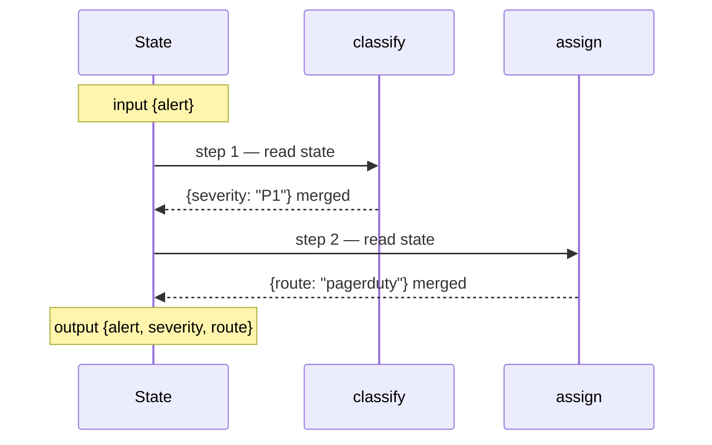
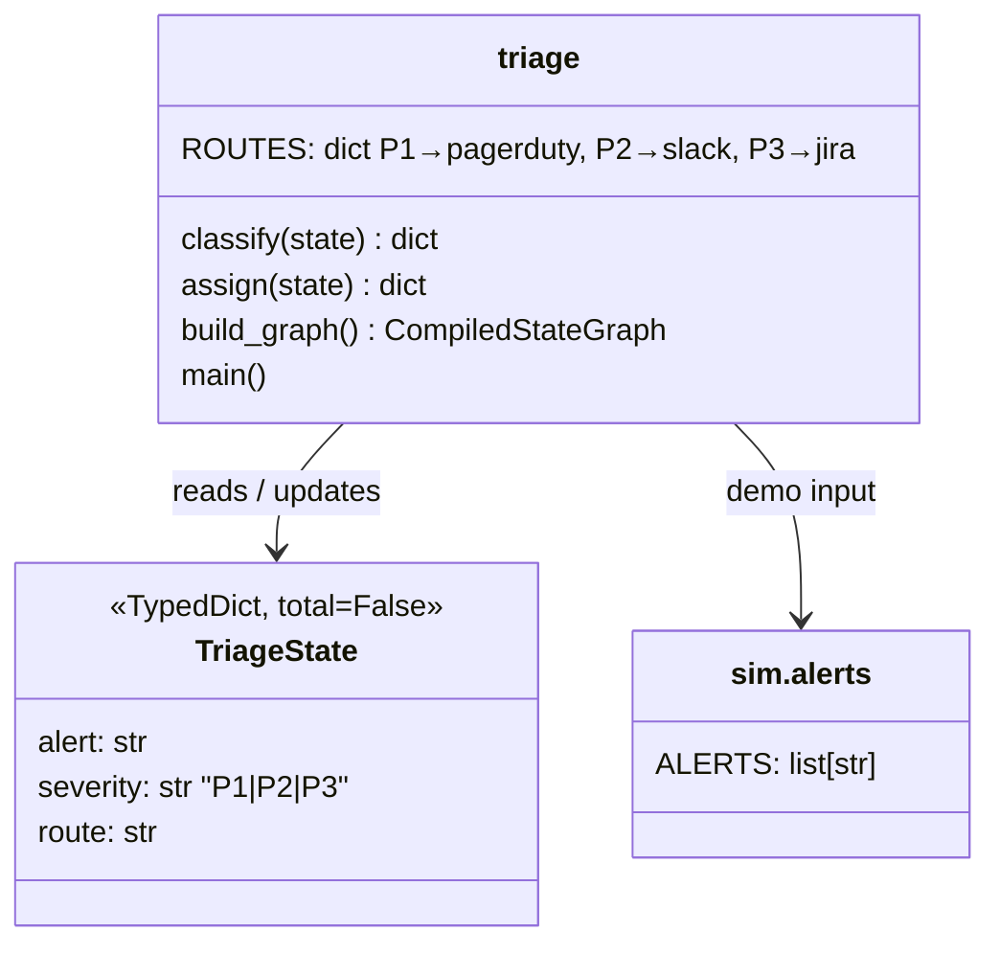

# Ch 1 — The graph mental model

Deterministic alert triage: `classify → assign`. No LLM, so this chapter runs anywhere (no Ollama needed).

## Concept

- A LangGraph app is a **state machine**: **State** (a `TypedDict`), **nodes** (functions `state -> partial update`) and **edges** (what runs next).
- A node returns **only the keys it changes**. LangGraph merges that dict into state. You never mutate state in place.
- Execution runs in **super-steps** (the Pregel model): every node scheduled for a step runs, their updates are merged, then the next step starts. Here each step has one node; Ch 2 runs several in one step. See [The Pregel model](#the-pregel-model) below.
- `compile()` checks the wiring and returns a Runnable with `invoke`, `stream`, `ainvoke`. The object it returns is literally a `Pregel` instance (`CompiledStateGraph` subclasses `langgraph.pregel.Pregel`).
- `graph.get_graph().draw_ascii()` draws the compiled graph in the terminal (needs `grandalf`), so you can always see what you actually built. `draw_mermaid()` gives Mermaid source instead.

## The Pregel model

### Where the idea comes from

Pregel is Google's 2010 system for computing over huge graphs (e.g. PageRank over the web). Its central rule:

> Computation proceeds in **super-steps**. In each super-step every active vertex runs once, reading the messages sent to it in the *previous* step and sending messages for the *next* step. A **global barrier** separates steps: nothing a vertex sends becomes visible until the barrier.

```text
state at step N + messages from step N
  → every active vertex runs (in parallel)
  → BARRIER: apply all outputs at once
  → state + messages for step N+1
```

The run stops when no vertex is active and no messages are in flight. Seen this way, Pregel is a **state machine over a graph**: the global state (all vertex state + pending messages) moves `S₀ → S₁ → S₂ → …`, one transition per super-step, and each vertex is a function `(my state, incoming messages) → (new state, outgoing messages)`. Deterministic functions give a deterministic run.

### What LangGraph keeps and what it changes

LangGraph borrows the *execution discipline* (steps, barrier, triggers, halting), but not the per-vertex state. The key translation is **channels**:

| Pregel | LangGraph | In this chapter |
| --- | --- | --- |
| Vertex | Node (a function) | `classify`, `assign` |
| Per-vertex state | **Shared** state, stored as one channel per key | `alert`, `severity`, `route` channels |
| Message to a neighbour | A write to a channel | `classify` returns `{"severity": "P1"}` |
| Edge | A hidden trigger channel the source writes, the target subscribes to | `add_edge("classify", "assign")` → channel `branch:to:assign` |
| Active vertex | Node whose trigger channel changed in the last step | `assign` is active in step 2 because `branch:to:assign` was written in step 1 |
| Global barrier | Writes are buffered, then applied together at the end of the step | Nodes in the same step see the state from *before* the step |
| Aggregator / combiner | Channel type: `LastValue` (default) or a reducer (`Annotated[list, operator.add]`) | All three keys are `LastValue` |
| Vote to halt | A step that writes no trigger channel → nothing scheduled → run ends | After `assign` nothing is triggered, so the run stops (with or without `END`) |

So "nodes send messages" becomes "nodes return partial updates". LangGraph routes each key in the dict to its channel, and the edges decide who wakes up next. That's why a node never mutates state in place: the only way to affect anything is to emit a write and let the runtime apply it at the barrier.

### This graph, as the runtime actually sees it

Here's what `build_graph()` compiles to (printed from `graph.channels` and `graph.nodes`, langgraph 1.2.20):

```text
CHANNELS                                NODES (subscribe to → read)
  alert               LastValue           classify  triggers=[branch:to:classify]  reads=[alert, severity, route]
  severity            LastValue           assign    triggers=[branch:to:assign]    reads=[alert, severity, route]
  route               LastValue
  __start__           EphemeralValue
  branch:to:classify  EphemeralValue      (Ephemeral = cleared after one step, so a
  branch:to:assign    EphemeralValue       trigger fires once, not forever)
```

Running one alert with a checkpointer and walking `get_state_history()` shows one checkpoint per super-step:

```text
step -1  input  values={}                                             next=(__start__,)
step  0  loop   values={alert}                                        next=(classify,)
step  1  loop   values={alert, severity: "P1"}                        next=(assign,)
step  2  loop   values={alert, severity: "P1", route: "pagerduty"}    next=()
```

Step by step:

| Step | Who runs (and why) | Writes at the barrier | Triggers for next step |
| --- | --- | --- | --- |
| 0 | `__start__`: the input is written to state | `alert` | `branch:to:classify` |
| 1 | `classify`: its trigger was written in step 0 | `severity="P1"` | `branch:to:assign` |
| 2 | `assign`: its trigger was written in step 1 | `route="pagerduty"` | none, so the run halts |

That's exactly what the demo prints as `step 1: classify` and `step 2: assign` (`stream_mode="debug"` reports the super-step number of each task).

### Why "channel"? Edge channels vs state channels

LangGraph has no per-vertex state. It has one shared state, and each key is stored in a **channel**: a named mailbox nodes write into, rather than a plain variable. A channel has three parts:

1. **A value**, e.g. `severity = "P1"`.
2. **A write rule** applied at the barrier: `LastValue` (keep one, error on two in a step), a reducer (merge all writes), or `EphemeralValue` (cleared after one step).
3. **A version counter**, bumped on every write.

In a `StateGraph`, though, **only edge channels wake nodes. State channels are read, not subscribed to.** The listing above shows it:

```text
assign    triggers=[branch:to:assign]    reads=[alert, severity, route]
```

`assign` doesn't run because `severity` changed. It runs because `classify` finished and its edge wrote `branch:to:assign`. That write happens even if `classify` returned `{}`. Once `assign` runs, it gets the whole current state, and whether it uses `severity` is up to the function.

| Channel kind | Job |
| --- | --- |
| Edge channels (`branch:to:X`) | Control flow: who runs next |
| State channels (`alert`, `severity`, `route`) | Data: what nodes read, and how writes are applied |

So why are state keys channels at all, if they don't trigger anything? Waking nodes is only one feature of a channel. For state, the other features matter:

- **Per-key write rules.** Two parallel nodes writing a `LastValue` key raise `InvalidUpdateError`. A reducer key merges their writes instead (Ch 2).
- **Versions.** The checkpointer uses them to see which keys changed in each step (Ch 5).
- **One engine.** `StateGraph` sits on top of the lower-level Pregel API, where a node *can* subscribe directly to a data channel. Treating everything as a channel lets one runtime handle both styles.

### What the barrier buys you

Each of these was checked against langgraph 1.2.20:

- **Isolation inside a step.** Two nodes fanned out from `START` run in the same step. If `a` writes `x=1`, `b` still reads `x` as `None`, because writes land only at the barrier. (Ch 2 builds on this.)
- **Conflicts surface instead of racing.** If two nodes in one step both write a `LastValue` key, you get `InvalidUpdateError: At key 'x': Can receive only one value per step. Use an Annotated key…`. A reducer (`Annotated[list, operator.add]`) is how you say "merge these" on purpose.
- **Checkpoints at clean boundaries.** Between steps there's no half-applied state, so LangGraph can save a checkpoint after every step. That's what makes resume, replay, time travel and human-in-the-loop interrupts possible later (Ch 5 persistence, Ch 8 human-in-the-loop).
- **Loops are just more steps.** A conditional edge back to the same node simply schedules it again next step. The run stops when a step schedules nothing, or raises `GraphRecursionError` once it hits the recursion limit, which is really a *super-step* limit. Set it per call with `config={"recursion_limit": N}`.

### Short version

- Pregel = graph computation in lock-step super-steps with a barrier between them.
- LangGraph = the same discipline, but the "messages" are writes to shared state channels, and edges are channels that wake the next node.
- In triage: step 0 loads the alert, step 1 `classify` writes `severity`, step 2 `assign` writes `route`, and then nothing is triggered, so the run halts.

## Files

| File | What |
| --- | --- |
| `triage.py` | Concept code: state, two nodes, the graph, a demo printing super-steps |
| `sim/alerts.py` | The alerts the pager receives during the incident |
| `test_triage.py` | Two small tests: a node's partial update, routing end to end |

## Diagrams

**Graph topology**


**Super-step timeline for one alert**



**Classes**



## Run it

```bash
uv run python -m chapters.ch01_graph_basics.triage
uv run pytest chapters/ch01_graph_basics
```

You'll see an ASCII drawing of the graph, then for each alert: `step 1: classify`, `step 2: assign`, and the final state.

## Break it

Each of these was checked against langgraph 1.2.20:

| Change | What happens | Lesson |
| --- | --- | --- |
| In `classify`, do `state["severity"] = sev; return {}` | `assign` fails with `KeyError: 'severity'` | In-place mutation is not an update. Only the returned dict is merged |
| Return `{"sev": sev}` (a key not in `TriageState`) | Silently dropped; `assign` fails with `KeyError` | Unknown keys are ignored, not errors. Typos hide here |
| Return `sev` (a string, not a dict) | `InvalidUpdateError: Expected dict, got P1` | A node must return a dict (or `None` = no update) |
| Delete `add_edge("assign", END)` | Still runs and finishes | A node with no outgoing edge ends the run. `END` makes it explicit |
| Delete `add_edge(START, "classify")` | `compile()` raises | The graph needs an entry point. `compile()` validates this |
