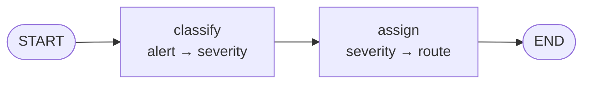
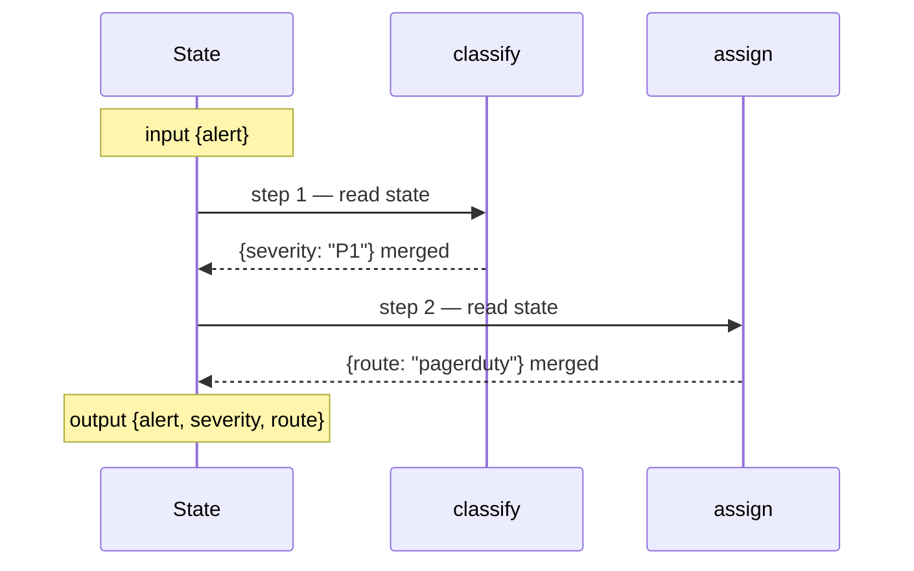
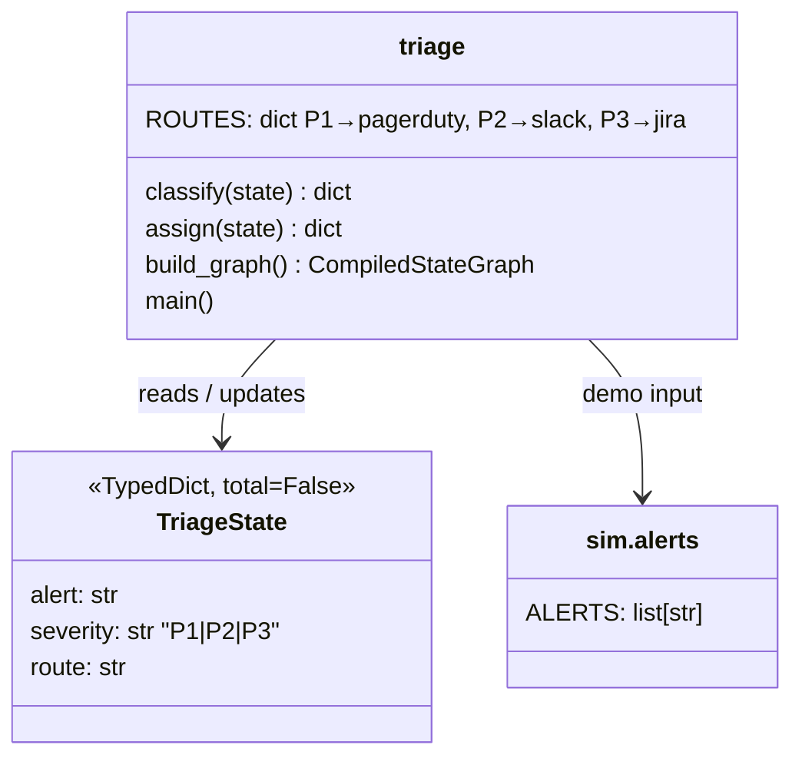

# Ch 1 — The graph mental model

Deterministic alert triage: `classify → assign`. No LLM, so this chapter runs anywhere (no Ollama needed).

## Concept

- A LangGraph app is a **state machine**: **State** (a `TypedDict`), **nodes** (functions `state -> partial update`) and **edges** (what runs next).
- A node returns **only the keys it changes**. LangGraph merges that dict into state. You never mutate state in place.
- Execution runs in **super-steps** (the Pregel model): every node scheduled for a step runs, their updates are merged, then the next step starts. Here each step has one node; Ch 2 runs several in one step.
- `compile()` checks the wiring and returns a Runnable with `invoke`, `stream`, `ainvoke`.
- `graph.get_graph().draw_mermaid()` draws the compiled graph, so you can always see what you actually built.

## Files

| File | What |
| --- | --- |
| `triage.py` | Concept code: state, two nodes, the graph, a demo printing super-steps |
| `sim/alerts.py` | The alerts the pager receives during the incident |
| `test_triage.py` | Two small tests: a node's partial update, routing end to end |

## Diagrams

**Graph topology**



**Super-step timeline for one alert**



**Classes**



## Run it

```bash
uv run python -m chapters.ch01_graph_basics.triage
uv run pytest chapters/ch01_graph_basics
```

You'll see the mermaid source, then for each alert: `step 1: classify`, `step 2: assign`, and the final state.

## Break it

Each of these was checked against langgraph 1.2.20:

| Change | What happens | Lesson |
| --- | --- | --- |
| In `classify`, do `state["severity"] = sev; return {}` | `assign` fails with `KeyError: 'severity'` | In-place mutation is not an update. Only the returned dict is merged |
| Return `{"sev": sev}` (a key not in `TriageState`) | Silently dropped; `assign` fails with `KeyError` | Unknown keys are ignored, not errors. Typos hide here |
| Return `sev` (a string, not a dict) | `InvalidUpdateError: Expected dict, got P1` | A node must return a dict (or `None` = no update) |
| Delete `add_edge("assign", END)` | Still runs and finishes | A node with no outgoing edge ends the run. `END` makes it explicit |
| Delete `add_edge(START, "classify")` | `compile()` raises | The graph needs an entry point. `compile()` validates this |
