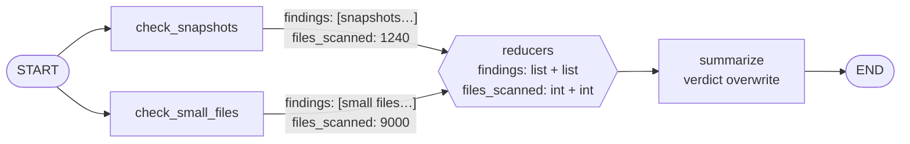
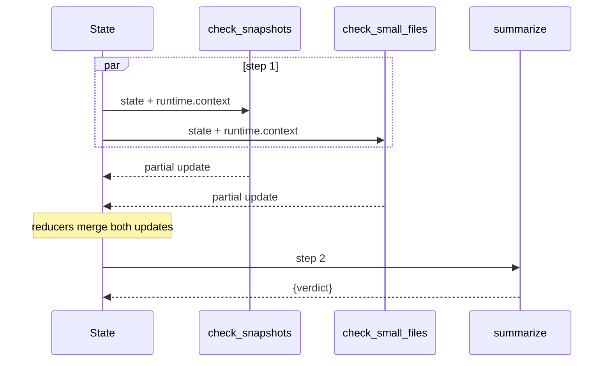
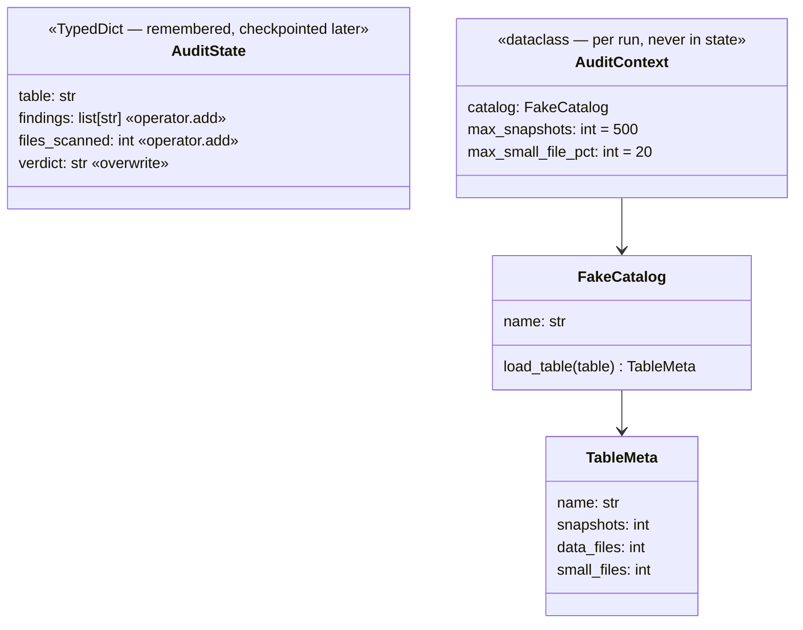
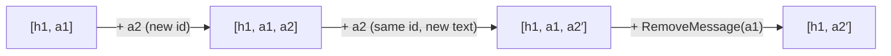

# Ch 2 — State, reducers and runtime context

Two Iceberg checks run **in parallel** on a table and both write `findings` and `files_scanned`. Reducers merge the writes; the catalog client arrives as **runtime context**. No LLM, so this chapter runs anywhere.

## Concept

- By default a key is **overwritten** by the last write (`verdict` here). A **reducer** (`Annotated[type, fn]`) says how to merge writes instead: `operator.add` appends lists and sums ints.
- Two nodes writing the same key **in the same super-step** with no reducer → `InvalidUpdateError`. That error is a feature: it tells you to declare the merge.
- Fan-out = several edges from one node (here `START`); fan-in = `add_edge([a, b], c)`, so `c` waits for both.
- `add_messages` (used by `MessagesState`) is a reducer for chat history: **append** new ids, **update** same id, **delete** via `RemoveMessage`.
- **State** is what the graph remembers (and later checkpoints). **Runtime context** (`context_schema`, read via `runtime.context`) is per-run, immutable input: tenant, thresholds, DB/catalog handles. It never appears in state.

## Files

| File | What |
| --- | --- |
| `table_audit.py` | Concept code: reducers on `AuditState`, `AuditContext`, fan-out / fan-in graph |
| `messages_reducer.py` | `add_messages` called directly: append, update, delete |
| `sim/catalog.py` | `FakeCatalog` with `sales.orders` (unhealthy) and `sales.items` (healthy) |
| `test_table_audit.py` | Two tests: writes merge; context changes behaviour but stays out of state |

## Diagrams

**Fan-out / fan-in with reducer merge**



**Super-steps**



**State vs context**



**`add_messages` behaviour**



## Run it

```bash
uv run python -m chapters.ch02_state_reducers.table_audit
uv run python -m chapters.ch02_state_reducers.messages_reducer
uv run pytest chapters/ch02_state_reducers
```

Look for: both checks in `step 1`, `summarize` in `step 2`, `files_scanned: 10240` (summed), and `'catalog' in state? False`.

## Break it

Checked against langgraph 1.2.20:

| Change | What happens | Lesson |
| --- | --- | --- |
| `findings: list[str]` (drop `operator.add`) | `InvalidUpdateError: At key 'findings': Can receive only one value per step` | Parallel writers need a declared merge |
| `files_scanned: int` (drop `operator.add`) | Same error on `files_scanned` | Reducers are per key, not per state |
| Call `graph.invoke({"table": ...})` without `context=` | `AttributeError: 'NoneType' object has no attribute 'catalog'` | Context is required input, not a default |
| Pass `AuditContext(..., max_snapshots=5000, max_small_file_pct=50)` | Verdict flips to `HEALTHY` | Same graph, behaviour tuned per run via context |

**Exercise — custom reducer:** make both checks also append `"sales.orders needs attention"`. With `operator.add` you get it twice. Write `def dedupe(left, right): return left + [x for x in right if x not in left]` and use `Annotated[list[str], dedupe]`.
