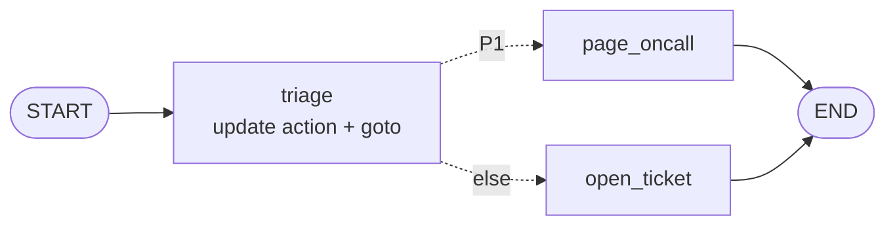
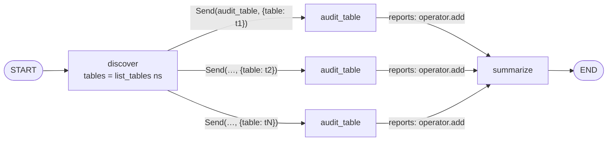
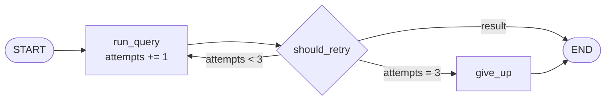
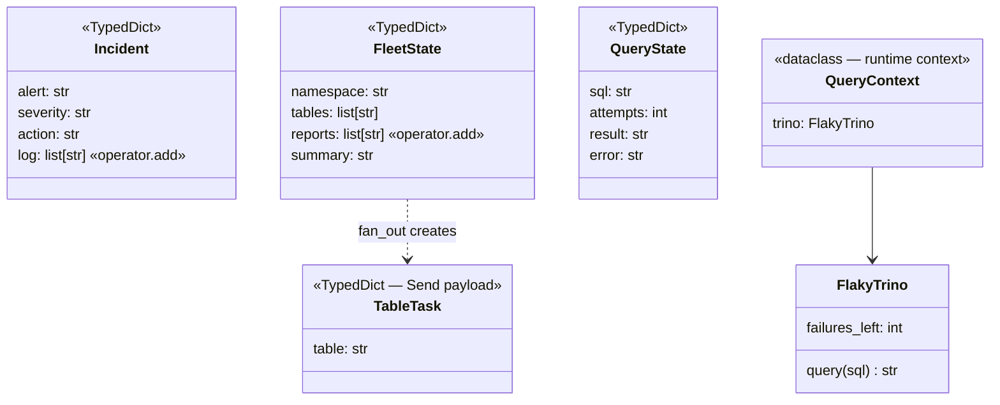

# Ch 3 — Control flow: conditional edges, `Command`, `Send`, loops

Three small graphs, one routing tool each. No LLM, so this chapter runs anywhere.

## Concept

- **Conditional edge** (`add_conditional_edges(node, router)`): a router function reads state and returns the next node name (or `END`). Use it when routing is a pure decision with no state change.
- **`Command(update=..., goto=...)`**: a node updates state *and* routes in one return. Annotate it `-> Command[Literal["a", "b"]]` so `compile()` and the drawing know the possible targets.
- **`Send(node, payload)`**: dynamic fan-out (map-reduce). The number of branches is only known at runtime. Each branch gets its **own private input**, and a reducer collects the results.
- **Loops** are just an edge back to an earlier node. The exit condition is **your** job.
- `recursion_limit` caps the number of super-steps per run. In langgraph 1.2 the default is **10007** (older docs say 25), so it is no longer a tight safety net. Bound loops in your logic and set the limit explicitly if you rely on it.

**Which one to use**

| Need | Use | Example here |
| --- | --- | --- |
| Pick the next node from state, no update | Conditional edge | `retry_loop.should_retry` |
| Update state and pick the next node together | `Command` | `incident_router.triage` |
| Run one node N times in parallel, N known at runtime | `Send` | `fleet_audit.fan_out` |
| Repeat until a condition holds | Conditional edge back to an earlier node | `run_query → run_query` |

## Files

| File | What |
| --- | --- |
| `incident_router.py` | `Command`: P1 → `page_oncall`, else → `open_ticket` |
| `fleet_audit.py` | `Send`: discover tables in a namespace → audit each in parallel → summarize |
| `retry_loop.py` | Conditional edge loop: retry a flaky Trino query up to 3 times, then give up; `recursion_limit` demo |
| `sim/incidents.py` | Two pre-classified incidents |
| `sim/fleet.py` | `list_tables(namespace)`, `table_health(table)` |
| `sim/flaky_trino.py` | `FlakyTrino(n)`: times out `n` times, then answers |
| `test_control_flow.py` | One test per graph |

## Diagrams

**`incident_router` — Command (dashed = routed by `Command`, known from the `Literal`)**



**`fleet_audit` — Send map-reduce**



Super-steps for `sales`: step 1 `discover`, step 2 three `audit_table` tasks in parallel, step 3 `summarize`.

**`retry_loop` — loop with exit condition**



**Classes**



## Run it

```bash
uv run python -m chapters.ch03_control_flow.incident_router
uv run python -m chapters.ch03_control_flow.fleet_audit
uv run python -m chapters.ch03_control_flow.retry_loop
uv run pytest chapters/ch03_control_flow
```

## Break it

Checked against langgraph 1.2.20:

| Change | What happens | Lesson |
| --- | --- | --- |
| `triage(...) -> Command:` (drop the `Literal`) | Still routes correctly, but the drawing shows `triage --> __end__` and no edges to the targets | The `Literal` is how the graph *knows* the edges. Without it, the topology lies |
| `add_conditional_edges("discover", fan_out)` (drop `["audit_table"]`) | Still runs; drawing shows `discover --> __end__` | Same idea for `Send`: give the path map |
| `reports: list[str]` (drop `operator.add`) | `InvalidUpdateError: At key 'reports'` | N parallel `Send` branches = N writes in one step |
| Replace `Send` with `add_edge("discover", "audit_table")` | `KeyError: 'table'` | A normal edge passes full state; only `Send` gives a private payload |
| In `should_retry`, always return `"run_query"` with `FlakyTrino(100)` | Runs **101** attempts, no error | Default `recursion_limit` is 10007: an unbounded loop can run a long time |
| `config={"recursion_limit": 2}` | `GraphRecursionError` | Set the limit yourself; it counts super-steps across the whole run (every node, not just the loop) |
