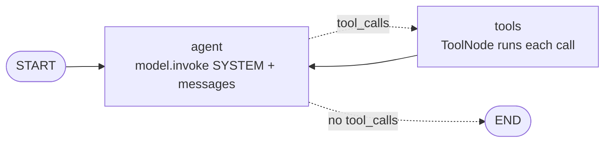
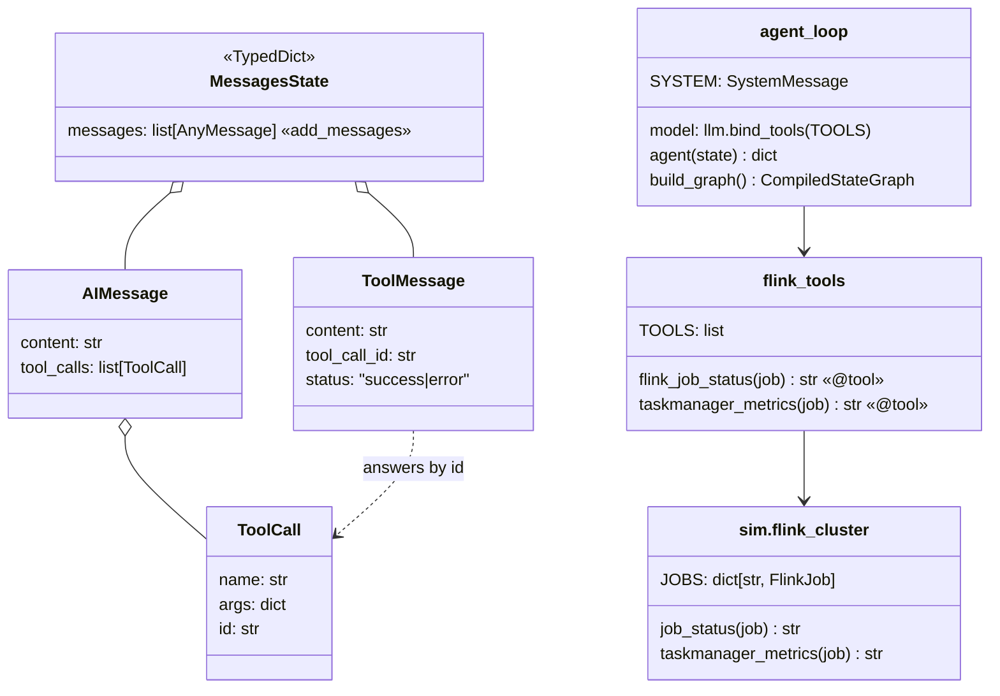

# Ch 4 — Tools and the hand-built agent loop

**The loop** every agent in this curriculum is built on: model → tool calls? → run tools → back to model → stop when there are no tool calls. Here it investigates why `orders-enricher` is lagging. **Needs Ollama** (the tests do not).

## Concept

- `@tool` turns a typed, docstring-ed function into a **schema**: name + docstring + argument types. That schema is all the model knows about the tool, so the **docstring is the tool's prompt**.
- `llm.bind_tools(tools)` sends those schemas with every model call. The model answers with an `AIMessage` whose `tool_calls` say which tool to run with which args. The model never runs anything itself.
- `ToolNode(tools)` executes **every** tool call in the last `AIMessage` (in parallel) and returns one `ToolMessage` per call, matched by `tool_call_id`.
- `tools_condition` is a ready-made conditional edge (Ch 3): `tool_calls` present → `"tools"`, otherwise `END`. The edge `tools → agent` is the loop.
- `MessagesState` (Ch 2's `add_messages` reducer) accumulates the whole conversation: Human → AI(tool_calls) → Tool… → AI(answer).
- Errors: bad args or an unknown tool name come back to the model as an error `ToolMessage`. An **exception inside the tool crashes the graph** unless you set `ToolNode(..., handle_tool_errors=True)`.
- `recursion_limit` counts super-steps: each `agent` turn and each `tools` turn is one. Your loop's real budget.

## Files

| File | What |
| --- | --- |
| `agent_loop.py` | Concept code: `agent` node, `ToolNode`, `tools_condition`, the loop; demo streams each step |
| `flink_tools.py` | The two `@tool`s: `flink_job_status`, `taskmanager_metrics` |
| `sim/flink_cluster.py` | Fake Flink REST API: `orders-enricher` (lagging) and `orders-sink` (healthy) |
| `test_agent_loop.py` | No model: `tools_condition` routing, `ToolNode` answering two calls |

## Diagrams

**The loop**



**Messages over one run** (the model may also ask for both tools in one turn)

```mermaid
sequenceDiagram
  participant U as Human
  participant A as agent (LLM)
  participant T as tools (ToolNode)
  participant F as sim.flink_cluster
  U->>A: "orders-enricher is lagging. Why?"
  A->>T: AIMessage tool_calls=[flink_job_status(orders-enricher)]
  T->>F: job_status
  F-->>T: lag 2,400,000; checkpoint FAILED
  T-->>A: ToolMessage (tool_call_id=c1)
  A->>T: AIMessage tool_calls=[taskmanager_metrics(orders-enricher)]
  T->>F: taskmanager_metrics
  F-->>T: backpressure HIGH on enrich-join; heap 92%
  T-->>A: ToolMessage (tool_call_id=c2)
  A-->>U: AIMessage (no tool_calls): cause, evidence, fix
```

**Classes**



## Run it

```bash
# on the Ollama machine
uv run python -m chapters.ch04_tool_loop.agent_loop
# anywhere
uv run pytest chapters/ch04_tool_loop
```

What you should see:
1. The tool schemas sent to the model: just name, docstring, and `job: string`.
2. `node: agent` with an `AIMessage` holding `tool_calls`, then `node: tools` with the `ToolMessage` results. Repeats once or twice.
3. A final `node: agent` with no tool calls: the diagnosis (checkpoint timeouts + backpressure on `enrich-join` + 92% heap → raise parallelism / memory, fix the join).

A small model (`qwen3.5:4b`) will vary run to run: sometimes both tools in one turn, sometimes one per turn, sometimes it skips a tool. That variability is the point of later chapters (harness, verification).

## Break it

**Verified here, no model needed** (langgraph 1.2.20):

| Change | What happens | Lesson |
| --- | --- | --- |
| Make `sim.flink_cluster.taskmanager_metrics` `raise RuntimeError("Flink REST API 503")` | The whole run crashes with `RuntimeError` | Tool exceptions are not caught by default |
| …then use `ToolNode(TOOLS, handle_tool_errors=True)` | Model gets `ToolMessage(status="error", "Error: RuntimeError('Flink REST API 503')\n Please fix your mistakes.")` and carries on | Turn failures into observations the model can react to |
| Model sends wrong arg name (e.g. `jobname`) or an unknown tool | Error `ToolMessage` back to the model (`job: Field required` / `nope is not a valid tool`), no crash | Schema validation is built in |

**Try on the Ollama machine** (model-dependent):

| Change | Expect | Lesson |
| --- | --- | --- |
| Docstring of `taskmanager_metrics` → `"Does stuff."` | The model stops calling it, or calls it at random | The docstring is the prompt |
| Rename `job` to `x` in both tools | More wrong or missing args | Arg names are part of the prompt too |
| `{"recursion_limit": 4}` | `GraphRecursionError` if the model calls tools in two separate turns (5 steps); passes if it asks for both in one turn (3 steps) | Count steps: agent + tools per round, +1 to answer |
| Remove `SYSTEM` | Answers sooner, with less evidence | Prompt shapes how much the loop investigates |
| Ask `"orders-sink is lagging. Why?"` | Healthy readings → it should say no problem found | Tools ground the answer in data |
