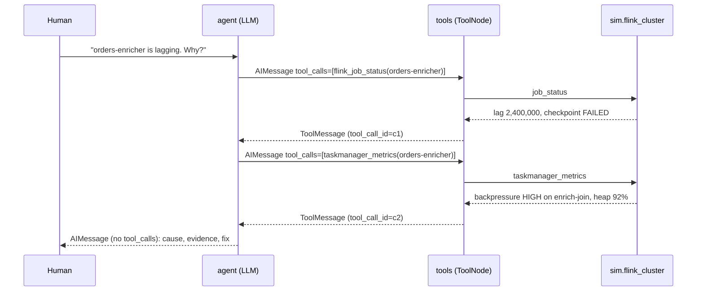
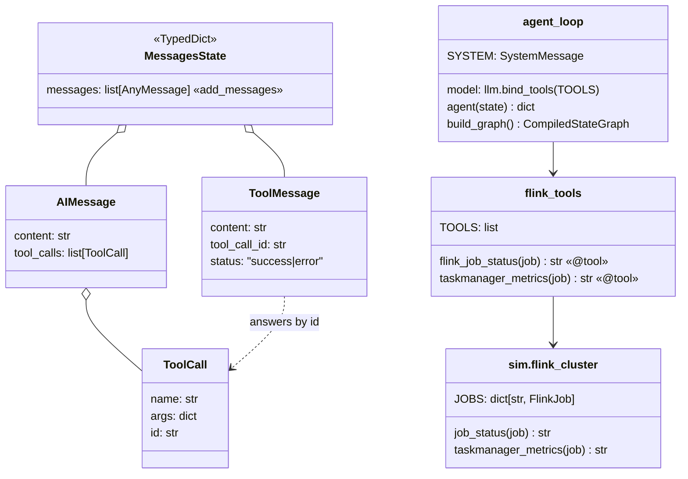

# Ch 4 — Tools and the hand-built agent loop

**The loop** every agent in this curriculum is built on: model → tool calls? → run tools → back to model → stop when there are no tool calls. Here it investigates why `orders-enricher` is lagging. **Needs Ollama** (the tests do not).

## Concept

- `@tool` turns a typed, docstring-ed function into a **schema**: name + docstring + argument types. That schema is all the model knows about the tool, so the **docstring is the tool's prompt**.
- `llm.bind_tools(tools)` sends those schemas with every model call. The model answers with an `AIMessage` whose `tool_calls` say which tool to run with which args. The model never runs anything itself.
- `ToolNode(tools)` executes **every** tool call in the last `AIMessage` (in parallel) and returns one `ToolMessage` per call, matched by `tool_call_id`. Details [below](#toolnode-and-handle_tool_errors-in-detail).
- `tools_condition` is a ready-made conditional edge (Ch 3): `tool_calls` present → `"tools"`, otherwise `END`. The edge `tools → agent` is the loop. Details [below](#tools_condition-in-detail).
- `MessagesState` (Ch 2's `add_messages` reducer) accumulates the whole conversation: Human → AI(tool_calls) → Tool… → AI(answer).
- Errors: bad args or an unknown tool name come back to the model as an error `ToolMessage`. An **exception inside the tool crashes the graph** unless you set `ToolNode(..., handle_tool_errors=True)`. It **never retries**: the model sees the error and decides.
- `recursion_limit` counts super-steps: each `agent` turn and each `tools` turn is one. Your loop's real budget.

### `tools_condition` in detail

It's just a router function, the same kind you'd pass to `add_conditional_edges` in Ch 3. Its whole body (langgraph 1.2.20, `langgraph/prebuilt/tool_node.py`) boils down to:

```python
def tools_condition(state, messages_key="messages") -> Literal["tools", "__end__"]:
    ai_message = state[messages_key][-1]          # only the LAST message
    if hasattr(ai_message, "tool_calls") and len(ai_message.tool_calls) > 0:
        return "tools"
    return "__end__"
```

**How it drives the loop.** `add_conditional_edges("agent", tools_condition)` runs it right after every `agent` step. The name it returns becomes a write to that node's trigger channel (Ch 1), e.g. `branch:to:tools`. The `Literal` return type is what lets `compile()` and the drawing know both targets.

| Step | Runs | Last message afterwards | `tools_condition` → |
| --- | --- | --- | --- |
| 1 | `agent` | `AIMessage(tool_calls=[flink_job_status])` | `"tools"` |
| 2 | `tools` | `ToolMessage` | (none: static edge `tools → agent`) |
| 3 | `agent` | `AIMessage(tool_calls=[taskmanager_metrics])` | `"tools"` |
| 4 | `tools` | `ToolMessage` | (static edge back to `agent`) |
| 5 | `agent` | `AIMessage("cause, evidence, fix")` | `"__end__"`, so the run stops |

The model decides when to stop: it stops by answering without tool calls. `tools_condition` only reads that decision.

**Behaviour, verified:**

| Last message | Returns |
| --- | --- |
| `AIMessage` with `tool_calls` | `"tools"` |
| `AIMessage` without `tool_calls` (the final answer) | `"__end__"` |
| `HumanMessage` or `ToolMessage` | `"__end__"` (no `tool_calls` attribute) |
| `messages` empty | `ValueError: No messages found in input state to tool_edge` |

**Gotchas:**
- **The tool node must be named `"tools"`.** The string is hard-coded. If you name it `run_tools`, `invoke` raises `ValueError: At 'agent' node, 'tools_condition' branch found unknown target 'tools'`. Fix it with a path map: `add_conditional_edges("agent", tools_condition, {"tools": "run_tools", "__end__": END})`.
- **It only looks at the last message.** Anything appended after the `AIMessage` (e.g. a node that adds a note) hides the `tool_calls`, and the loop ends.
- **Different state key?** Wrap it: `lambda s: tools_condition(s, messages_key="chat_history")`.
- **Need another branch** (a step budget, a "verify" node, human approval)? Write your own router that returns more targets. `tools_condition` is a convenience, not magic. `create_agent` in Ch 11 builds this same loop for you.

### `ToolNode` and `handle_tool_errors` in detail

**One `tools` step:** read the last `AIMessage` → look up each call by name → validate args against the schema → run all calls **in parallel** on a thread pool (three 1 s calls took 1.0 s) → return one `ToolMessage(tool_call_id, content, status="success"|"error")` per call. Most chat APIs reject a history where a tool call has no matching answer, so the ids matter. In 1.2.20 `ToolNode` must run inside a graph: calling `ToolNode(...).invoke()` directly raises `Missing required config key`.

**Two kinds of failure**, and which ones `handle_tool_errors` catches:

| Setting | The model's mistake (bad args, unknown tool) | Exception inside the tool |
| --- | --- | --- |
| *(default)* | Error `ToolMessage` | **Crashes the run** |
| `True` | Error `ToolMessage` | `"Error: RuntimeError('…')\n Please fix your mistakes."` |
| `"text"` | Error `ToolMessage` | That text |
| `(TimeoutError, …)` | Error `ToolMessage` | Only those types caught, others crash |
| `def h(e: RuntimeError) -> str` | Error `ToolMessage` | Types from `e`'s type hint, message = `h(e)` |
| `False` | **Crashes** (`ToolInvocationError`) | **Crashes** |

An unknown tool name never crashes, whatever the setting.

**One bad call among several:** with the default, the whole run crashes, and the healthy sibling call *did* run but its result is lost. With `True`, you get one `status="error"` message and one success, and the loop continues.

**No automatic retry.** The tool runs once. The error becomes an observation, and on the next `agent` step the model chooses: call it again, try something else, or report it. The default text ("Please fix your mistakes") suits bad args, not outages, so pass a string or callable like `"Flink is down. Don't retry, report it."` for those. To actually retry:

| Mechanism | Re-runs | Verified |
| --- | --- | --- |
| `ToolNode(..., handle_tool_errors=True, wrap_tool_call=retry3)` | Only the failing call | `flaky` ×3, healthy `ok` ×1 |
| `add_node("tools", ToolNode(...), retry_policy=RetryPolicy(max_attempts=3))` | The **whole node**, so every call in that turn | `flaky` ×3 **and** `ok` ×3, so side effects repeat |

```python
def retry3(request, execute):           # execute() may be called many times
    for _ in range(3):
        result = execute(request)
        if result.status != "error":
            return result
    return result                        # give up: the model sees the error
```

## Files

| File | What |
| --- | --- |
| `agent_loop.py` | Concept code: `agent` node, `ToolNode`, `tools_condition`, the loop; demo streams each step |
| `flink_tools.py` | The two `@tool`s: `flink_job_status`, `taskmanager_metrics` |
| `sim/flink_cluster.py` | Fake Flink REST API: `orders-enricher` (lagging) and `orders-sink` (healthy) |
| `test_agent_loop.py` | No model: `tools_condition` routing, `ToolNode` answering two calls |

## Diagrams

**The loop**


**Messages over one run** (the model may also ask for both tools in one turn)



**Classes**



## Run it

```bash
# on the Ollama machine
uv run python -m chapters.ch04_tool_loop.agent_loop
# anywhere
uv run pytest chapters/ch04_tool_loop
```

What you should see:
1. The tool schemas sent to the model: just name, docstring, and `job: string`.
2. `node: agent` with an `AIMessage` holding `tool_calls`, then `node: tools` with the `ToolMessage` results. Repeats once or twice.
3. A final `node: agent` with no tool calls: the diagnosis (checkpoint timeouts + backpressure on `enrich-join` + 92% heap → raise parallelism / memory, fix the join).

A small model (`qwen3.5:4b`) will vary run to run: sometimes both tools in one turn, sometimes one per turn, sometimes it skips a tool. That variability is the point of later chapters (harness, verification).

## Break it

**Verified here, no model needed** (langgraph 1.2.20):

| Change | What happens | Lesson |
| --- | --- | --- |
| Make `sim.flink_cluster.taskmanager_metrics` `raise RuntimeError("Flink REST API 503")` | The whole run crashes with `RuntimeError` | Tool exceptions are not caught by default |
| …then use `ToolNode(TOOLS, handle_tool_errors=True)` | Model gets `ToolMessage(status="error", "Error: RuntimeError('Flink REST API 503')\n Please fix your mistakes.")` and carries on | Turn failures into observations the model can react to |
| Model sends wrong arg name (e.g. `jobname`) or an unknown tool | Error `ToolMessage` back to the model (`job: Field required` / `nope is not a valid tool`), no crash | Schema validation is built in |

**Try on the Ollama machine** (model-dependent):

| Change | Expect | Lesson |
| --- | --- | --- |
| Docstring of `taskmanager_metrics` → `"Does stuff."` | The model stops calling it, or calls it at random | The docstring is the prompt |
| Rename `job` to `x` in both tools | More wrong or missing args | Arg names are part of the prompt too |
| `{"recursion_limit": 4}` | `GraphRecursionError` if the model calls tools in two separate turns (5 steps); passes if it asks for both in one turn (3 steps) | Count steps: agent + tools per round, +1 to answer |
| Remove `SYSTEM` | Answers sooner, with less evidence | Prompt shapes how much the loop investigates |
| Ask `"orders-sink is lagging. Why?"` | Healthy readings → it should say no problem found | Tools ground the answer in data |
