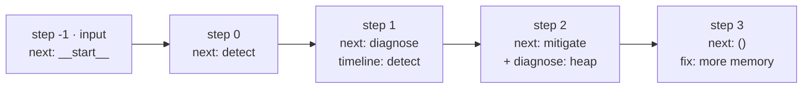
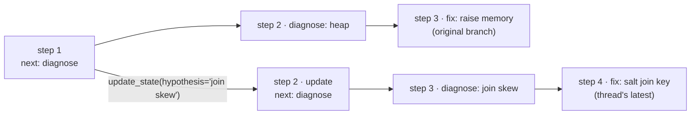
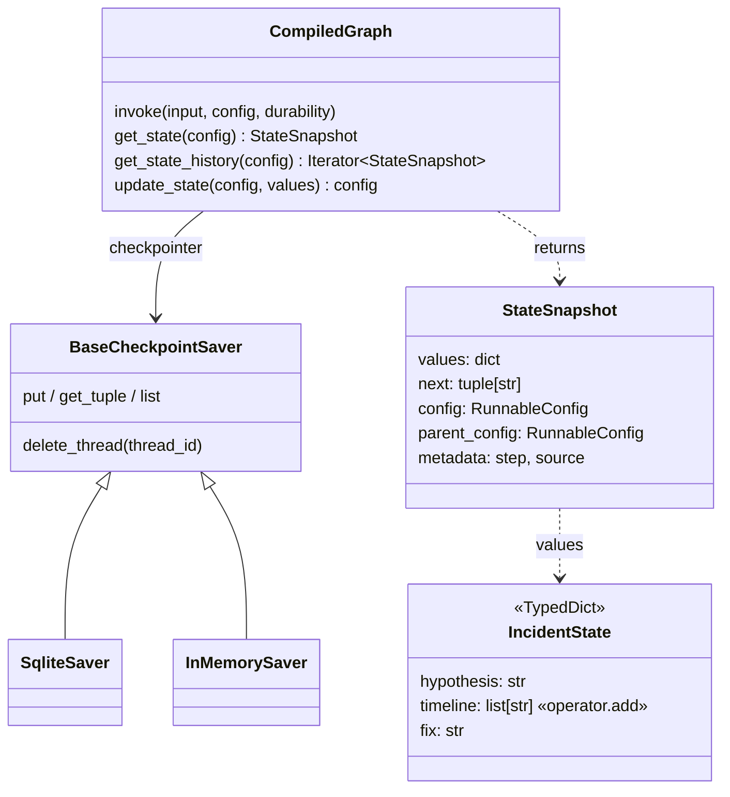

# Ch 5 — Persistence: checkpointers, threads, time travel

`checkpoint_basics.py` shows every concept on a 3-node graph with no LLM (runs anywhere). `incident_thread.py` applies them to the Ch 4 agent loop (**needs Ollama**).

## Concept

- A **checkpointer** saves a snapshot of state after **every super-step**. A **thread** (`configurable.thread_id`) is one conversation or job; its checkpoints are its history.
- Calling `invoke` again on the same thread **continues** it: the new input is merged into the saved state (reducers apply). That is multi-turn memory.
- `get_state(cfg)` = latest snapshot (`values`, `next`, `config`). `get_state_history(cfg)` = every snapshot, newest first, each with a `parent_config`.
- **Time travel:** `update_state(past.config, {...})` writes a new checkpoint whose parent is `past`, then `invoke(None, fork_cfg)` continues from it. The original branch stays; the thread's "latest" moves to the fork.
- `durability=` per run sets when checkpoints are written: `"exit"` (only the final one: fast, but no mid-run history or recovery), `"async"` (default), `"sync"` (safest).
- Backends: `InMemorySaver` (tests), `SqliteSaver` (local, survives restarts), `PostgresSaver` (production, Ch 22). Persistence is what makes memory, HITL (Ch 8) and recovery possible.

## Files

| File | What |
| --- | --- |
| `checkpoint_basics.py` | No LLM: history table, `get_state`, fork with a different hypothesis, durability counts, reading the DB from a fresh connection |
| `incident_thread.py` | Agent loop + `SqliteSaver`: two turns on `INC-4211`, then a fork from the first question |
| `agent_builder.py` | The Ch 4 loop rebuilt here (tools + agent node), returns the uncompiled builder |
| `sim/flink_cluster.py` | Fake Flink REST API (same as Ch 4) |
| `test_checkpoint_basics.py` | Fork keeps the original branch; `durability="exit"` writes one checkpoint |
| `ch05.db` | Created on first run (git-ignored). Both demos clear their own thread at start |

## Diagrams

**Checkpoint timeline of one run (`checkpoint_basics`, thread `INC-1`)**



**Time-travel fork tree**



**Multi-turn thread + fork (`incident_thread`)**

```mermaid
sequenceDiagram
  participant U as you
  participant G as graph
  participant S as SqliteSaver (ch05.db)
  U->>G: invoke(Q1, thread INC-4211)
  G->>S: checkpoint per step (agent, tools, agent…)
  U->>G: invoke(Q2, same thread)
  S-->>G: load messages from turn 1
  G->>S: more checkpoints
  U->>G: update_state(checkpoint after Q1, + "assume heap is fine")
  G->>S: new checkpoint (parent = after Q1)
  U->>G: invoke(None, fork_cfg)
  G->>S: new branch; original turns untouched
```

**Classes**



## Run it

```bash
uv run python -m chapters.ch05_persistence.checkpoint_basics     # anywhere
uv run python -m chapters.ch05_persistence.incident_thread       # on the Ollama machine
uv run pytest chapters/ch05_persistence
```

In `checkpoint_basics`, look for checkpoint `step 1 (next: diagnose)` showing up as the **parent of two children** after the fork, and `exit -> 1 checkpoints` vs `async -> 5`.

In `incident_thread`, turn 2's summary should use turn 1's findings (it never re-reads the tools). The fork's answer should focus on the join.

## Break it

Checked against langgraph 1.2.20 (with `checkpoint_basics`):

| Change | What happens | Lesson |
| --- | --- | --- |
| `build_graph(None)` (no checkpointer), invoke twice on one thread | Each run starts fresh; `get_state` → `ValueError: No checkpointer set` | No checkpointer, no memory, no history |
| Invoke thread `INC-1` again with `{}` | `timeline` doubles: `detect, diagnose, detect, diagnose` | Reusing a `thread_id` continues that thread. One incident = one thread |
| Run with `durability="exit"`, then try the fork | History is just `[()]`; there is no "before diagnose" checkpoint to fork from | Durability trades speed for recoverability and time travel |
| Remove `saver.delete_thread(...)` and run a demo twice | History keeps growing across runs | SQLite persists across processes |

Try on the Ollama machine (`incident_thread`):

| Change | Expect |
| --- | --- |
| Compile without `checkpointer=saver` | Turn 2 has no idea what "what you found" means; then `get_state` raises `ValueError` |
| Use a different `thread_id` for turn 2 | Same: memory is per thread |
