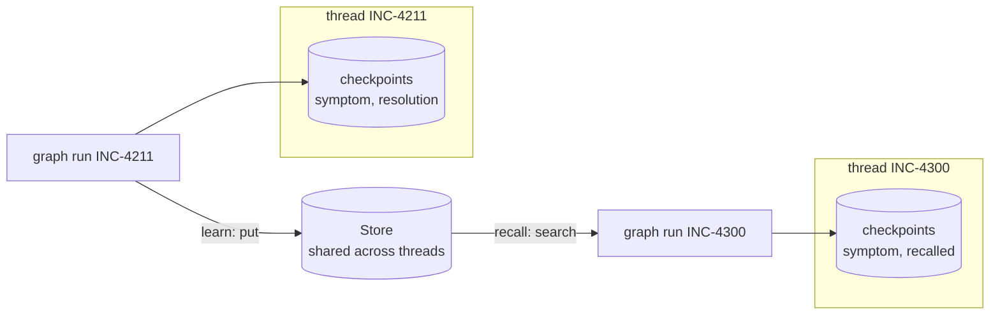
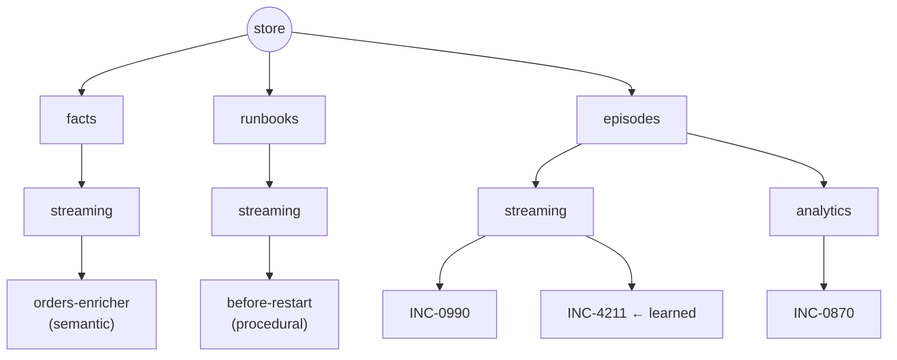
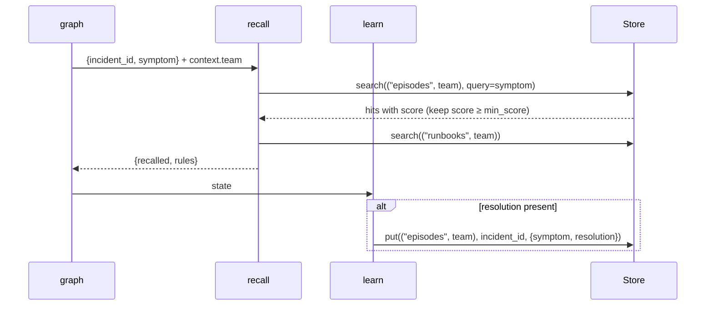
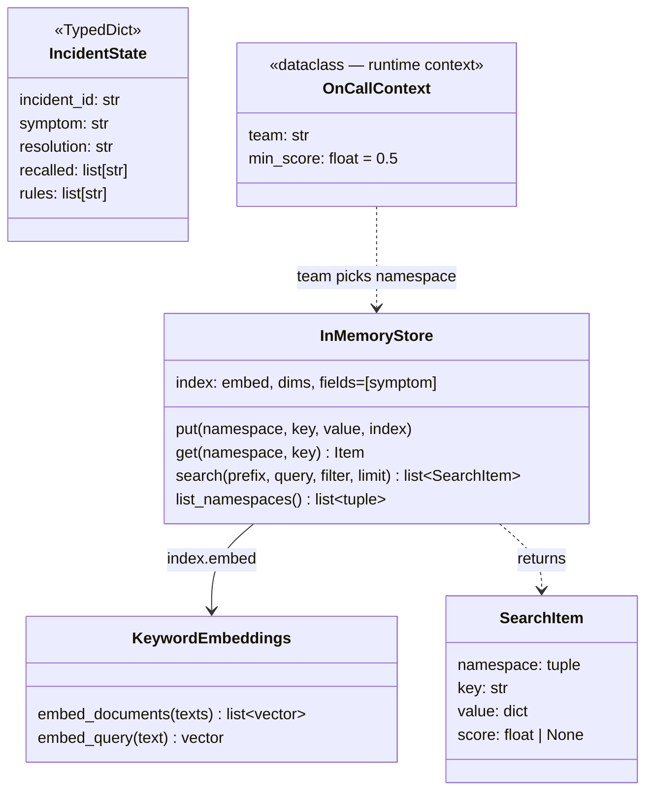

# Ch 6 — Memory: short-term vs long-term (`Store`)

INC-4300 recalls how INC-4211 was fixed, even though they are different threads. Runs anywhere with keyword embeddings from `sim/`; add `--ollama` for real `nomic-embed-text` embeddings.

## Concept

- **Short-term memory** = the thread's checkpointed state (Ch 5). One thread only. You keep it small by trimming or summarising (Ch 12).
- **Long-term memory** = a **`Store`**: JSON documents under a **namespace** tuple + key, e.g. `("episodes", "streaming") / "INC-4211"`. Shared by **every** thread.
- Compile with `store=...`; nodes reach it via `runtime.store` (`put`, `get`, `search`, `list_namespaces`).
- `InMemoryStore(index={"embed": ..., "dims": ..., "fields": [...]})` embeds the chosen fields on `put`, so `search(ns, query=...)` ranks by similarity and returns a `score`. Without an index, `query` is ignored: results come back unranked with `score=None`.
- Namespaces are the access boundary: put the team (or user/tenant from runtime context) in the namespace, and a search only sees that team's memories.
- Three kinds worth storing: **semantic** (facts: `facts/`), **episodic** (past incidents and fixes: `episodes/`), **procedural** (rules and runbooks: `runbooks/`).
- Search always returns up to `limit` hits, even weak ones. Filter by score (here `min_score` in runtime context).

## Files

| File | What |
| --- | --- |
| `runbook_memory.py` | Concept code: `recall` (semantic search + runbook list) → `learn` (store the fix); 5-step demo |
| `sim/keyword_embeddings.py` | `KeywordEmbeddings`: one dimension per on-call concept with synonyms. Deterministic, no Ollama |
| `sim/seed_memories.py` | One fact, one runbook rule, two past episodes (streaming + analytics) |
| `test_runbook_memory.py` | Cross-thread recall; team namespaces isolate memories |

## Diagrams

**Checkpointer (per thread) vs Store (shared)**



**Namespace tree**



**Graph and data flow**



**Classes**



## Run it

```bash
uv run python -m chapters.ch06_memory_store.runbook_memory             # anywhere
uv run python -m chapters.ch06_memory_store.runbook_memory --ollama    # on the Ollama machine
uv run pytest chapters/ch06_memory_store
```

Look for: `raw ranking: [('INC-4211', 1.0), ('INC-0990', 0.0)]` → only INC-4211 passes `min_score`; the analytics run recalls nothing; thread INC-4300 has no `resolution` of its own.

With `--ollama` the scores are real cosine similarities (not 1.0 / 0.0). If nothing or too much is recalled, tune `min_score`.

You will see a `NumPy not found` warning: `InMemoryStore` falls back to pure Python vector maths. Harmless at this size.

## Break it

Checked against langgraph 1.2.20:

| Change | What happens | Lesson |
| --- | --- | --- |
| `InMemoryStore()` with no `index` | Search returns every episode with `score=None`; `recall` keeps none | No index = no semantic search, just listing |
| `OnCallContext("streaming", min_score=0.0)` | The unrelated OOM fix (INC-0990, score 0.00) is recalled too | Search always fills `limit`; filter weak hits |
| `OnCallContext(team="analytics")` | `recalled: []`, `rules: []` | The namespace is the boundary |
| `compile(checkpointer=...)` without `store=` | `AttributeError: 'NoneType' object has no attribute 'search'` | `runtime.store` only exists if you pass one |
| Close two incidents with the same `incident_id` | Only the last resolution survives | `put` with an existing key overwrites. Choose keys deliberately |
