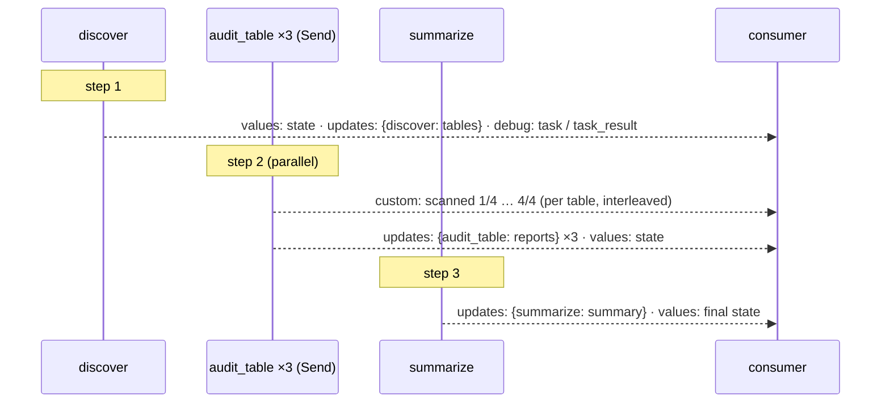
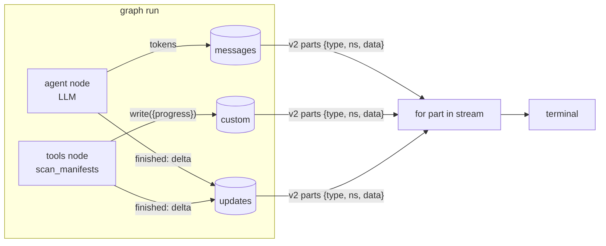
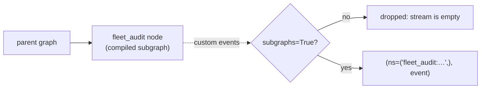
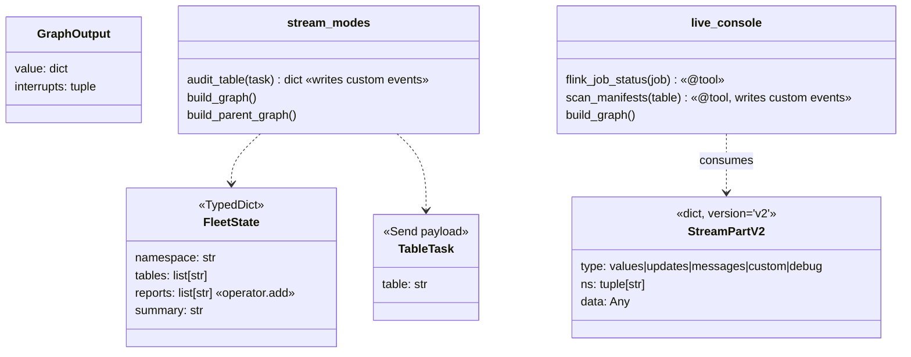

# Ch 7 — Streaming

`stream_modes.py` runs one graph (a `Send` fleet audit that reports scan progress) through every stream mode. No LLM. `live_console.py` streams an agent: LLM tokens, a tool's progress events and node updates together (**needs Ollama**).

## Concept

- `graph.stream(..., stream_mode=...)` picks what you receive while the graph runs:

  | Mode | Emits | Use it for |
  | --- | --- | --- |
  | `"values"` | full state after each step | debugging, simple UIs |
  | `"updates"` | `{node: delta}` each time a node finishes | "which step just finished" |
  | `"messages"` | `(message_chunk, metadata)` LLM tokens; messages returned by nodes too | live chat output |
  | `"custom"` | whatever you `write(...)` via `get_stream_writer()` | progress bars, "scanned 40/900" |
  | `"debug"` | task start / result events with step numbers | deep debugging |

- A **list** of modes → `(mode, chunk)` tuples, interleaved in the order they happen.
- `get_stream_writer()` works in **any** node or tool. Parallel `Send` branches interleave their events, so the order varies between runs.
- `version="v2"` (langgraph ≥ 1.1) → every part is a typed dict `{type, ns, data}`, whatever the modes. `invoke(..., version="v2")` returns a `GraphOutput(value, interrupts)`.
- Events from **inside a subgraph** are hidden unless you pass `subgraphs=True`; then each event carries the subgraph's namespace (`ns`).
- `messages` metadata includes `langgraph_node`, so you can show only the tokens from the `agent` node and skip `ToolMessage`s.

## Files

| File | What |
| --- | --- |
| `stream_modes.py` | No LLM: the fleet audit through `values`, `updates`, `custom`, `debug`, multi-mode, `v2`, and inside a parent graph with / without `subgraphs=True` |
| `live_console.py` | Agent loop; `scan_manifests` tool emits progress; prints tokens + progress + node updates live |
| `sim/lakehouse.py` | Tables with manifest files to scan, plus a Flink job status |
| `test_stream_modes.py` | One custom event per manifest; subgraph events need `subgraphs=True` |

## Diagrams

**What each mode emits over one run of the fleet audit**



**Live console: three streams merged into one loop**



**Subgraph visibility**



**Classes**



## Run it

```bash
uv run python -m chapters.ch07_streaming.stream_modes      # anywhere
uv run python -m chapters.ch07_streaming.live_console      # on the Ollama machine
uv run pytest chapters/ch07_streaming
```

In `live_console` you should see `[agent done] tool calls: [...]`, then `[progress] sales.orders: scanned 1/4 …` lines while the tool runs, `[tools done]`, then the answer appearing token by token.

## Break it

Checked against langgraph 1.2.20 (`stream_modes`):

| Change | What happens | Lesson |
| --- | --- | --- |
| Parent graph, `stream_mode="custom"` without `subgraphs=True` | Empty stream | Inner events stay hidden unless you ask |
| …with `subgraphs=True` | `(ns, event)` tuples, `ns=('fleet_audit:<task id>',)` | The namespace tells you which subgraph spoke |
| Run `stream_modes` twice | `custom` / `updates` order of the 3 tables changes | Parallel branches interleave; don't rely on order |
| Stream a graph with no LLM in `"messages"` mode | You still get messages that nodes return, whole (not tokens) | `messages` mode isn't only for token streaming |
| Call `get_stream_writer()` outside a running graph (e.g. call `audit_table({...})` directly) | `RuntimeError: Called get_config outside of a runnable context` | Writers belong to a run. Unit-test such nodes through the graph |

Try on the Ollama machine (`live_console`):

| Change | Expect |
| --- | --- |
| Remove the `meta["langgraph_node"] == "agent"` filter | Tool results printed as if they were model output |
| Drop `"custom"` from `stream_mode` | No progress lines; the tool still runs |
| Use `stream_mode="values"` only | No tokens: the answer appears all at once at the end |
