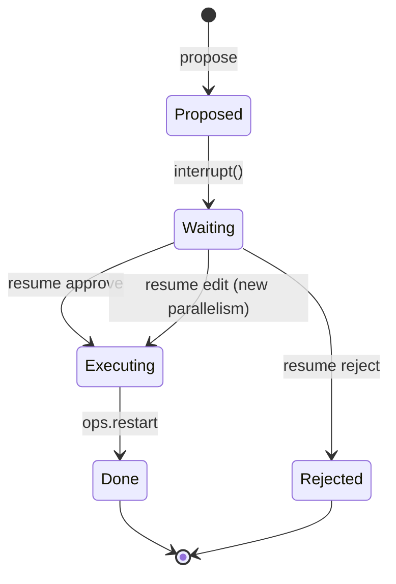
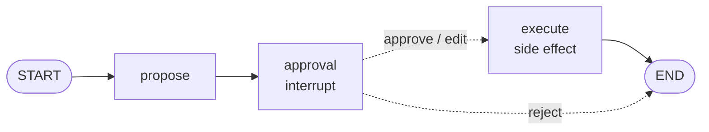
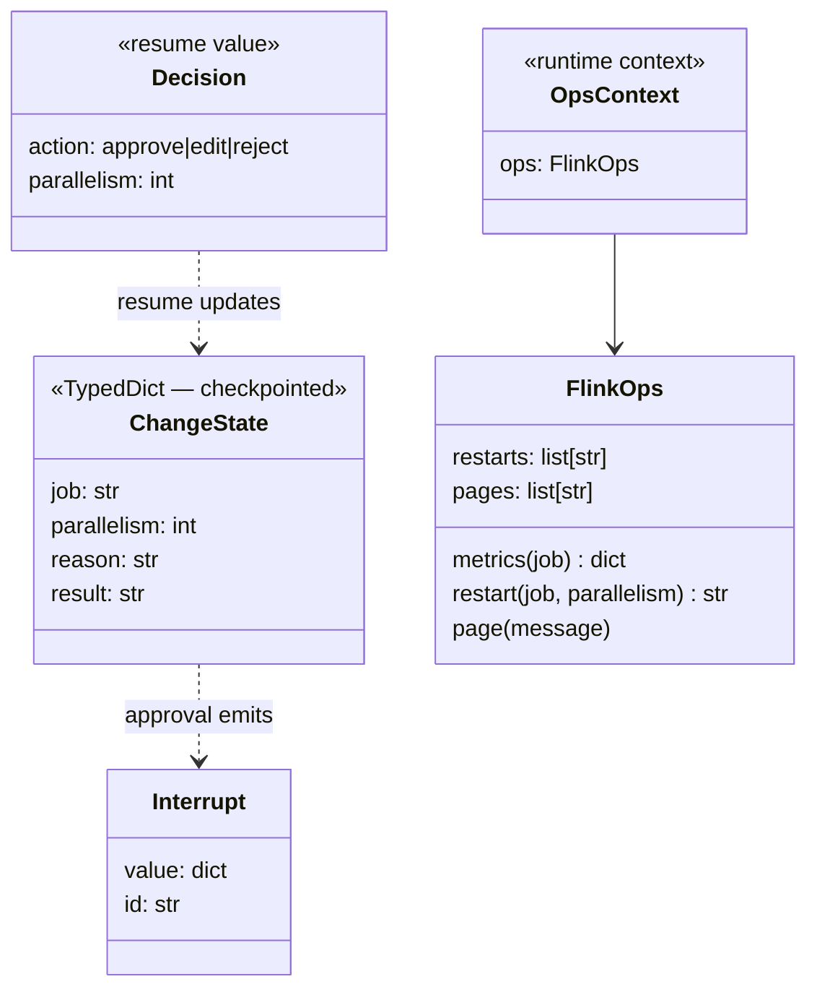

# Ch 8 — Human-in-the-loop: `interrupt` and `Command(resume=)`

No production restart without a human: `propose → approval (pause) → execute`. Three threads show approve, edit and reject. No LLM. Add `--interactive` to make the decisions yourself.

## Concept

- `interrupt(payload)` inside a node **pauses** the run: the checkpoint is saved and `invoke` returns `{"__interrupt__": [Interrupt(value=payload, id=...)]}`. `get_state(cfg).next` shows the paused node.
- Resume with `graph.invoke(Command(resume=value), same_config)`. Inside the node, `interrupt()` **returns `value`**.
- **Gotcha:** on resume the node **re-runs from its first line** (watch the `· approval node` line print twice). Anything before `interrupt()` happens twice. Put side effects after it, ideally in their own node (`execute`), or make them idempotent.
- It needs a checkpointer: without one the pause still happens, but resuming raises.
- Combine with `Command(goto=...)` (Ch 3) to route on the human's decision: approve → `execute`, edit → update + `execute`, reject → `END`.
- Common patterns: approve / reject, edit the proposed action, review the output, ask for missing input.

## Files

| File | What |
| --- | --- |
| `restart_approval.py` | Concept code: `propose`, `approval` (interrupt + Command), `execute`; scripted or `--interactive` demo |
| `sim/flink_ops.py` | `FlinkOps`: fake metrics, `restart()` and `page()` that **record every call** |
| `test_restart_approval.py` | Edit changes what runs; reject runs nothing |

## Diagrams

**Pause and resume (graph ↔ checkpointer ↔ human)**

```mermaid
sequenceDiagram
  participant H as on-call human
  participant G as graph
  participant C as checkpointer
  H->>G: invoke({job}, thread CHG-2)
  G->>G: propose → parallelism 8
  G->>G: approval: line 1 runs, then interrupt(request)
  G->>C: save checkpoint (next = approval)
  G-->>H: {"__interrupt__": [request]}
  Note over H: review, decide
  H->>G: invoke(Command(resume={edit, 6}), thread CHG-2)
  C-->>G: load checkpoint
  G->>G: approval re-runs from line 1; interrupt() returns {edit, 6}
  G->>G: Command(update parallelism=6, goto=execute)
  G->>G: execute → ops.restart(6)  (once)
  G-->>H: {result}
```

**Approval state machine**



**Graph**



**Classes**



## Run it

```bash
uv run python -m chapters.ch08_human_in_loop.restart_approval
uv run python -m chapters.ch08_human_in_loop.restart_approval --interactive   # type: approve | edit 6 | reject
uv run pytest chapters/ch08_human_in_loop
```

Look for: `next=('approval',)` while paused, the approval line printed **twice** per thread, and `restarts actually executed: ['orders-enricher@8', 'orders-enricher@6']` (the rejected one never ran).

## Break it

Checked against langgraph 1.2.20:

| Change | What happens | Lesson |
| --- | --- | --- |
| Add `runtime.context.ops.page(...)` as the **first line** of `approval` (add `runtime: Runtime[OpsContext]` to its signature) and print `len(ops.pages)` | **6 pages for 3 approvals** | Code before `interrupt()` runs again on resume |
| Move `ops.restart(...)` above the `interrupt()` | **8 restarts instead of 2**: twice per thread before the pause and on resume (even the rejected one), plus `execute` | Side effects go after approval |
| `build_graph()` → `compile()` with no checkpointer | Pause works; resume → `RuntimeError: Cannot use Command(resume=...) without checkpointer` | No checkpoint, nothing to resume from |
| Resume a thread that already finished | No new restart; you get the old result back | Resume only acts on a pending interrupt |
| Resume with the wrong `thread_id` | Graph starts from scratch with no input → `KeyError: 'job'` | Resume must use the paused thread's config |
