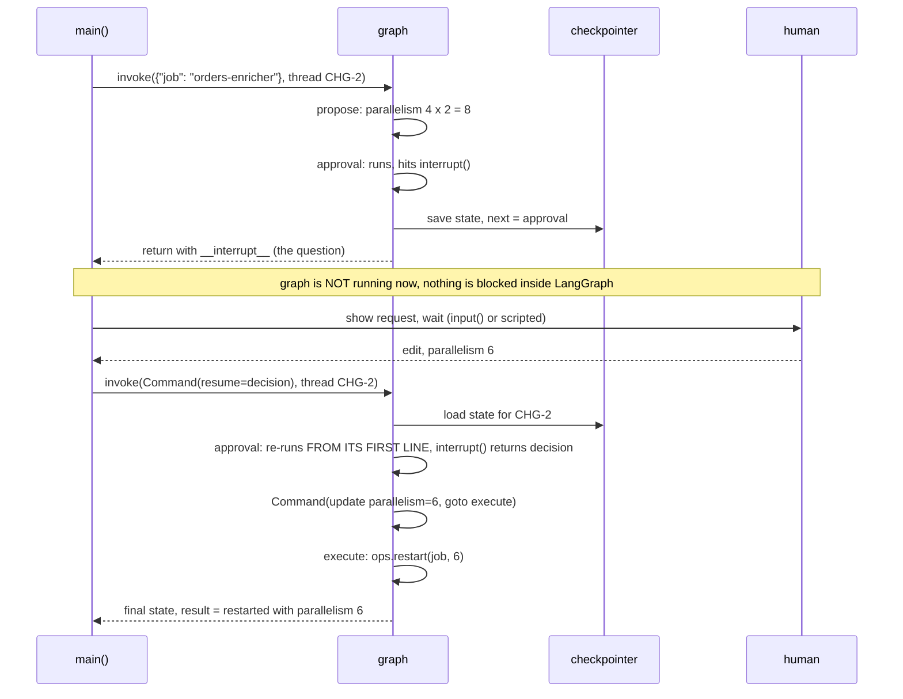

# Ch 8 explained: human approval with `interrupt()` and `Command(resume=...)`

A guided walk through `restart_approval.py`. Every output shown here comes from actually running the code (langgraph 1.2.20).

---

## 0. "I ran it and it didn't wait for approval". Why?

That's expected. The file has **two modes**:

```bash
# Mode 1, scripted (the default): decisions are hard-coded, so nothing waits for you
uv run python -m chapters.ch08_human_in_loop.restart_approval

# Mode 2, interactive: it stops at a prompt and waits for you to type
uv run python -m chapters.ch08_human_in_loop.restart_approval --interactive
```

The switch is these lines in `main()`:

```python
interactive = "--interactive" in sys.argv          # line 80
...
decision = ask_human(request) if interactive else scripted_decision   # line 95
```

Without `--interactive`, the program takes the next decision from this list instead of asking you:

```python
scripted = [{"action": "approve"},
            {"action": "edit", "parallelism": 6},
            {"action": "reject"}]
```

So the three runs are: thread CHG-1 is approved, CHG-2 is edited to parallelism 6, CHG-3 is rejected. They finish instantly.

> If you used the IDE's ▶ Run button, it runs the file with no arguments, which means scripted mode. Run the interactive command above in a terminal, or add `--interactive` to the run configuration's arguments.

In interactive mode you'll see a prompt like this:

```
▶ thread CHG-1: propose a restart of orders-enricher
   · approval node: running from its first line
   paused. next=('approval',)  request={'question': 'Approve this production restart?', 'job': 'orders-enricher', 'parallelism': 8, 'reason': 'backpressure HIGH on enrich-join'}
   approve / edit N / reject >      <-- type: approve | edit 3 | reject
```

### The more important point: the *graph* never waits

Even in interactive mode, the waiting is done by **Python's `input()` in `main()`**, not by LangGraph. When the graph hits `interrupt()`, it does **not** block or sleep. It:

1. saves its state to the checkpointer,
2. **stops and returns** from `graph.invoke(...)`, with the question in `out["__interrupt__"]`.

The process is then free to do anything it likes: wait an hour, exit, send a Slack message. Later, *anyone* holding the same `thread_id` calls `graph.invoke(Command(resume=...))` and the graph continues. In this script both halves happen in one process for convenience. In production, the pause and the resume would usually be two separate HTTP requests, possibly minutes or days apart.

---

## 1. The problem this chapter solves

The agent wants to restart a production Flink job (`orders-enricher`) with higher parallelism. A restart is a **dangerous side effect**, so a human must:

- **approve** it as proposed,
- **edit** it (for example, "use parallelism 6, not 8"), or
- **reject** it.

And the restart must happen **only after** the human says yes, and **exactly once**.

---

## 2. The graph

```
START → propose → approval ──approve/edit──→ execute → END
                      └────────reject────────────────→ END
```

| Node | What it does | Side effects? |
|---|---|---|
| `propose` | Reads job metrics, proposes `parallelism × 2` (4 → 8) and a reason | None (read-only) |
| `approval` | **Pauses** with `interrupt(...)`, then routes on the human's answer | None |
| `execute` | Calls `ops.restart(job, parallelism)` | **Yes**: the restart |

The state is a small dict:

```python
class ChangeState(TypedDict, total=False):
    job: str            # "orders-enricher"
    parallelism: int    # proposed by `propose`, maybe edited by the human
    reason: str         # "backpressure HIGH on enrich-join"
    result: str         # what happened at the end
```

`OpsContext` / `runtime.context.ops` is **dependency injection**: the fake Flink client (`FlinkOps`) is passed into nodes at invoke time (`context=ctx`). It isn't stored in state, because it's a tool, not data.

---

## 3. The two key APIs

### `interrupt(payload)`: "stop here and ask"

```python
def approval(state):
    decision = interrupt({            # ← first run: the graph STOPS here
        "question": "Approve this production restart?",
        "job": state["job"],
        "parallelism": state["parallelism"],
        "reason": state["reason"],
    })
    # ← resumed run: interrupt() RETURNS the human's answer
    if decision["action"] == "approve": ...
```

`interrupt()` behaves differently on the two runs:

| | 1st time the node runs | After `Command(resume=X)` |
|---|---|---|
| `interrupt(payload)` | Raises internally, the graph stops, and `payload` is handed to the caller as `out["__interrupt__"][0].value` | **Returns `X`** (the human's decision) |

### `Command(resume=decision)`: "here's the answer, carry on"

```python
final = graph.invoke(Command(resume=decision), cfg, context=ctx)
```

- **Same `cfg` / `thread_id`**: that's how LangGraph finds the paused run.
- `resume=decision` becomes the return value of `interrupt()`.

### `Command(goto=..., update=...)` as a node's return value

The `approval` node also *returns* a `Command`, to update state **and** pick the next node in one step:

```python
return Command(goto="execute")                                      # approve
return Command(update={"parallelism": 6}, goto="execute")           # edit
return Command(update={"result": "rejected by on-call"}, goto=END)  # reject
```

That's why there's no `add_edge("approval", ...)` in `build_graph()`. The routing lives in the returned `Command`. The type hint `Command[Literal["execute", "__end__"]]` tells LangGraph (and the graph drawing) which nodes it can go to. Note that `Command(resume=...)` and `Command(goto=...)` are the same class used two ways: `resume` is used by the **caller**, `goto`/`update` are returned by a **node**.

---

## 4. Timeline of one thread (CHG-2, the "edit" case)



---

## 5. The "prints twice" line (the #1 gotcha)

```python
print("   · approval node: running from its first line")   # prints twice
```

Real output for one thread:

```
▶ thread CHG-1: propose a restart of orders-enricher
   · approval node: running from its first line     ← 1st run, before the pause
   paused. next=('approval',)  request={...}
   human -> {'action': 'approve'}
   · approval node: running from its first line     ← again, on resume
   result: orders-enricher restarted from latest savepoint with parallelism 8
```

**On resume, LangGraph re-runs the interrupted node from the top.** It does not continue from the exact line where it paused, because Python can't freeze a function mid-execution and save it to a database. Instead it re-runs the node, and this time `interrupt()` returns the resume value instead of stopping.

Consequence: **anything before `interrupt()` in the same node runs twice.** If you put `ops.restart(...)` *before* the interrupt in `approval`, it could restart production before anyone approved, and then again on resume. That's why the side effect lives in its own node, `execute`, which runs only after approval:

```python
def execute(state, runtime):
    # The side effect lives after the approval, in its own node: it runs once, only if approved.
    return {"result": runtime.context.ops.restart(state["job"], state["parallelism"])}
```

Rules of thumb:
- Keep code before `interrupt()` cheap and side-effect-free (or idempotent).
- Put dangerous actions in a **separate node after** the approval.

---

## 6. Why a checkpointer is required

```python
return builder.compile(checkpointer=checkpointer or InMemorySaver())   # interrupts need a checkpointer
```

Pausing means "save everything, stop, and continue later". The checkpointer is where it's saved, keyed by `thread_id`. Without one, there's nothing to resume from (LangGraph raises an error).

- `InMemorySaver`: lives in RAM, so the pause can't survive the process exiting. Fine for this demo.
- `SqliteSaver` / `PostgresSaver` (Ch 5): the pause survives restarts. Process A can pause, and process B can resume the next day with the same `thread_id`.

Each scripted run uses its own thread (`CHG-1`, `CHG-2`, `CHG-3`), so three independent approvals can be pending at the same time.

`graph.get_state(cfg).next` shows `('approval',)` while paused. That's how you can check which threads are waiting on a human.

---

## 7. Walking through `main()` line by line

```python
for i, scripted_decision in enumerate(scripted, 1):
    cfg = {"configurable": {"thread_id": f"CHG-{i}"}}       # one thread per change request

    out = graph.invoke({"job": "orders-enricher"}, cfg, context=ctx)
    #   runs propose → approval → hits interrupt → RETURNS here (doesn't block)

    request = out["__interrupt__"][0].value                 # the dict passed to interrupt()
    print(f"paused. next={graph.get_state(cfg).next} ...")  # ('approval',)

    decision = ask_human(request) if interactive else scripted_decision
    #   interactive: input() waits for you (THIS is the only real "wait")
    #   scripted:    takes the next hard-coded decision immediately

    final = graph.invoke(Command(resume=decision), cfg, context=ctx)
    #   same thread → loads saved state → re-runs approval → routes → maybe execute

print(f"restarts actually executed: {ops.restarts}")
```

Final line of the scripted run:

```
restarts actually executed: ['orders-enricher@8', 'orders-enricher@6']
```

Two restarts (approve at 8, edit to 6). The rejected one never reached `execute`.

---

## 8. Try it

```bash
# you decide all three
uv run python -m chapters.ch08_human_in_loop.restart_approval --interactive
#   approve      → restart at 8
#   edit 3       → restart at 3
#   reject       → no restart

# trace it in Phoenix: you'll see TWO traces per thread (pause run + resume run)
PHOENIX_TRACING=true uv run python -m chapters.ch08_human_in_loop.restart_approval

# tests
uv run pytest chapters/ch08_human_in_loop -q
```

Note: `ask_human` has no input validation. Typing something unexpected like `yes` gives `{"action": "yes"}`, which the `approval` node treats as a **reject** because it falls through to the last `return`. Failing closed like this is the safe default for production changes.

---

## 9. One-paragraph summary

`interrupt(payload)` saves the graph's state and **returns control to the caller** with `payload` as the question. The graph does not sit and wait. The caller gets the human's answer however it wants, then calls `graph.invoke(Command(resume=answer), same_thread_id)`. LangGraph reloads the state, **re-runs the paused node from its first line**, and this time `interrupt()` returns `answer`. The node routes with `Command(goto=..., update=...)`. Dangerous actions go in a separate node *after* the approval, so they run exactly once and only when approved. A checkpointer is mandatory because it's what makes "pause now, resume later" possible.
