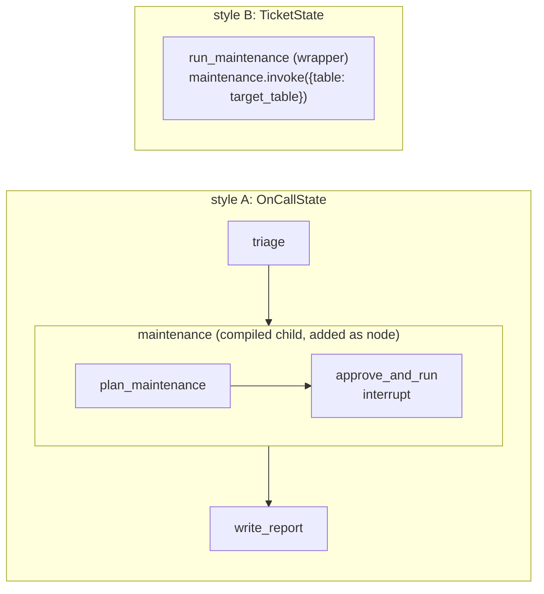
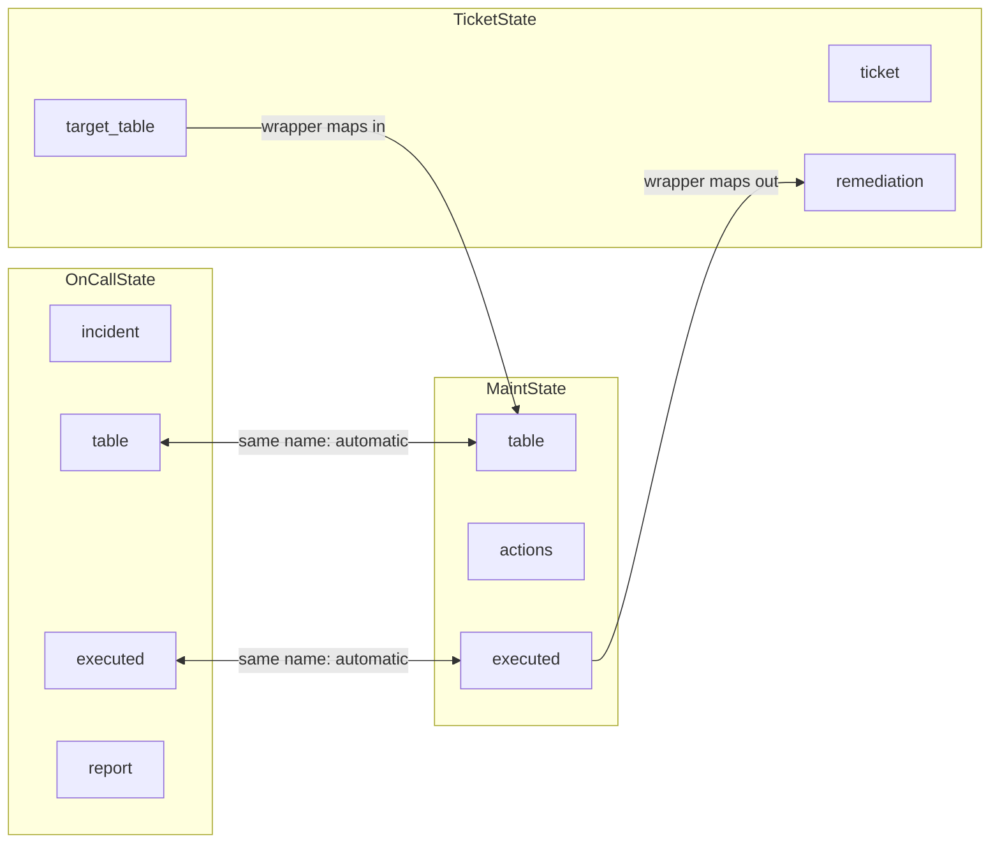
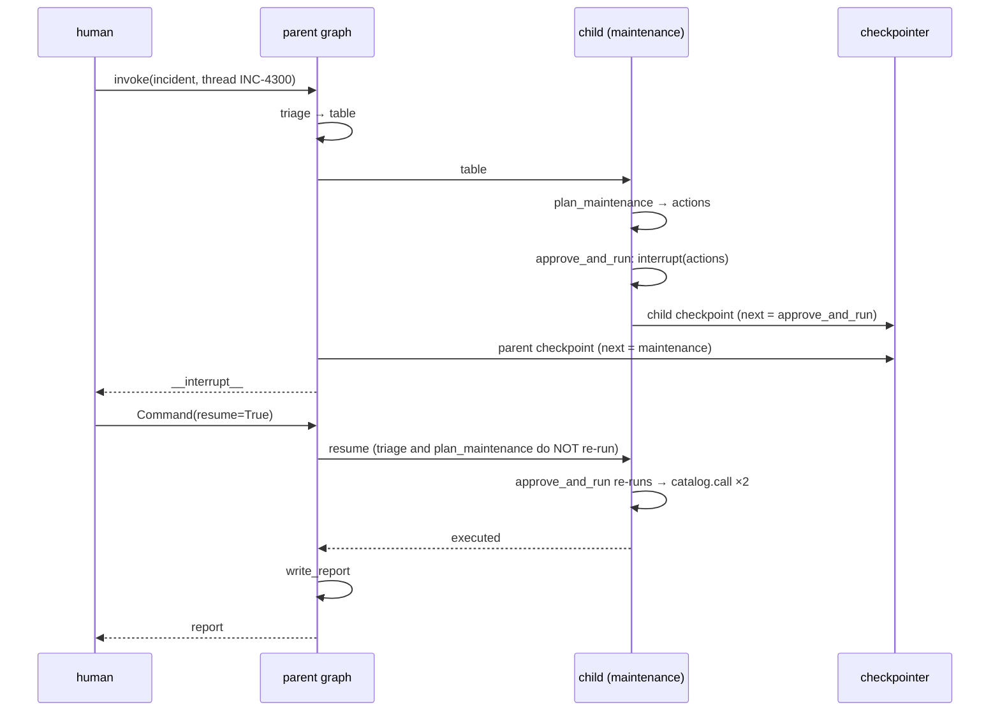
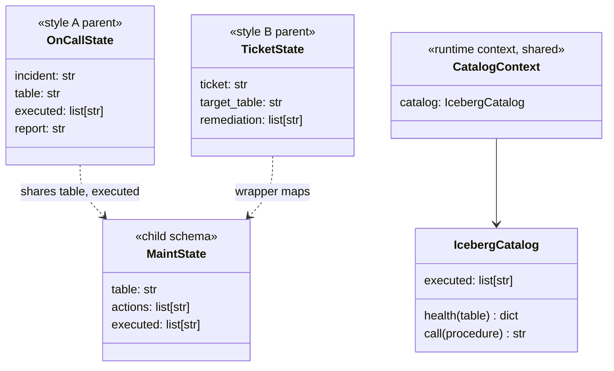

# Ch 9 — Subgraphs and composition

The Iceberg-maintenance team owns its own graph (plan → approve → run). The on-call graph uses it in both styles: **shared keys** and a **wrapper node**. The child pauses for approval; the interrupt surfaces through the parent. No LLM.

## Concept

- A **compiled graph can be a node** of another graph. Use it for team ownership, reuse, and (later) multi-agent systems.
- **Shared keys:** `add_node("maintenance", child_graph)`. Keys with the **same name** in both schemas flow in and out automatically. Other keys are invisible to the child.
- **Different schemas:** a **wrapper node** calls `child.invoke({...})` and maps state in and out by hand. More code, but the two schemas are fully decoupled.
- The child is compiled **without** a checkpointer: it inherits the parent's. Runtime context also flows into the child.
- An `interrupt()` inside the child **surfaces to the parent** (`__interrupt__`); resume the **parent** with `Command(resume=...)`. Inspect the paused child with `get_state(cfg, subgraphs=True).tasks[0].state`.
- On resume, only the interrupted **child node** re-runs; earlier child nodes do not. With a wrapper, the **wrapper re-runs from its first line** (the child then resumes from its own checkpoint).
- Stream child events with `subgraphs=True` (Ch 7): each event carries the child's namespace.

## Files

| File | What |
| --- | --- |
| `maintenance_team.py` | Child graph (`plan_maintenance`, `approve_and_run`), style A (`build_shared_keys_graph`), style B (`build_wrapper_graph`), demo |
| `sim/iceberg_catalog.py` | `IcebergCatalog`: table health + `call()` that records every procedure run |
| `test_maintenance_team.py` | Shared-keys interrupt + resume; wrapper mapping |

## Diagrams

**Parent / child nesting**



**State mapping**



**Interrupt inside the child, resume through the parent**



**Classes**



## Run it

```bash
uv run python -m chapters.ch09_subgraphs.maintenance_team
uv run pytest chapters/ch09_subgraphs
```

Look for: `[child ]` events in the stream, `parent next=('maintenance',), child next=('approve_and_run',)` while paused, and in style B the wrapper line printed **twice** but `plan_maintenance (child)` only **once**.

## Break it

Checked against langgraph 1.2.20:

| Change | What happens | Lesson |
| --- | --- | --- |
| Rename the parent's `table` to `table_name` (style A) | `KeyError: 'table'` inside the child | Shared-key style matches by **name** only |
| Rename the child's `executed` to `done` (style A and B) | No error. Procedures **do run** on the catalog, but the parent reports `0 maintenance procedures run` / `remediation=[]` | Output keys that don't match are **silently dropped**. Test the contract |
| Resume with `Command(resume=False)` | `0 maintenance procedures run`, catalog untouched | The child's decision logic, driven from the parent |
| Compile the parent without a checkpointer | Pause works; resume → `RuntimeError` (as in Ch 8) | The child relies on the parent's checkpointer |
| Stream style A without `subgraphs=True` | Only `triage` and the parent `__interrupt__`; no `plan_maintenance` event | Child internals are hidden by default |
