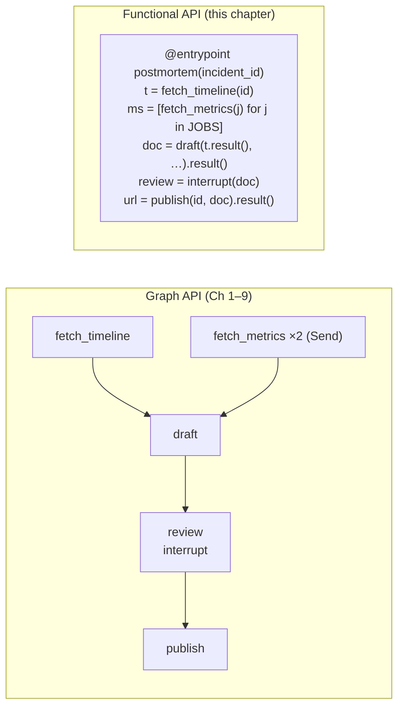
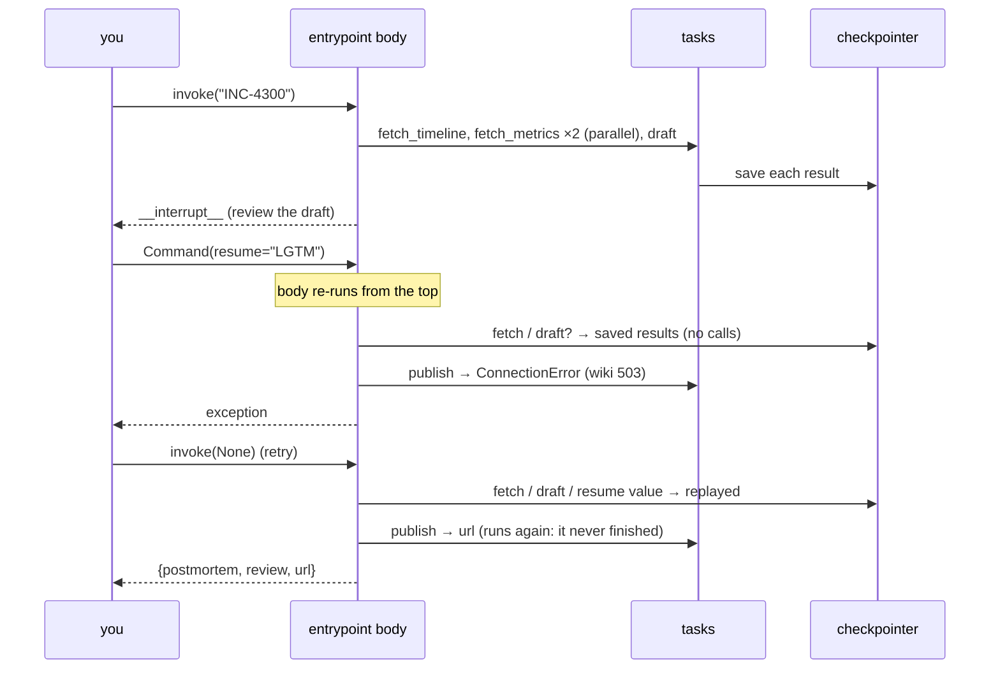
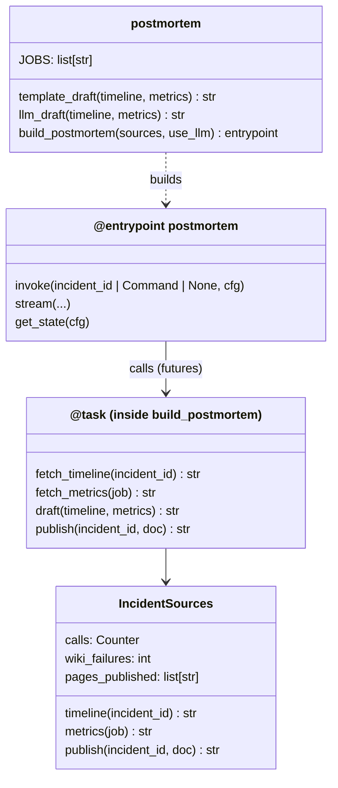

# Ch 10 — Functional API and durable execution

A post-mortem workflow written as plain Python: fetch timeline + metrics (in parallel) → draft → pause for review → publish to the wiki. Call counters prove finished tasks are **replayed, not re-run**, after a pause or a crash. Runs anywhere with a template draft; `--ollama` lets the LLM write it.

## Concept

- Same runtime as `StateGraph` (checkpoints, interrupts, streaming), no explicit graph. `@entrypoint` is the workflow; `@task` is a unit of work whose **result is checkpointed**.
- Use it when the logic is ordinary Python control flow (loops, if/else, try/except) and drawing it as nodes and edges adds nothing.
- **Durable execution:** on resume (after `interrupt` or a crash) the **entrypoint body re-runs from the top**, but each finished task returns its saved result instead of running again. A task that failed runs again.
- So: put every **side effect** and every **non-deterministic** step (LLM call, API read, clock) inside a `@task`. Code directly in the entrypoint body runs again on every resume.
- Calling a task returns a **future**. Start several, then `.result()` them: they run in parallel.
- After a crash, retry with `workflow.invoke(None, cfg)`: it continues from the last checkpoint, and earlier `resume` values are kept.
- `get_graph()` shows a single `postmortem` node: tasks are not drawn.

## Files

| File | What |
| --- | --- |
| `postmortem.py` | Concept code: `build_postmortem()` creates 4 `@task`s and the `@entrypoint`; demo with a pause/resume and a crash/retry |
| `sim/incident_sources.py` | `IncidentSources`: timeline, metrics, wiki `publish()` (can fail N times); counts every call |
| `test_postmortem.py` | Resume replays tasks; retry after crash re-runs only the failed task |

## Diagrams

**Graph API vs functional API — same workflow**



| | Graph API | Functional API |
| --- | --- | --- |
| Shape | nodes + edges, explicit state schema | a Python function |
| Saved per step | state after each super-step | each task's result + entrypoint's return |
| Branching / loops | conditional edges, `Command`, `Send` | `if`, `for`, `try` |
| On resume | the interrupted node re-runs | the entrypoint re-runs; finished tasks replay |

**Pause, crash and retry (thread PM-4300)**



**Classes**



## Run it

```bash
uv run python -m chapters.ch10_functional_api.postmortem             # anywhere
uv run python -m chapters.ch10_functional_api.postmortem --ollama    # LLM-written draft, on the Ollama machine
uv run pytest chapters/ch10_functional_api
```

Look for: `calls after resume` still shows `timeline: 1`; after the crash and retry only `publish` went from 1 to 2; `review kept='LGTM'`.

## Break it

Checked against langgraph 1.2.20:

| Change | What happens | Lesson |
| --- | --- | --- |
| Replace `fetch_timeline(incident_id)` with `sources.timeline(incident_id)` directly in the body (and pass `timeline` to `draft`) | `timeline: 2` after one resume | Work outside a `@task` re-runs on every resume |
| Add `sources.publish(incident_id, doc)` directly in the body, before `interrupt` | `publish: 3` instead of 1 (twice before/at the pause, once after) | Side effects outside tasks repeat: duplicate wiki pages |
| After the crash, call `invoke("INC-4300", cfg)` instead of `invoke(None, cfg)` | Every fetch runs again (`timeline: 2`, `metrics: 2`); it also silently reuses the earlier `"LGTM"` instead of asking again | `None` = continue from the checkpoint. Passing input again is not a clean retry |
| `@entrypoint()` without a checkpointer | Pause works, resume → `RuntimeError` (Ch 8) | Durability needs a checkpointer |
