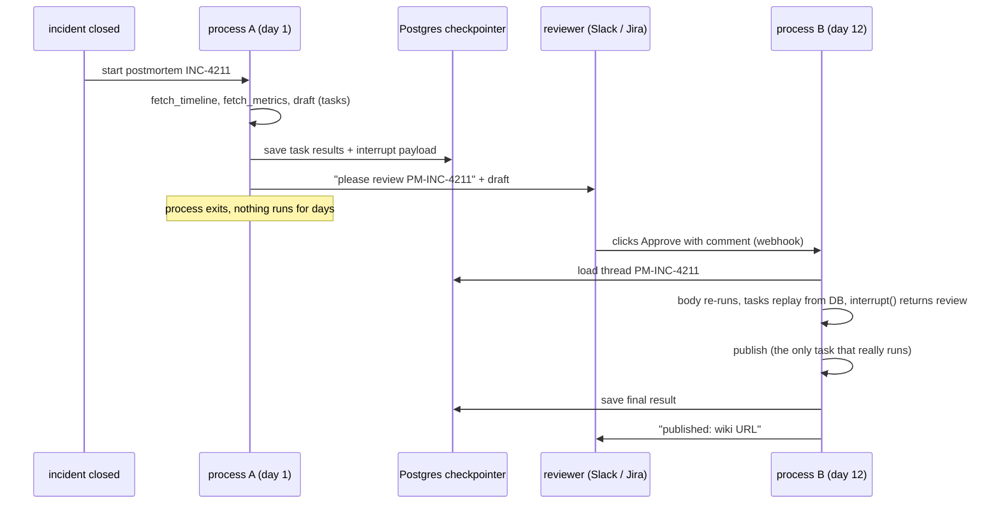

# Real life: a review that takes days or weeks

In `postmortem.py`, the pause and the resume happen a few lines apart in one process, and the "review" is hard-coded (line 74). That's a demo convenience. In production they are **two separate events, days apart, usually in different processes or even different machines**. Between them **nothing is running**.

`review_service.py` shows this for real. Every command is its own short-lived process.

---

## 1. The core idea

```
Day 1   process A:  invoke("INC-4211")  → tasks run → interrupt() → checkpoint saved → process EXITS
                    notify reviewer (Slack/Jira/email) with thread_id = "PM-INC-4211"

Day 2…11            nothing running. No thread, no sleep, no memory.
                    The paused workflow is just rows in Postgres/SQLite.

Day 12  process B:  reviewer clicks "Approve" → your API handler runs:
                    invoke(Command(resume="LGTM…"), thread_id="PM-INC-4211")
                    → load checkpoint → body re-runs, finished tasks replay from DB
                    → interrupt() returns the review → publish → done
```

Because a paused workflow is just data, waiting a week costs exactly as much as waiting a second: a few rows in a table.



---

## 2. Proof: the demo, run as six separate processes

```bash
M=chapters.ch10_functional_api.review_service
uv run python -m $M start INC-4211           # process 1
uv run python -m $M start INC-4300           # process 2
uv run python -m $M pending                  # process 3
uv run python -m $M resume PM-INC-4211 "LGTM, add action items"   # process 4 (could be weeks later)
uv run python -m $M resume PM-INC-4211 "approve"                  # process 5 (double click)
uv run python -m $M pending                  # process 6
```

Real output:

```
--- process 1: start
paused PM-INC-4211. calls in this process: {'metrics:orders-enricher': 1, 'metrics:orders-sink': 1, 'timeline': 1}
(notify reviewer: 'reply with: resume PM-INC-4211 <your review>') -> process exits now
--- process 3: pending
WAITING  PM-INC-4211  since 2026-11-08T12:20:26.982670+00:00
WAITING  PM-INC-4300  since 2026-11-08T12:20:27.600904+00:00
--- process 4: resume
resumed PM-INC-4211: review='LGTM, add action items' url=https://wiki.internal/postmortems/INC-4211
calls in this process: {'publish': 1}   <- only publish: fetch/draft came from the DB
--- process 5: resume again (double click)
PM-INC-4211 is not waiting for a review (next=())
--- process 6: pending
done     PM-INC-4211  url=https://wiki.internal/postmortems/INC-4211
WAITING  PM-INC-4300  since 2026-11-08T12:20:27.600904+00:00
```

Process 4 is a brand-new Python process with fresh counters, and the only call it made was `publish`. The timeline, metrics and draft were loaded from `reviews.db`. Kill everything, reboot, come back in a month, and it still works.

The only change needed in `postmortem.py` was letting the caller pass a durable checkpointer:

```python
build_postmortem(sources, use_llm, checkpointer=SqliteSaver(...))   # default is still InMemorySaver
```

---

## 3. Production architecture

```
                      ┌──────────────────────────────┐
 incident closed ───▶ │ POST /postmortems/{incident} │── invoke(incident_id, thread) ──┐
                      └──────────────────────────────┘                                 │
                                                                                        ▼
                                                                           ┌──────────────────────┐
                      ┌──────────────────────────────┐                     │ Postgres             │
 reviewer clicks ───▶ │ POST /reviews/{thread_id}    │── invoke(Command(   │  - LangGraph         │
 Approve in Slack     │   auth: is this user allowed?│     resume=…)) ───▶ │    checkpoints       │
                      └──────────────────────────────┘                     │  - your `reviews`    │
                                                                           │    table (status,    │
 cron, hourly    ───▶  find reviews WAITING > N days → remind / escalate / │    assignee, due)    │
                       or auto-resume with {"action": "expired"}           └──────────────────────┘
```

### Must-haves

| Concern | What to do | Why |
|---|---|---|
| **Durable checkpointer** | `PostgresSaver` (already in `pyproject.toml`) or SQLite for a single box. **Never `InMemorySaver`** | `InMemorySaver` loses every paused review when the process restarts |
| **Stable `thread_id`** | Derive it from the business ID: `PM-INC-4211`, `CHG-2` | The resume request must be able to find the thread. Put it in the Slack button / Jira field |
| **Notify, then exit** | After `invoke()` returns `__interrupt__`, send `request` + `thread_id` to the reviewer and return the HTTP response | No process should sit waiting. That's what makes weeks-long waits free |
| **Your own `reviews` table** | Insert `(thread_id, status=WAITING, assignee, created_at, due_at)` when you notify. Update it to `DONE` on resume | `saver.list()` + `get_state()` works (the demo's `pending`) but scans checkpoints. A small table is easier to query, index and show in a UI |
| **Guard against double resume** | Check `get_state(cfg).interrupts` before resuming (demo process 5), and in production also take a row lock / status update on your `reviews` table: `UPDATE … SET status='DONE' WHERE thread_id=? AND status='WAITING'` | Two reviewers clicking at once, or a retried webhook, must not publish twice |
| **AuthZ + audit** | Check *who* may approve before calling resume. Put the approver in the resume value: `Command(resume={"by": "alice", "verdict": "approve", "comment": …})` | The resume value is saved in the checkpoint, giving you an audit trail for free |
| **Idempotent side effects** | Pass `thread_id` as an idempotency key to the wiki/deploy API | If the process dies after `publish` succeeds but before the checkpoint is written, the task runs again on retry |

### Things that bite after days or weeks

| Problem | Why it happens | Mitigation |
|---|---|---|
| **Nobody answers** | LangGraph has **no durable timers**. A paused thread waits forever | Cron job: query `reviews` for `due_at < now()`, then remind or escalate, or auto-resume with `{"verdict": "expired"}` and let the workflow handle it |
| **Code deployed while reviews are paused** | On resume, the **new** code re-runs the entrypoint body against **old** saved task results. Tasks are matched by call order, so adding, removing or reordering task calls *before* the `interrupt` can mismatch the replay | Treat the code before an `interrupt` as a frozen contract. Add new steps *after* it, or branch on a version stored in the input. For big changes, drain old threads or keep the old workflow deployed under another name |
| **Stale data** | Task results from day 1 are replayed on day 12. The metrics are 11 days old | Usually what you want (the reviewer approved *that* draft). If not, refetch in a task placed *after* the `interrupt` |
| **Crash during resume** | e.g. the wiki returns 503 in `publish` | Just retry `invoke(None, cfg)`: the saved review is kept and only `publish` re-runs (`postmortem.py` PM-4300 demo). Have a retry job or queue do this, since LangGraph won't do it on its own |
| **Old threads pile up** | Checkpoints are never deleted automatically | Periodically delete finished threads (`saver.delete_thread(thread_id)`) after your retention period |
| **Reviewer wants changes, not approval** | Not a yes/no decision | Loop in code: `while (r := interrupt(doc))["verdict"] == "changes": doc = revise(doc, r["comment"]).result()`. Each round is another pause/resume, which could be another week |

---

## 4. Options so you don't build the API yourself

- **LangGraph Server** (`langgraph dev` locally via `langgraph-cli[inmem]`, which is already a dependency, or the self-hosted/Platform server): exposes threads/runs over REST. Resume is `client.runs.create(thread_id, assistant_id, command={"resume": ...})` with `langgraph_sdk`, and it can list interrupted threads. Note that `langgraph dev` keeps state in memory and is for development only. Check the licensing terms for self-hosted production deployments. Also, Studio's UI loads from LangChain's website (see `docs/local-llm-tracing.md`), which matters for your no-egress requirement.
- **Temporal outside, LangGraph inside** (see `ch08_human_in_loop/ch08_vs_temporal.md`): if you need durable timers ("escalate after 3 days"), automatic crash recovery and versioning out of the box, let Temporal own the waiting and call the LangGraph parts as activities.

---

## 5. One-line summary

`interrupt()` doesn't wait. It **saves and stops**. "Waiting for weeks" just means a row sits in Postgres until some later request, from whatever process receives the reviewer's click, calls `invoke(Command(resume=review), thread_id)`. Your job is the plumbing around that: a durable checkpointer, a stable thread ID, a notification, an authenticated resume endpoint, a double-resume guard, and a cron job for reviews nobody answers.
