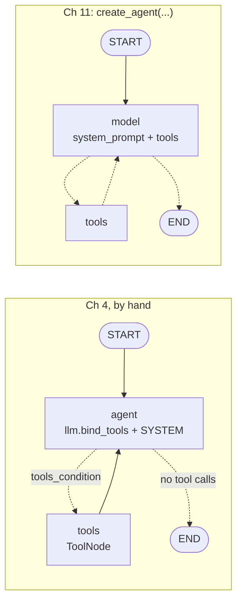
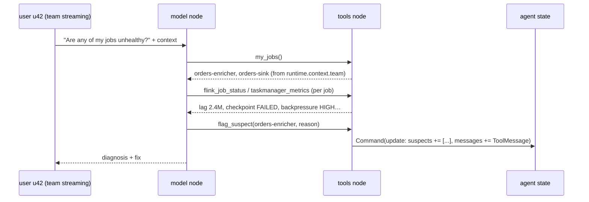
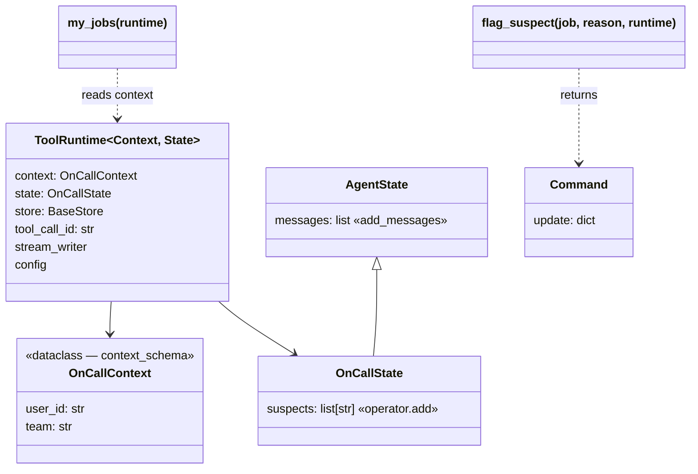

# Ch 11 — `create_agent`: the loop, packaged

The Ch 4 loop as one factory call. The agent lists the caller's jobs (from **context**), checks them, and **writes suspects into state** from a tool. **Needs Ollama** (the tests do not).

## Concept

- `langchain.agents.create_agent(model, tools, system_prompt=...)` builds the Ch 4 graph for you: nodes `model` and `tools`, edge back to `model`, stop when no tool calls. It returns a **`CompiledStateGraph`**, so `invoke`, `stream`, checkpointers, `get_state`, interrupts all work exactly as in Part 1.
- Key parameters: `model` (instance or `"provider:name"`), `tools`, `system_prompt`, `state_schema`, `context_schema`, `checkpointer`, `store`, `name`, plus `middleware` (Ch 12) and `response_format` (Ch 13).
- A tool parameter typed **`runtime: ToolRuntime[Context, State]`** is injected and **hidden from the model**. It gives `runtime.context`, `runtime.state`, `runtime.store`, `runtime.tool_call_id`, `runtime.stream_writer`, `runtime.config`.
- A tool can **return `Command(update={...})`** to write agent state. The update must include a `ToolMessage` for its `tool_call_id`, or the run fails.
- Extend the state by subclassing **`AgentState`** (it already has `messages`). Give new keys a **reducer** if parallel tool calls can write them (Ch 2).
- Pass a configured model **instance** (`common.llm.llm`) so base URL and temperature come with it.

## Files

| File | What |
| --- | --- |
| `flink_oncall_agent.py` | `build_agent()` with `create_agent`; demo streams tool calls, prints `state["suspects"]`, then a follow-up on the same thread |
| `oncall_tools.py` | `OnCallContext`, `OnCallState`, and 4 tools: `my_jobs` (context), `flink_job_status`, `taskmanager_metrics`, `flag_suspect` (returns `Command`) |
| `sim/flink_cluster.py` | Fake Flink jobs with team ownership |
| `test_oncall_tools.py` | No model: `runtime` hidden + context injected; parallel `flag_suspect` accumulate |

## Diagrams

**`create_agent` internals = the Ch 4 graph**



**One run**



**ToolRuntime and state**



## Run it

```bash
uv run python -m chapters.ch11_create_agent.flink_oncall_agent    # on the Ollama machine
uv run pytest chapters/ch11_create_agent                           # anywhere
```

What you should see: `nodes=['__start__', 'model', 'tools', '__end__']`, then `[model] calls: ['my_jobs({})']`, status/metrics calls, a `flag_suspect(...)` call, the answer, `state['suspects']` with `orders-enricher`, and a follow-up answer that remembers what it flagged.

A 4B model may skip `flag_suspect` or call tools in a different order. If `suspects` stays empty, that's the model, not the wiring (the tests prove the wiring).

**Observed run** (qwen3.5:4b, Ollama machine):

```text
[model] calls: ['my_jobs({})']
[tools] my_jobs -> orders-enricher, orders-sink
[model] calls: ["flink_job_status({'job': 'orders-enricher'})", "taskmanager_metrics({'job': 'orders-enricher'})"]
[tools] ...lag=2,400,000 records; last checkpoint FAILED... / backpressure=HIGH on operator 'enrich-join'; heap=92%
[model] calls: ["flink_job_status({'job': 'orders-sink'})", "taskmanager_metrics({'job': 'orders-sink'})"]
[tools] ...lag=0 records; last checkpoint OK / backpressure=LOW; heap=41%
[model] calls: ["flag_suspect({'job': 'orders-enricher', 'reason': 'High consumer lag and failed checkpoint ...'})"]
[tools] flag_suspect -> flagged orders-enricher
state['suspects']: ['orders-enricher: High consumer lag ... (flagged for u42)']
```

What it shows:
- **5 model calls, 4 tool rounds.** Two tool calls in one model turn run in **one** `tools` step, in parallel.
- `flag_suspect` was called **once** (only one job was unhealthy), so the reducer was not needed in this run. The test covers the two-flags case.
- `user_id` (`u42`) reached the tool via context. The model never saw it.
- The follow-up ("what did you flag and why?") was answered from the **message history** in the checkpoint: the `flag_suspect` call and its `ToolMessage`. The model never sees `state["suspects"]`. Custom state keys are for **your code** (and middleware, Ch 12), not the prompt.

## Break it

**Verified here, no model needed** (langchain 1.4.9 / langgraph 1.2.20):

| Change | What happens | Lesson |
| --- | --- | --- |
| Look at `my_jobs.tool_call_schema` | `properties: {}` | `runtime` is injected, never shown to the model |
| `suspects: list[str]` (drop `operator.add`) and flag two jobs in one turn | `InvalidUpdateError: At key 'suspects'` | Parallel tool calls = parallel writes (Ch 2) |
| `flag_suspect` returns `Command(update={"suspects": [...]})` without the `ToolMessage` | `ValueError: Expected to have a matching ToolMessage in Command.update` | Every tool call must be answered |

**Try on the Ollama machine:**

| Change | Expect |
| --- | --- |
| `context=OnCallContext("u7", "ml")` | It only looks at `feature-writer`, which is healthy |
| Remove `checkpointer=` | The follow-up can't say what was flagged; `get_state` raises |
| `model=MODEL` (the string) instead of `llm` | The model is built with langchain-ollama defaults, not `common.llm`'s `OLLAMA_BASE_URL` / `temperature=0` / thinking setting. On a remote Ollama host it may fail to connect |
