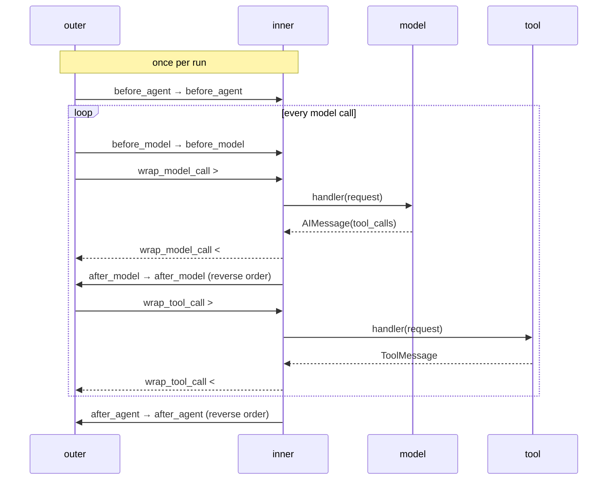
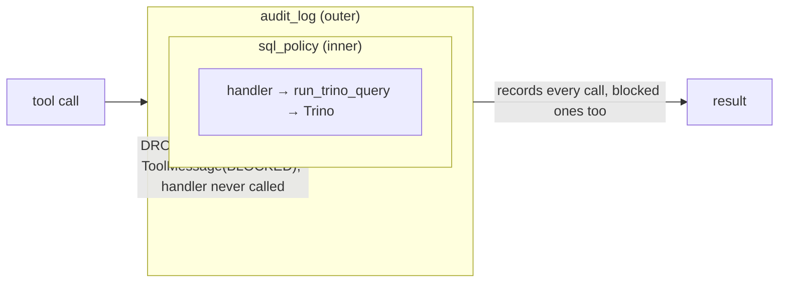
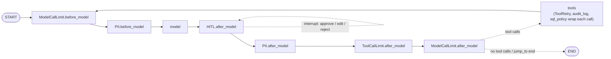
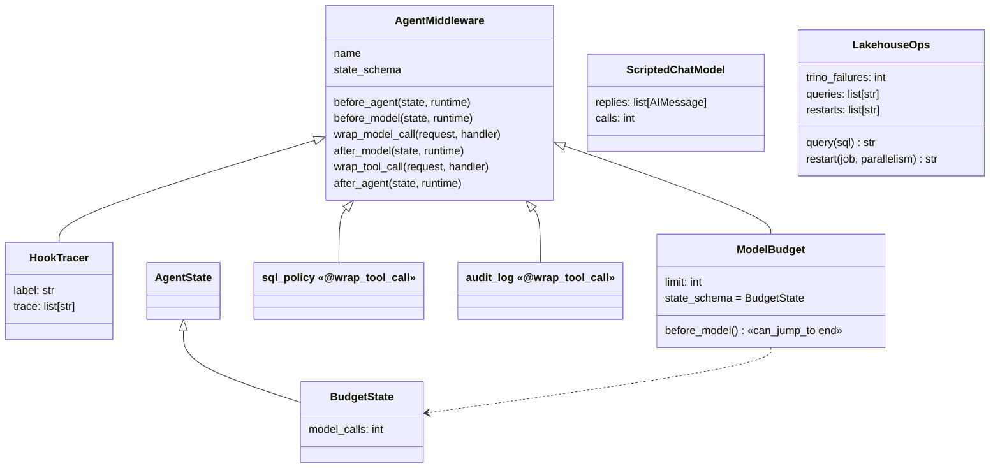

# Ch 12 — Middleware: the harness hook points

Production concerns wrapped **around** the Ch 11 loop without rewriting it: a SQL guardrail, an audit log, a loop budget, retries, PII redaction and human approval for restarts. Runs anywhere: a scripted model (`sim/scripted_model.py`) replays the model's replies, because middleware wraps the loop, not the model. Add `--ollama` to let the real LLM drive.

## Concept

- Six hooks, two styles:

  | Hook | Runs | Style | Typical use |
  | --- | --- | --- | --- |
  | `before_agent` | once, at the start of a run | node | load memory, validate input |
  | `before_model` | before every model call | node | budgets, trimming, early exit (`jump_to`) |
  | `wrap_model_call` | around every model call | wrap | retry, fallback, prompt / tool selection |
  | `after_model` | after every model reply | node | guardrails, HITL on tool calls, limits |
  | `wrap_tool_call` | around every tool call | wrap | policy, retries, audit, timeouts |
  | `after_agent` | once, at the end of a run | node | persist memory, metrics |

- **Node-style** hooks become **real graph nodes** (`ModelBudget.before_model`, `HumanInTheLoopMiddleware.after_model`). They take `(state, runtime)` and return a state update or `None`. **Wrap-style** hooks run inside the `model` / `tools` nodes and are not drawn. They get `handler`: call it once (pass through), zero times (short-circuit: the tool never runs) or several times (retry).
- **Order = onion.** For `middleware=[outer, inner]`: `before_*` run outer → inner, `after_*` run inner → outer, and `wrap_*` nest, so the first in the list is the outermost.
- A node hook can end the run with `{"jump_to": "end"}`, but only if it declares `@hook_config(can_jump_to=["end"])`. That declaration is what adds the edge to the graph.
- Middleware can add **state keys** (`state_schema = BudgetState`, so `model_calls` appears in the agent state) and tools.
- Built-ins used here: `ModelCallLimitMiddleware`, `ToolCallLimitMiddleware`, `ToolRetryMiddleware`, `PIIMiddleware`, `HumanInTheLoopMiddleware`. Others to know: `SummarizationMiddleware`, `ContextEditingMiddleware`, `ModelRetryMiddleware`, `ModelFallbackMiddleware`, `LLMToolSelectorMiddleware`, `TodoListMiddleware`.
- `HumanInTheLoopMiddleware` = Ch 8 packaged: it pauses in `after_model` (before the tool runs) and resumes with `Command(resume={"decisions": [{"type": "approve" | "edit" | "reject", ...}]})`. It needs a checkpointer.
- `PIIMiddleware("email", strategy="redact")` rewrites the **stored** user message, so the email never reaches the checkpoint, not just the model.

## Files

| File | What |
| --- | --- |
| `custom_middleware.py` | Hand-written: `HookTracer` (all six hooks), `sql_policy` and `audit_log` (`@wrap_tool_call`), `ModelBudget` (`before_model` + `jump_to` + own state key). Demo: hook order, policy + audit, budget |
| `prod_agent.py` | `prod_middleware()`: built-in stack + the custom policy/audit. Demo: PII + retry + approval (edit), reject, runaway loop |
| `ops_tools.py` | `run_trino_query`, `restart_job` |
| `sim/scripted_model.py` | `ScriptedChatModel`: replays canned `AIMessage`s with fresh tool-call ids |
| `sim/lakehouse_ops.py` | `LakehouseOps`: fake Trino (can fail N times) and Flink restarts; records every call |
| `test_middleware.py` | Onion order; policy blocks write SQL but audit sees it; rejected restart never runs |

## Diagrams

**Hook timeline: one tool round, `middleware=[outer, inner]`** (the real printout of demo 1)



**Onion nesting: `wrap_tool_call` in `[audit_log, sql_policy]`**



**Where the hooks sit in the graph** (`prod_agent`; wrap hooks hide inside `model` / `tools`)



**Classes**



## Run it

```bash
uv run python -m chapters.ch12_middleware.custom_middleware            # anywhere
uv run python -m chapters.ch12_middleware.prod_agent                   # anywhere
uv run python -m chapters.ch12_middleware.prod_agent --ollama          # real LLM, on the Ollama machine
uv run pytest chapters/ch12_middleware
```

Look for:
- `custom_middleware`: the onion trace; `[tool:error] BLOCKED by policy` with `queries Trino really ran: ['SELECT …']`, and the DROP still in the audit; `model_calls=3 … budget of 3 used up`.
- `prod_agent`: `[REDACTED_EMAIL]` in the **stored** human message; `Trino calls: 2` but only one `[tool:success]` (the retry is invisible to the model); `next=('HumanInTheLoopMiddleware.after_model',)` while paused; restarts `['orders-enricher@6']` for edit and `[]` for reject; the runaway loop gives `['success' ×3, 'error' ×3]` and then `Model call limits exceeded: run limit (6/6)`.

## Break it

Checked against langchain 1.4.9 / langgraph 1.2.20, scripted model:

| Change | What happens | Lesson |
| --- | --- | --- |
| `middleware=[sql_policy, audit_log]` (policy outer) | The blocked DROP is **missing from the audit**: the policy short-circuits before `audit_log` runs | Order decides who sees what. Observability goes outermost |
| Swap the two `HookTracer`s | Every line flips: the new first one is outermost | First in the list = outermost layer |
| Remove `@hook_config(can_jump_to=["end"])` from `ModelBudget.before_model` | `jump_to` is ignored, the loop never stops → `GraphRecursionError` (limit 30) | The decorator adds the edge; without it there is nowhere to jump |
| Name the hook parameter `rt` instead of `runtime` | `TypeError: before_agent() missing 1 required positional argument: 'rt'` | Hooks are called by parameter name |
| `build_prod_agent` without `checkpointer=` | Pause works; resume → `RuntimeError: Cannot use Command(resume=...) without checkpointer` | Same as Ch 8: HITL needs a checkpointer |
| `ToolRetryMiddleware(max_retries=0)` | The model gets `[tool:error] Tool 'run_trino_query' failed after 1 attempt with ConnectionError…` | Retries hide transient failures from the model |
| Remove `ToolRetryMiddleware` entirely | `ConnectionError: Trino coordinator 503` crashes the run | Without it, a tool exception is not caught (Ch 4) |
| `ScriptedChatModel` without fresh tool-call ids (same id every reply) | `KeyError: 'ModelBudget.before_model'` from the agent's router | `create_agent` treats a repeated `tool_call_id` as already answered. Real models never repeat ids |

**Try on the Ollama machine (`--ollama`):**

| Change | Expect |
| --- | --- |
| Run `prod_agent --ollama` | Same pause on `restart_job`. The model may ask for `parallelism=8` exactly as the user said, or skip the Trino check |
| Run `custom_middleware --ollama` | The model may refuse the DROP on its own, before the policy fires. That's why the policy exists: you don't rely on the model's judgement |
| Remove `PIIMiddleware` | The email appears in the checkpoint and in the prompt the model sees |
