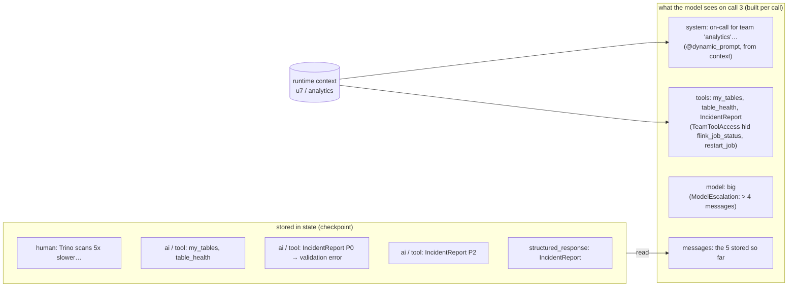
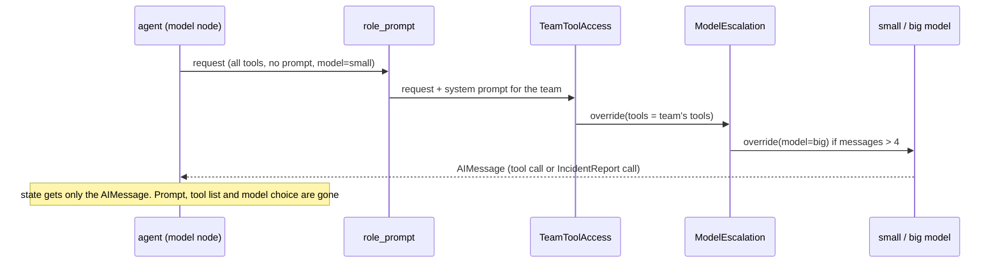
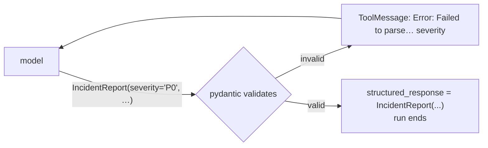
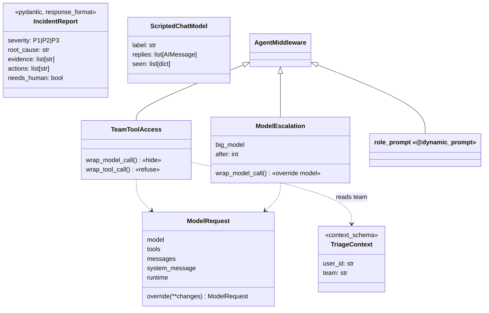

# Ch 13 — Context engineering and structured output

Triage of "Trino scans on `sales.orders` are 5x slower" for two callers. Each model call gets a **prompt and tool list built for that caller**. Long investigations **escalate to a bigger model**. The run ends with a validated **`IncidentReport`** object. Runs anywhere: scripted models (`sim/scripted_model.py`) replay the replies and **record what they were shown**. Add `--ollama` for `small_llm` → `llm`.

## Concept

- **Context engineering** = controlling exactly what the model sees on **each call**: system prompt, tools, messages, the model itself. In `create_agent` you do it in middleware.
- `@dynamic_prompt` builds the system prompt per call (here from `runtime.context.team`). The prompt is **never stored** in state: the checkpoint holds only human / ai / tool messages.
- In `wrap_model_call`, `request.override(tools=..., model=..., messages=..., system_prompt=...)` returns a new request for **this call only**. State and the agent's configured tools/model don't change. (Assigning `request.tools = ...` still works but raises a `DeprecationWarning`.)
- **Hiding is not forbidding.** Removing a tool from the model's list is context; the `tools` node can still run it if the model names it anyway. `TeamToolAccess` does both: hide (`wrap_model_call`) and refuse (`wrap_tool_call`).
- **Structured output:** `response_format=...` puts a validated object in `result["structured_response"]`.
  - `ToolStrategy(Schema)`: adds a tool named after the schema; the model "calls" it with the fields. Works with any tool-calling model. Validation errors go back to the model as a ToolMessage and it retries (`handle_errors=True`, the default).
  - `ProviderStrategy(Schema)`: the provider's native JSON-schema mode.
  - Plain `response_format=Schema` = auto: `ProviderStrategy` only if the model's profile says it supports it (some OpenAI / Anthropic / xAI models). **`ChatOllama` has no profile, so auto gives `ToolStrategy`.**
- The schema tool is added **after** your middleware has filtered the tools, so a tool filter can't hide it by accident.

## Files

| File | What |
| --- | --- |
| `triage_report.py` | `IncidentReport`, `role_prompt` (`@dynamic_prompt`), `TeamToolAccess`, `ModelEscalation`, `build_agent()`; demo for an analytics and a streaming caller |
| `triage_tools.py` | `TriageContext`, 4 tools (`my_tables` reads context), `TEAM_TOOLS` policy |
| `sim/scripted_model.py` | `ScriptedChatModel`: replays replies; logs model label, system prompt, tool names, message count per call |
| `sim/lakehouse.py` | Fake team ownership, table health, Flink job status, recorded restarts |
| `test_triage_report.py` | Per-call view + escalation + retried report; hidden tool is also refused |

## Diagrams

**What the model sees vs what is stored** (caller u7, team analytics)



**One call through the middleware stack**



**Structured output with `ToolStrategy`**



**Classes**



## Run it

```bash
uv run python -m chapters.ch13_context_output.triage_report            # anywhere
uv run python -m chapters.ch13_context_output.triage_report --ollama   # on the Ollama machine
uv run pytest chapters/ch13_context_output
```

Look for:
- analytics sees `['my_tables', 'table_health', 'IncidentReport']`, streaming sees all four tools plus `IncidentReport`;
- `model=small, small, big, …`: the switch happens on the third call;
- a different system prompt per team, but `stored in state` has no system message;
- for analytics, `structured-output retry: Error: Failed to parse…` (the scripted big model first sends `severity='P0'`), then a valid `IncidentReport(severity='P2', …)`.

With `--ollama`, `small_llm` and `llm` are the same model unless you set `SMALL_LLM_MODEL` (e.g. `SMALL_LLM_MODEL=ollama:qwen3.5:2b`). The escalation still happens, but you only see it in the model name if they differ.

## Break it

Checked against langchain 1.4.9, scripted models:

| Change | What happens | Lesson |
| --- | --- | --- |
| Delete `TeamToolAccess.wrap_tool_call`, and script the analytics model to call `restart_job` | The restart **runs** (`restarts: ['orders-enricher@8']`) although the model was never shown the tool | Hiding a tool is context, not security. Enforce on the tool side |
| `ToolStrategy(IncidentReport, handle_errors=False)` | `StructuredOutputValidationError: … severity …` ends the run | The default sends the error back to the model to fix |
| `response_format=IncidentReport` (no strategy) | Same result: auto picked `ToolStrategy` for a model with no profile | Auto only uses provider-native mode when the model profile says it can |
| Call `invoke(...)` without `context=` | `AttributeError: 'NoneType' object has no attribute 'team'` in `role_prompt` | Context is required input, not state |
| In `wrap_model_call`, assign `request.tools = [...]` instead of `override` | Works, but `DeprecationWarning: Direct attribute assignment to ModelRequest.tools is deprecated` | `override` gives a new request and leaves the original untouched |

**Try on the Ollama machine (`--ollama`):**

| Change | Expect |
| --- | --- |
| Run it as is | A 4B model may skip `my_tables` or call `flink_job_status` with a guessed job. It should still end with an `IncidentReport`, maybe after a validation retry |
| `response_format=ProviderStrategy(IncidentReport)` | Ollama's native JSON-schema mode instead of the tool trick. May fail or be ignored with tools bound. Compare it with `ToolStrategy` |
| Remove `role_prompt` | No "return an IncidentReport" instruction: more validation retries, or the model answers in plain text first |
