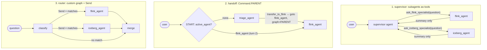
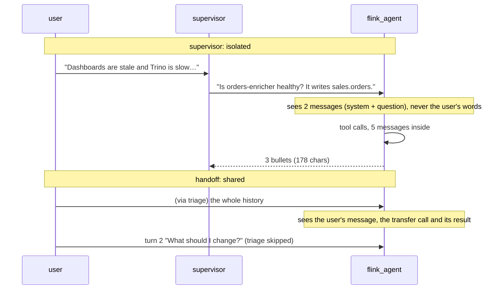
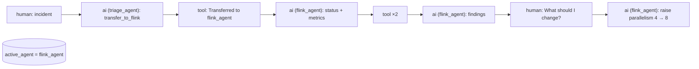
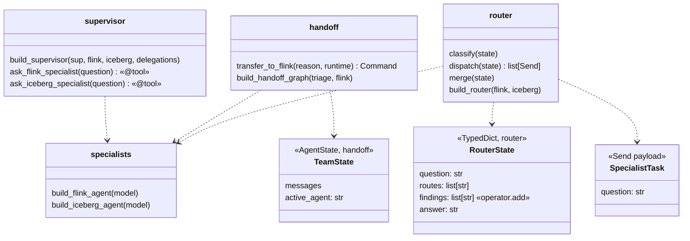

# Ch 14 — Multi-agent patterns

One incident ("dashboards are stale **and** Trino is slow on `sales.orders`") solved by a Flink specialist and an Iceberg specialist, wired three ways: **supervisor** (subagents as tools), **handoff** (`Command.PARENT`) and **router** (custom graph + `Send`). Runs anywhere: scripted models replay each agent's replies and **record what each agent saw**. Add `--ollama` to use the real LLM.

## Concept

| Pattern | How | Context | When |
| --- | --- | --- | --- |
| **Subagents as tools** (supervisor) | Each specialist is wrapped in a `@tool`; a supervisor agent calls them | **Isolated.** The specialist sees only the question; the supervisor sees only the reply | Default. Easy to trace, keeps the supervisor's context small |
| **Handoff** | A tool returns `Command(goto="flink_agent", graph=Command.PARENT)` | **Shared.** One message history, passed on | The specialist should take over the conversation (follow-ups go to it) |
| **Router** | Classify once, then `Send` to one or more specialists in parallel; merge | Each specialist gets the question only | Distinct domains, single-hop questions; cheap, predictable |
| **Custom graph** | Agents are nodes in your own `StateGraph` (the router is one) | You decide per edge | Fixed pipelines: plan, then execute, then verify |

- The real question in every pattern is **context**: what each agent sees, and what comes back. A subagent returns its **summary** (here 178 chars), not its history (1,302 chars as a string, 5 messages).
- Give each specialist a narrow toolset and a sharp tool **description**: the supervisor routes on descriptions.
- **Handoff mechanics** (langgraph 1.2.20 / langchain 1.4.9):
  - `graph=Command.PARENT` means "leave my subgraph (the triage agent) and go to `flink_agent` in the parent graph".
  - The update must carry **both** the AIMessage that called the transfer tool and its ToolMessage, so the shared history stays a valid call/result pair.
  - `add_node("triage_agent", agent, destinations=("flink_agent",))` only tells the **drawing** where a node can jump.
  - Store `active_agent` in state and route `START` on it, so the next turn goes straight to whoever owns the conversation.
- Specialists are compiled without a checkpointer. In the handoff graph they inherit the parent's (Ch 9).

## Files

| File | What |
| --- | --- |
| `specialists.py` | `INCIDENT`, 3 tools, `build_flink_agent()`, `build_iceberg_agent()` |
| `supervisor.py` | `build_supervisor()`: `ask_flink_specialist` / `ask_iceberg_specialist` tools wrap the specialists; demo prints what each delegation cost |
| `handoff.py` | `TeamState(active_agent)`, `transfer_to_flink` (`Command.PARENT`), `build_handoff_graph()`; two-turn demo |
| `router.py` | `classify` (keywords), `dispatch` (`Send`), `merge`; `build_router()`; three questions |
| `sim/scripted_model.py` | Replays replies; logs message count and the first user message per call |
| `sim/scripts.py` | Canned replies for each agent |
| `sim/platform.py` | Fake Flink and Iceberg data for the incident |
| `test_multi_agent.py` | Supervisor isolates context; handoff shares history and keeps the thread; router dispatch |

## Diagrams

**The three patterns**



**Who sees what**



**Handoff state on the thread**



**Classes**



## Run it

```bash
uv run python -m chapters.ch14_multi_agent.supervisor     # anywhere (--ollama for the real LLM)
uv run python -m chapters.ch14_multi_agent.handoff
uv run python -m chapters.ch14_multi_agent.router
uv run pytest chapters/ch14_multi_agent
```

Look for:
- `supervisor`: each specialist "ran 4–5 messages inside, returned ~160 chars", and the supervisor's state is `['human', 'ai', 'tool', 'tool', 'ai']`. Both delegations ran in one step, in parallel.
- `handoff`: `ai triage_agent calls ['transfer_to_flink']`, then `flink_agent` messages in the same history, `active_agent = flink_agent`, and in turn 2 `triage=1`: triage was skipped.
- `router`: routes `['flink_agent', 'iceberg_agent']`, then `['flink_agent']`, then `[]` → "escalate to a human".

## Break it

Checked against langgraph 1.2.20 / langchain 1.4.9, scripted models:

| Change | What happens | Lesson |
| --- | --- | --- |
| `transfer_to_flink` without `graph=Command.PARENT` | Warning `wrote to unknown channel branch:to:flink_agent, ignoring it` on every step, then `GraphRecursionError` | Inside the agent subgraph there is no `flink_agent` node; `PARENT` targets the outer graph |
| Leave `transfer_call` out of the update | No error, but the history has a `ToolMessage` with no AIMessage calling it (`human, tool, ai…`) | Broken call/result pairs: many providers reject that history on the next call |
| Drop `destinations=` from `add_node("triage_agent", ...)` | Runs the same, but the drawn graph has no `triage_agent → flink_agent` edge | `destinations` is for the drawing; `Command` does the routing |
| Route `START` straight to `triage_agent` (ignore `active_agent`) | Turn 2 goes through triage again: `triage calls 2` and another transfer | Handoff ownership must be stored in state and used for routing |
| In `delegate`, return `str(result["messages"])` instead of the last reply | The supervisor gets 1,302 chars per delegation instead of 178 | The summary is the isolation; full traces bloat the supervisor's context |

**Try on the Ollama machine (`--ollama`):**

| Change | Expect |
| --- | --- |
| Run `supervisor --ollama` | The 4B model may delegate only once, or ask both specialists the full incident text. Watch what each specialist was asked |
| Make both tool descriptions vague ("Ask a specialist.") | Wrong or random delegation: the supervisor routes on descriptions |
| Run `handoff --ollama` | Triage may answer by itself instead of transferring. A stricter `TRIAGE_PROMPT` or `tool_choice` fixes it |
