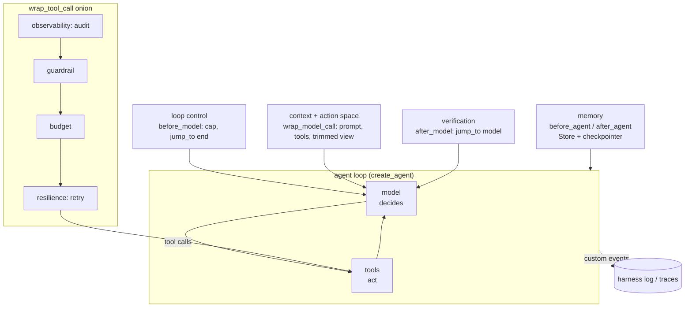
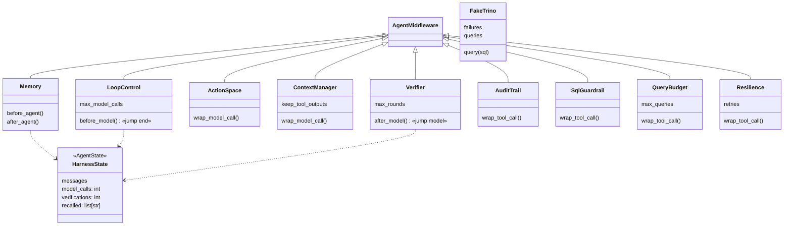

# Ch 15 — Harness anatomy, mapped to LangGraph

**The model decides; the harness is everything else** that keeps those decisions safe, bounded, observable and correct. This chapter builds one small agent for "Trino is slow on `sales.orders`" in which each harness component is a short middleware. Each component reports what it did to the `custom` stream, so a run prints a **harness log**. In the scripted run all nine components act at least once: a retry, a policy block, a budget refusal, a rejected answer, and memory across threads. Runs anywhere; `--ollama` for the real LLM.

## Concept

| Component | Question it answers | Here (`harness_components.py`) | Hook | Built-in / primitive alternative |
| --- | --- | --- | --- | --- |
| Loop control | When do we stop? | `LoopControl`: model-call cap counted in state | `before_model` + `jump_to: end` | `ModelCallLimitMiddleware`, `recursion_limit`, conditional edges |
| Action space | What can it do? | `ActionSpace`: reports the tools of this call | `wrap_model_call` | tools / `ToolNode`, per-call filtering (Ch 13), `LLMToolSelectorMiddleware` |
| Context management | What does it see each step? | `ContextManager`: recalled memory in the prompt, old tool outputs cleared from **the view** | `wrap_model_call` + `override` | `SummarizationMiddleware`, `ContextEditingMiddleware`, filesystem offload (Ch 17) |
| State and memory | What does it remember? | `Memory`: Store recall at start, save at end; thread state via checkpointer | `before_agent` / `after_agent` | checkpointer (thread), `Store` (cross-thread, Ch 6) |
| Guardrails and policy | What must it never do? | `SqlGuardrail`: write SQL refused | `wrap_tool_call` (no `handler()`) | `PIIMiddleware`, `HumanInTheLoopMiddleware`, `interrupt` (Ch 8) |
| Resilience | What if a step fails? | `Resilience`: retry, then report the error to the model | `wrap_tool_call` (calls `handler()` again) | `ToolRetryMiddleware`, `ModelRetryMiddleware`, `ModelFallbackMiddleware`, `RetryPolicy`, durable execution |
| Budgets | How much may it spend? | `QueryBudget`: max Trino queries per thread, counted from state | `wrap_tool_call` | `ToolCallLimitMiddleware`, counters in state (Ch 16) |
| Verification | Is the answer right? | `Verifier`: the answer must quote a figure from the evidence, else back to the model | `after_model` + `jump_to: model` | a verifier node, evaluator-optimizer loop (Ch 16) |
| Observability | What happened, and why? | `AuditTrail` + the `custom` event stream itself | outermost `wrap_tool_call` | LangSmith / Phoenix traces (`PHOENIX_TRACING=true`), stream modes (Ch 7) |

- **Composition vs explicit graph.** Here the harness is `create_agent` + middleware: fast and idiomatic, and it's what Deep Agents does. Ch 16 builds the same components as an explicit `StateGraph` for full control over the loop.
- **Counters live in state**, not in Python attributes: `model_calls` and `verifications` are `HarnessState` keys, and the query budget is counted from the messages. They survive a resume and stay per thread.
- **Order is part of the design** (Ch 12): tool wrappers run audit → guardrail → budget → retry, outer to inner. Audit is outermost so it sees refusals; retry is innermost so it only repeats the real call.
- **Components interact.** Verification protects memory: an unverified answer would be stored and recalled on the next thread. Loop control without a forced answer ends the run with no answer at all (Ch 16 fixes that).

## Files

| File | What |
| --- | --- |
| `harness_components.py` | `HarnessState` + one middleware per component, each emitting `{"component", "text"}` |
| `harness_map.py` | `run_trino_query`, `harness()` (the ordered stack), `build_agent()`, two-thread demo, component checklist |
| `sim/scripted_model.py` | Replays replies (fresh tool-call ids) |
| `sim/trino.py` | `FakeTrino` over Iceberg metadata tables; fails N times; records queries |
| `test_harness_map.py` | All components act and DELETE never runs; only the verified answer is stored and recalled |

## Diagrams

**Harness anatomy: the loop in the middle, components around it**



**One run, as the harness log shows it** (run 1, scripted)

```mermaid
sequenceDiagram
  participant H as harness
  participant M as model
  participant T as Trino
  H->>H: memory: recalled 0
  M->>H: query $snapshots
  H->>T: attempt 1 → 503
  H->>T: attempt 2 → ok (resilience)
  M->>H: DELETE FROM sales.orders…
  H-->>M: BLOCKED (guardrail; Trino never called)
  M->>H: query $files → ok
  M->>H: query $partitions
  H-->>M: Budget exhausted (3 used)
  Note over H: context: old tool outputs cleared from the model's view
  M->>H: "Probably bad partitioning."
  H-->>M: verifier: cite the figures (jump_to model)
  M->>H: "1,240 snapshots … 38% < 16 MB …"
  H->>H: verification accepted → memory saved (resolutions, INC-1)
```

**Classes**



## Run it

```bash
uv run python -m chapters.ch15_harness_anatomy.harness_map            # anywhere
uv run python -m chapters.ch15_harness_anatomy.harness_map --ollama   # on the Ollama machine
uv run pytest chapters/ch15_harness_anatomy
```

Look for: every line tagged with its component, `Trino really ran: 3 queries (incl. the failed attempt)` although the model asked for 4 (one failed and was retried, two were refused), `model_calls=6`, run 2 starting with `recalled 1 past resolution(s)`, and ✔ on all nine components.

## Break it

Checked against langchain 1.4.9 / langgraph 1.2.20, scripted model:

| Change | What happens | Lesson |
| --- | --- | --- |
| `LoopControl(max_model_calls=4)` | The run ends after the budget refusal with **no answer**; `Memory` saves `"Budget exhausted: 3 queries. Answer now."` as the resolution | A hard stop needs a **forced final answer** (Ch 16), or later components get junk |
| `Verifier(max_rounds=0)` | `"Probably bad partitioning."` is accepted and stored in the Store; the next thread would recall it | Verification guards memory, not just the reply |
| Move `AuditTrail()` to the end of `harness()` (innermost) | 2 audit records instead of 4: the blocked DELETE and the budget refusal are missing | Observability goes outermost |
| Call `create_agent(...)` without `store=` (keep the `Memory` middleware) | `AttributeError: 'NoneType' object has no attribute 'search'` in `Memory.before_agent` | Cross-thread memory needs a Store |
| Remove `Resilience` | `ConnectionError: Trino coordinator 503` crashes the run | A tool exception is fatal without a resilience layer (Ch 4) |
| `trino.FakeTrino(failures=5)` | 3 attempts, then `giving up, telling the model`; the model gets `Tool failed after 3 attempts.` | Retry, then degrade gracefully |

**Try on the Ollama machine (`--ollama`):**

| Change | Expect |
| --- | --- |
| Run as is | The model may never try DELETE (the guardrail stays quiet) or may stop before the budget. The log shows which components it needed |
| `QueryBudget(max_queries=1)` | It must answer from one query; watch whether the verifier then has enough figures |
| `PHOENIX_TRACING=true` with a local Phoenix server | Every model and tool call as a trace span: the observability component, outside the process |
