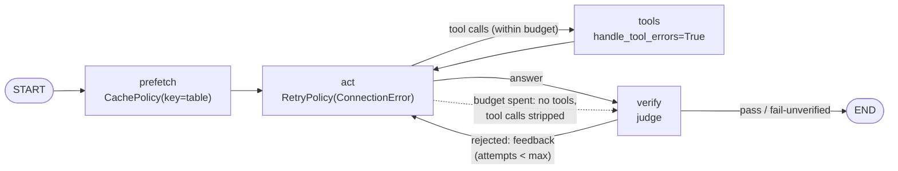
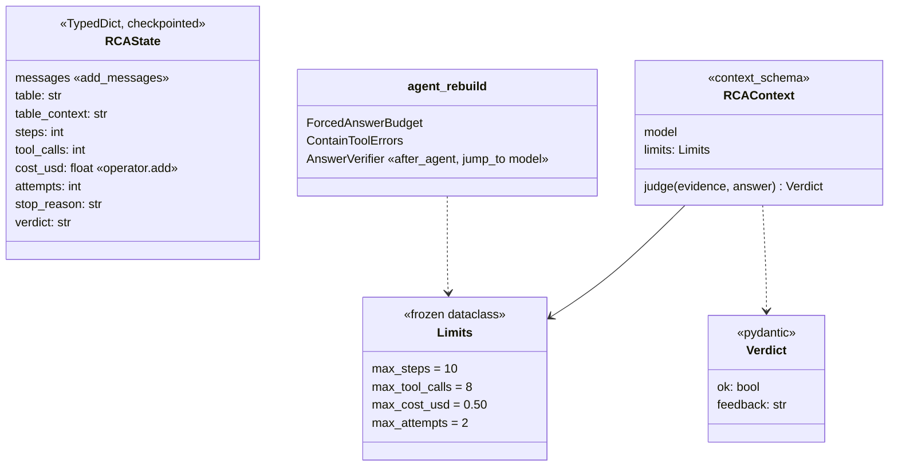

# Ch 16 — A custom harness from scratch

The Ch 15 components as an **explicit `StateGraph`** for "orders-enricher lags and dashboards are stale". The graph has:
- budgets in state (steps, tool calls, cost);
- node-level retries for a flaky model API, and contained tool errors for a flaky Trino;
- a cached metadata prefetch;
- a verifier loop with feedback, and a forced final answer when a budget runs out.

Exercise 3 then rebuilds the same harness with `create_agent` + middleware and compares them on the same script. Runs anywhere: a scripted model plus a rule-based judge; `--ollama` uses the LLM for both.

## Concept

- **Topology:** `START → prefetch → act ⇄ tools`, `act → verify → (act with feedback | END)`. `act` and `verify` route with `Command[Literal[...]]` (Ch 3).
- **Budgets live in state** (`steps`, `tool_calls`, `cost_usd`, `attempts`): checkpointed, visible in every stream update, they survive a resume. `cost_usd` has an `operator.add` **reducer**, so each `act` adds only its own cost (from `usage_metadata`).
- **Forced answer:** when a budget is spent, `act` calls the model **without tools** and with "Budget exhausted. Answer now." It also **strips any tool calls** from the reply. The harness guarantees the stop, not the model.
- `RetryPolicy(max_attempts=3, initial_interval=0.05, retry_on=ConnectionError)` on `act` re-runs the node when the model API fails. No retry code of your own, and the failed attempt writes nothing to state.
- `ToolNode(TOOLS, handle_tool_errors=True)` turns a tool exception into an error `ToolMessage`. The model sees it and retries the query.
- `CachePolicy(ttl=300, key_func=...)` + `compile(cache=InMemoryCache())` memoises `prefetch` **across threads**. The key matters: the default key hashes the whole node input, which includes messages with fresh random ids, so it never hits. A cache hit shows in `updates` as `"__metadata__": {"cached": True}`.
- **Verifier loop** (evaluator-optimizer): `verify` judges evidence vs answer. A rejection adds `Reviewer feedback: …` as a HumanMessage and goes back to `act`, at most `max_attempts` times. Then it ends as `fail-unverified`.
- `recursion_limit=50` stays as the outer safety net.

**Graph vs `create_agent` (exercise 3)**

| Harness piece | Explicit graph (`rca_harness`) | `create_agent` (`agent_rebuild`) |
| --- | --- | --- |
| Step / tool / cost budget + forced answer | counters in state, checked in `act` | `ForcedAnswerBudget.wrap_model_call` (derives counts from messages) + `ModelCallLimitMiddleware` as a backstop |
| Model API retry | `RetryPolicy` on the `act` node | `ModelRetryMiddleware` |
| Tool error containment | `ToolNode(handle_tool_errors=True)` | `ContainToolErrors.wrap_tool_call` |
| Verifier loop | `verify` node → `Command(goto="act")` | `AnswerVerifier.after_agent` + `jump_to: "model"` |
| Cached prefetch | `CachePolicy` on a node | no node to cache; would need your own cache in a hook |
| What you see in the graph | 4 nodes you named | `model`, `tools` + middleware nodes |

## Files

| File | What |
| --- | --- |
| `rca_harness.py` | `RCAState`, `Limits`, `RCAContext`, `rule_judge` / `llm_judge`, nodes `prefetch` `act` `verify`, `build_harness()`; demo: flaky run (exercise 1) and cost-budget run (exercise 2) |
| `agent_rebuild.py` | Exercise 3: `ForcedAnswerBudget`, `ContainToolErrors`, `AnswerVerifier`, `build_agent()`; side-by-side comparison |
| `rca_tools.py` | `flink_job_status`, `taskmanager_metrics`, `run_trino_query` |
| `sim/scripted_model.py` | Replays replies; a reply can be an Exception (flaky API); every reply carries token usage |
| `sim/platform.py` | Flink data, `FakeTrino(fail_every=N)`, `FakeCatalog` counting metadata loads |
| `test_rca_harness.py` | Recovery + verify + cache; cost budget forces a tool-free answer; the rebuild gives the same answer |

## Diagrams

**The harness graph, with its budget exits**



**Run 1: flaky model, flaky Trino, vague first answer**

```mermaid
sequenceDiagram
  participant A as act
  participant T as tools
  participant V as verify
  Note over A: model API 503 → RetryPolicy re-runs act
  A->>T: flink_job_status + taskmanager_metrics
  A->>T: query $snapshots → ok
  A->>T: query $files → 503 → error ToolMessage
  A->>T: query $files again → ok
  A->>V: "orders-enricher is struggling."
  V-->>A: feedback: cite a figure; give a concrete action
  A->>V: "backpressure HIGH… heap=92%… scale to parallelism 8"
  V-->>V: pass (attempts=2, steps=6, model calls=7)
```

**State**



## Run it

```bash
uv run python -m chapters.ch16_custom_harness.rca_harness            # anywhere
uv run python -m chapters.ch16_custom_harness.rca_harness --ollama   # LLM actor + LLM judge
uv run python -m chapters.ch16_custom_harness.agent_rebuild          # exercise 3 comparison
uv run pytest chapters/ch16_custom_harness
```

Look for:
- run 1: the `run_trino_query: error — …503` line followed by a successful retry, `verify: rejected … Revise.` then `pass`, and `model calls: 7 for 6 act steps`;
- run 2: `+$0.013` per step, `⚠ forced (cost)` on step 4, and a forced answer whose tool call was stripped;
- `prefetch (cache hit)` on the second thread and `catalog metadata scans for 2 threads: 1`;
- in `agent_rebuild`: the same verdict, verify rounds, model calls and final answer for both builds.

With `--ollama`, the pretend prices still apply to ChatOllama's real `usage_metadata` token counts.

## Break it

Checked against langgraph 1.2.20 / langchain 1.4.9, scripted model:

| Change | What happens | Lesson |
| --- | --- | --- |
| `CachePolicy(ttl=300)` with no `key_func` | 2 catalog scans for 2 threads with the same question | The default key hashes the whole input; message ids differ per run |
| `key_func=lambda s: s["table"]` | `KeyError: 'table'` from `get_graph()`: drawing calls the key function on an empty state. Returning `None` → `TypeError: object supporting the buffer API required` | The key function must handle `{}` and return a string |
| `ToolNode(TOOLS)` (no `handle_tool_errors`) | `ConnectionError: Trino coordinator 503` crashes the run | Contain tool errors, let the model react |
| Remove the `RetryPolicy` from `act` | `ConnectionError: model API 503` crashes the run | Transient model failures need node-level retry |
| Keep the tool calls in the forced answer (don't strip) | `act → tools → act…` never stops → `GraphRecursionError` (limit 50) | The harness must guarantee the stop |
| `cost_usd: float` (no reducer) | Cost stays at `$0.013` (overwritten each step); the cost budget never trips and the run goes on until `stop_reason='tool calls'` at step 8 | A running total needs a reducer (Ch 2) |

**Try on the Ollama machine (`--ollama`):**

| Change | Expect |
| --- | --- |
| Run as is | The LLM judge is stricter or looser than `rule_judge`; compare verdicts. A 4B judge may pass weak answers |
| `Limits(max_tool_calls=2)` | A forced answer after the first tool round; check whether it still cites evidence |
| `fail_every=1` (every Trino query fails) | The model sees only errors; watch whether it answers from Flink evidence alone or the verifier ends it as `fail-unverified` |
