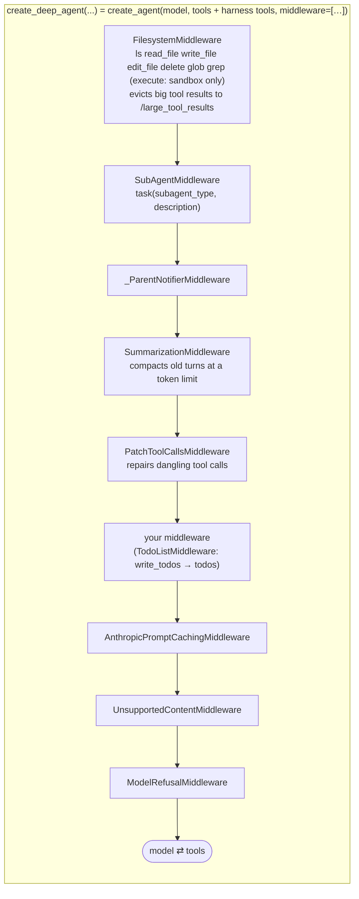
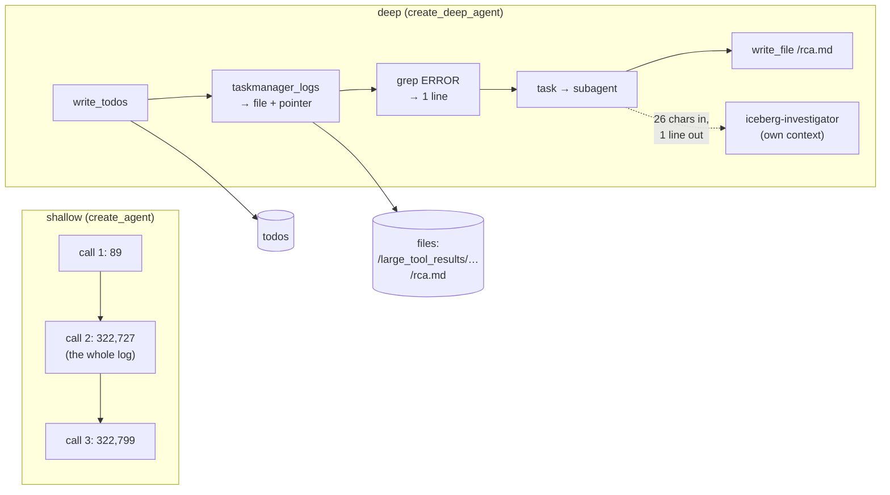
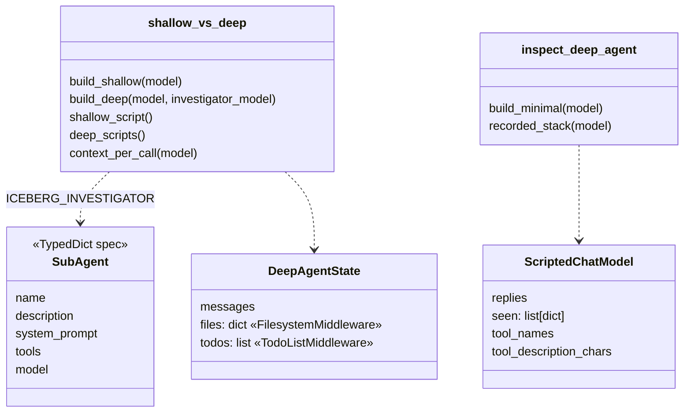

# Ch 17 — Deep Agents: concepts

A shallow tool loop (Ch 4, Ch 11) breaks down on long tasks:
- its context fills with raw tool output;
- it loses the plan;
- it can't split work.

**Deep Agents** (`deepagents`) is LangChain's opinionated **harness** on top of `create_agent` that fixes this with a fixed middleware stack. This chapter takes a minimal deep agent apart (`inspect_deep_agent.py`). It then runs one incident through a shallow loop and a deep agent and **measures the context** each model call carried (`shallow_vs_deep.py`). Runs anywhere with scripted models; `--ollama` for the real LLM.

## Concept

| Pillar | Mechanism | Harness problem solved | Seen in this chapter |
| --- | --- | --- | --- |
| Planning | `write_todos` (`TodoListMiddleware`) | The plan lives in state (`todos`) and survives context churn | **Opt-in** on 0.7+: without it `write_todos is not a valid tool` |
| Filesystem | `ls`, `read_file`, `write_file`, `edit_file`, `delete`, `glob`, `grep` over a **backend** (default: state, `files` key) | **Context offload**: tool results over ~20k tokens are saved to `/large_tool_results/<id>`, and the model gets a pointer + preview | 322,638-char log → ~1.7k-char pointer; `grep` finds the OOM line |
| Subagents | `task(subagent_type, description)` spawns an isolated agent | **Context isolation**: the subagent burns tokens, the parent gets one reply | The subagent saw 26 chars: only its task description |
| Detailed prompt | Built-in system prompt + **long tool descriptions** | Behaviour from instructions, not code | 1,486 chars of system prompt + 9,087 chars of tool descriptions (`write_todos` alone: 3,873) |
| Memory and skills | `memory=[AGENTS.md…]`, `skills=[dirs]` | Procedural memory without a giant prompt | Ch 19 |
| Steering | `interrupt_on`, `permissions`, `SummarizationMiddleware`, prompt caching | Safety and cost at long horizons | Summarization and caching are in the default stack; Ch 18–19 |

- The result is still a **compiled LangGraph graph** (`create_deep_agent` ends with a `create_agent(...)` call), with `recursion_limit` preset to 9,999. Checkpoints, streaming and HITL from Part 1 apply unchanged.
- The default stack, outer → inner: `FilesystemMiddleware`, `SubAgentMiddleware`, `_ParentNotifierMiddleware`, `SummarizationMiddleware`, `PatchToolCallsMiddleware`, your middleware (here `TodoListMiddleware`), `AnthropicPromptCachingMiddleware`, `UnsupportedContentMiddleware`, `ModelRefusalMiddleware`.
- A middleware you pass with the **same name** as a core one **replaces** it (e.g. your own `FilesystemMiddleware(...)` settings).
- `execute` (shell) is registered, but it is **not offered to the model** unless the backend is a sandbox (Modal, Daytona, Runloop, …). Never give a deep agent a real shell on your laptop.
- A `general-purpose` subagent always exists next to yours. A subagent spec without `model` uses the parent's model.

## Files

| File | What |
| --- | --- |
| `inspect_deep_agent.py` | `build_minimal()`; `recorded_stack()` captures the middleware list passed to `create_agent`; prints versions, stack, tools registered vs offered, prompt sizes, state keys, nodes |
| `shallow_vs_deep.py` | `build_shallow()` (`create_agent`), `build_deep()` (`create_deep_agent` + `iceberg-investigator` subagent); scripts; context-per-call comparison |
| `oncall_tools.py` | `taskmanager_logs` (huge), `table_health` (small) |
| `sim/scripted_model.py` | Replays replies; records system / conversation chars per call and tool description size |
| `sim/platform.py` | A 322 KB TaskManager log with a few OOM errors; table health |
| `test_deep_agents.py` | Stack + offered tools; offload and isolation keep context small |

## Diagrams

**The deep-agent middleware stack around the `create_agent` loop**



**Context offload and isolation: what each call carries** (real numbers from `shallow_vs_deep`)



Totals over the run: shallow **645,615** chars sent to the model; deep **9,955** (main + subagent).

**Classes**



## Run it

```bash
uv run python -m chapters.ch17_deep_agents.inspect_deep_agent     # version check + anatomy
uv run python -m chapters.ch17_deep_agents.shallow_vs_deep        # anywhere
uv run python -m chapters.ch17_deep_agents.shallow_vs_deep --ollama
uv run pytest chapters/ch17_deep_agents
```

Recorded versions: **deepagents 0.7.34, langchain 1.4.9, langgraph 1.2.20**.

Look for: `not offered: ['execute']`; `shallow: ['89', '322,727', '322,799']` vs `deep: ['89', '291', '2,038', …]`; `grep → 501: … OutOfMemoryError …`; `/rca.md` in `files`.

## Break it

Checked against deepagents 0.7.34, scripted models:

| Change | What happens | Lesson |
| --- | --- | --- |
| Drop `TodoListMiddleware()` from `build_deep` | `Error: write_todos is not a valid tool, try one of [ls, read_file, …]`; `todos` stays `None` | Planning is opt-in on 0.7+ |
| Add `FilesystemMiddleware(tool_token_limit_before_evict=None)` to `middleware=` | Replaces the core one: no eviction, the deep agent's context jumps to `322,929` chars per call, like the shallow loop | Offload is the eviction threshold; same-named middleware replaces the default |
| `task(subagent_type="flink-investigator", …)` | `We cannot invoke subagent flink-investigator because it does not exist, the only allowed types are general-purpose, iceberg-investigator` | Subagents are a closed list, plus `general-purpose` |
| Remove `"model"` from the subagent spec (scripted demo) | The subagent consumes the **main** model's script; the run goes off the rails | A spec without `model` uses the parent's model. Fine with a real LLM, but the scripts need separate models |

**Try on the Ollama machine (`--ollama`):**

| Change | Expect |
| --- | --- |
| Run as is | The shallow run sends the whole 320 KB log to a 4B model: slow, and it may hit the context limit or lose the question. The deep run should grep or read the file in pages |
| Ask without "write the RCA to /rca.md" | The model may not use files or todos at all: the pillars are offered, not forced |
| Make the subagent description vague | The model may use `general-purpose` instead of `iceberg-investigator` |
