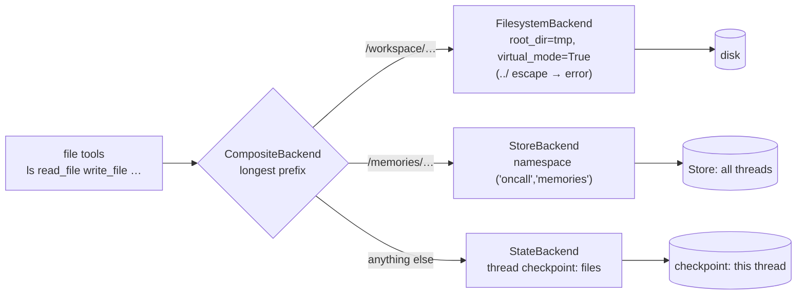
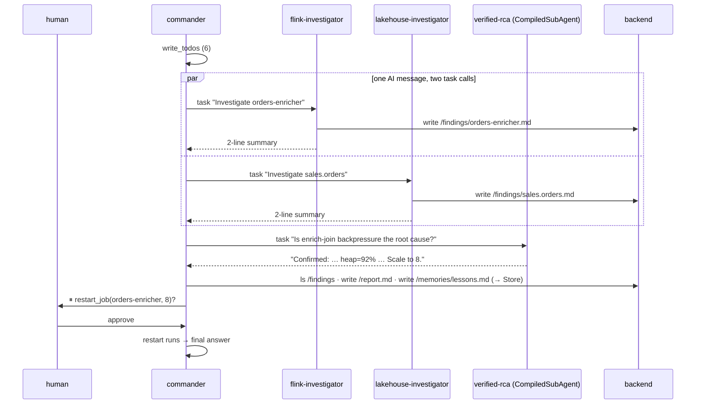
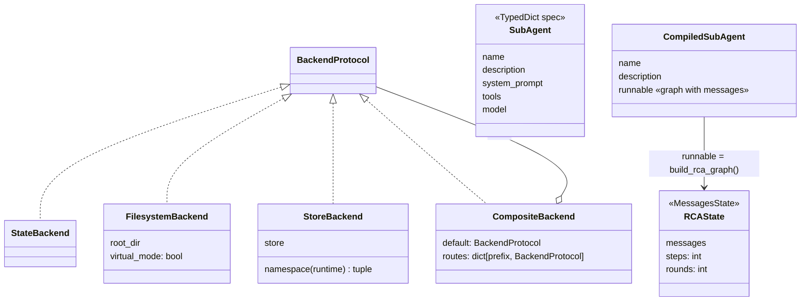

# Ch 18 — The `deepagents` API: backends, subagents, steering

An **incident commander** deep agent for INC-4211:
- plans with todos;
- runs a Flink and a lakehouse investigator **in parallel**;
- confirms the root cause with a **hand-built verified-RCA graph** plugged in as a `CompiledSubAgent`;
- writes `/report.md` and saves a lesson to `/memories/` (Store);
- **waits for a human** before `restart_job`.

A separate `backends_tour.py` shows where files actually live. Runs anywhere: one scripted model per agent (so the scripts never interleave); `--ollama` uses the real LLM everywhere.

## Concept

- **Backends decide where files live.** Pass an instance as `backend=`:

  | Backend | Lives in | Survives a new thread? | Here |
  | --- | --- | --- | --- |
  | `StateBackend()` (default) | the thread's checkpoint (`files` key) | no | `/findings/`, `/report.md` |
  | `FilesystemBackend(root_dir, virtual_mode=True)` | real disk, jailed under `root_dir` | yes | `/workspace/` → a temp dir |
  | `StoreBackend(namespace=lambda rt: (...), store=...)` | LangGraph Store | yes, shared by all threads | `/memories/` |
  | `CompositeBackend(default=..., routes={"/prefix/": ...})` | routes by **longest prefix**; the prefix is stripped (`/workspace/report.md` → `<root>/report.md`, Store key `/lessons.md`) | per route | both demos |

- `virtual_mode=True` is what jails a `FilesystemBackend`. With `False`, an absolute path like `/etc/hosts` reads your **real** disk.
- **Subagent spec** (dict): `name`, `description` (the parent routes on it), `system_prompt`, plus optional `tools`, `model`, `middleware`, `interrupt_on`, `skills`, `permissions`, `response_format`, `mode` (`"isolated"` / `"fork"`).
- **`CompiledSubAgent(name, description, runnable)`** plugs in **any compiled graph**: the parent sends the task as a HumanMessage and gets the **last message** back. The graph's state must have a `messages` key. Here it is a small Ch 16-style graph (act ⇄ tools → verify, step budget), rebuilt in this chapter as `rca_graph.py`.
- **Parallel subagents:** two `task` calls in one AI message run at the same time. Each streams in its own namespace (`tools:<id>`) with `subgraphs=True`. Their file writes land in the **parent's** `files`, because the backend is shared.
- `interrupt_on={"restart_job": True}` adds `HumanInTheLoopMiddleware`: the run pauses before the tool, and you resume with `Command(resume={"decisions": [...]})` (Ch 12).
- `memory=` and `skills=` (AGENTS.md, SKILL.md) are Ch 19.

## Files

| File | What |
| --- | --- |
| `incident_commander.py` | `subagent_specs()` (2 specs + `CompiledSubAgent`), `build_commander()`, scripted models, streamed demo with approval |
| `backends_tour.py` | `build_backend()` (State default, `/workspace/` disk, `/memories/` Store); two threads; jail-escape attempt |
| `rca_graph.py` | `build_rca_graph(model)`: compact verified-RCA graph with a `messages` key |
| `oncall_tools.py` | `flink_job_status`, `taskmanager_metrics`, `run_trino_query`, `restart_job` |
| `sim/scripted_model.py` | Replays replies, one instance per agent |
| `sim/platform.py` | Incident data; `FlinkOps` records restarts |
| `test_deepagents_api.py` | What a new thread sees per route; commander delegates, writes, and waits for approval |

## Diagrams

**CompositeBackend routing** (`backends_tour`)



**Parent → subagents → files** (`incident_commander`)



**Classes**



## Run it

```bash
uv run python -m chapters.ch18_deepagents_api.backends_tour            # anywhere
uv run python -m chapters.ch18_deepagents_api.incident_commander       # anywhere
uv run python -m chapters.ch18_deepagents_api.incident_commander --ollama
uv run pytest chapters/ch18_deepagents_api
```

Look for:
- `backends_tour`: thread INC-2 sees `No files found` for `/findings`, but still has `/workspace/report.md` and `/memories/lessons.md`; the `../` escape is refused;
- `incident_commander`: `['task→flink-investigator', 'task→lakehouse-investigator']`, two `[subagent …]` streams interleaving, `task returned: Confirmed …` from the graph subagent, `⏸ paused before restart_job` with `restarts so far: []`, then `['orders-enricher@8']`, and `Store (/memories/): ['/lessons.md']`.

## Break it

Checked against deepagents 0.7.34, scripted models:

| Change | What happens | Lesson |
| --- | --- | --- |
| `CompiledSubAgent` over a graph whose state has no `messages` key | `ValueError: CompiledSubAgent must return a state containing a 'messages' key` | The parent reads the last message; give your graph `messages` |
| `backend=FilesystemBackend(root_dir=tmp, virtual_mode=False)` and `read_file("/etc/hosts")` | The agent reads your **real** `/etc/hosts` | Without `virtual_mode=True` the agent sees the whole disk |
| Same with `virtual_mode=True` | `Error: File '/etc/hosts' not found` (it looks under `root_dir`) | The jail maps `/` to `root_dir` |
| Leave `/memories/` out of `routes` | The lesson is written to thread state; INC-2's `ls /memories` finds nothing | Cross-thread memory is a routing decision |
| Remove `checkpointer=` from `build_commander` | Pause works, resume → `RuntimeError: Cannot use Command(resume=...) without checkpointer` (Ch 8, Ch 12) | HITL needs a checkpointer |

**Try on the Ollama machine (`--ollama`):**

| Change | Expect |
| --- | --- |
| Run as is | A 4B model may run the investigators one after another instead of in parallel, or skip `verified-rca`. The stream shows what it chose |
| Give `lakehouse-investigator` a smaller model (`"model": "ollama:qwen3.5:2b"`, if pulled) | Narrow work on a cheaper model: the curriculum's cost lever |
| Make both investigator descriptions identical | The commander can't tell them apart and may send both tasks to one |
