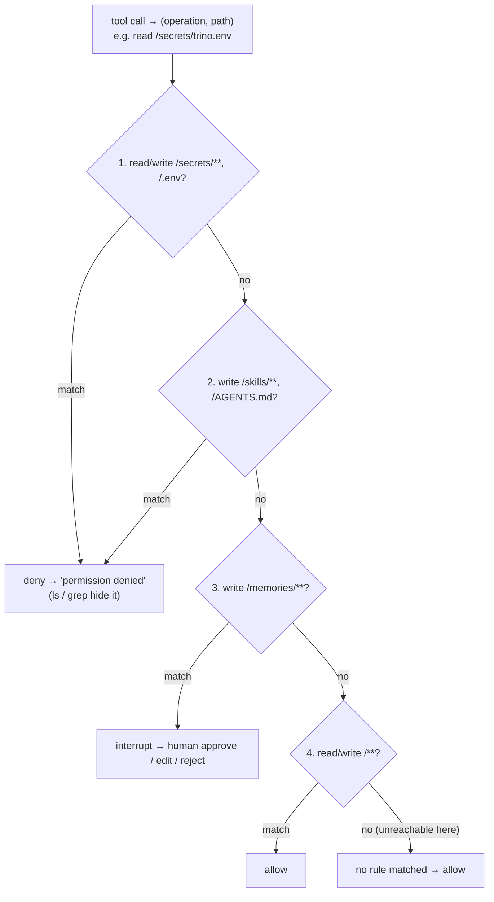
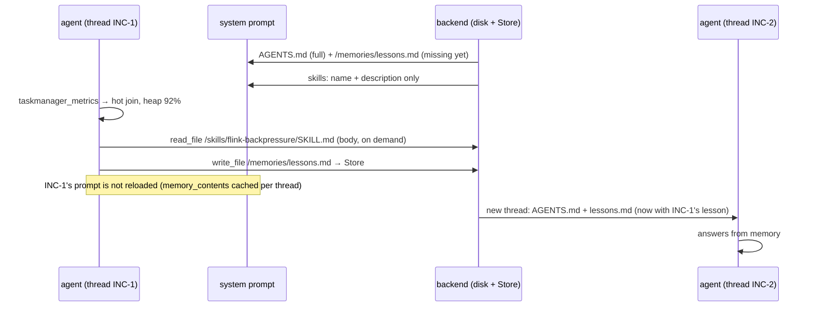
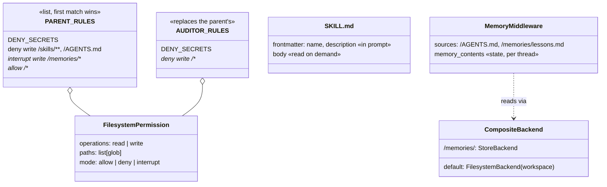

# Ch 19 — Memory, skills and permissions: production deep agents

The on-call workspace as a real folder (`oncall_ws/`): team conventions in `AGENTS.md`, runbooks as **skills**, and a fake secrets file the agent must never read. `skills_memory.py` shows what is in the prompt (and what isn't), and how a lesson from one incident reaches the next. `permissions.py` locks the workspace down with ordered rules and adds a **read-only auditor** subagent. Every run works on a fresh temp copy of `oncall_ws/`, so the repo files never change. Runs anywhere with scripted models; `--ollama` for `skills_memory`.

## Concept

- **`memory=["/AGENTS.md", "/memories/lessons.md"]`**: these files are put in the system prompt, read through the backend. They are loaded **once per thread** at the start and cached in state (`memory_contents`). A lesson written during a thread, or an edited `AGENTS.md`, reaches **new threads only**. Keep `AGENTS.md` short: it is in every call.
- **Long-term memory** = route `/memories/` to a `StoreBackend` (Postgres-backed in production) and tell the agent, in `AGENTS.md`, what to save there. It uses the file tools it already knows.
- **Skills** = progressive disclosure. `skills=["/skills/"]` puts only each `SKILL.md`'s **frontmatter** (name + description) in the prompt, with a pointer to the file. The agent `read_file`s the body when the description matches. So runbooks go in skills, not in the system prompt.
- **Permissions** = `FilesystemPermission(operations=["read"|"write"], paths=[globs], mode="allow"|"deny"|"interrupt")`, evaluated top to bottom: **first match wins**, no match = allow.
  - `deny` returns `Error: permission denied …`, and it also **hides** paths: `ls` omits `/secrets/` and `grep` skips denied files.
  - `interrupt` turns the operation into a human approval (needs a checkpointer).
- **Subagent `permissions` replace the parent's** (they are not merged). An auditor given only "deny all writes" can read the secrets the parent may not. Repeat the parent's denies, or leave `permissions` out to inherit the parent's rules.
- Permissions don't apply to sandbox backends: there, the sandbox is the boundary.
- **Async subagents** (`AsyncSubAgent`) run in the background on a LangSmith deployment. The parent launches, checks or cancels them while it keeps talking. They need a deployed server, so there is no local demo here.

## Files

| File | What |
| --- | --- |
| `oncall_ws/AGENTS.md` | Team conventions (always loaded) |
| `oncall_ws/skills/flink-backpressure/SKILL.md`, `oncall_ws/skills/iceberg-maintenance/SKILL.md` | Runbooks as skills (frontmatter + body) |
| `oncall_ws/secrets/trino.env` | **Fake** credentials the rules must protect |
| `skills_memory.py` | `build_oncall_agent()` with `memory=`, `skills=`, disk + Store backend; two-thread demo with prompt checks |
| `permissions.py` | `PARENT_RULES`, `AUDITOR_RULES`, `build_agent()`; demo of deny / hide / interrupt for parent and auditor |
| `sim/workspace.py` | `fresh_workspace()`: temp copy of `oncall_ws/` |
| `sim/scripted_model.py` | Replays replies; records the full system prompt per call |
| `sim/platform.py` | Fake Flink metrics |
| `test_memory_skills.py` | Skill bodies on demand + lesson reaches the next thread; rules for parent and auditor |

## Diagrams

**Permission rule evaluation** (`PARENT_RULES`)



**Skill loading and memory across threads**



**Classes**



## Run it

```bash
uv run python -m chapters.ch19_memory_skills.skills_memory            # anywhere
uv run python -m chapters.ch19_memory_skills.skills_memory --ollama   # does the 4B model pick the right skill?
uv run python -m chapters.ch19_memory_skills.permissions              # anywhere
uv run pytest chapters/ch19_memory_skills
```

Look for:
- `skills_memory`: `✔ AGENTS.md rule`, `✔` for both skill descriptions, `✗ flink-backpressure body (not loaded until read)`, then `skills the agent read: ['/skills/flink-backpressure/SKILL.md']`, `Store now holds: ['/lessons.md']`, and on INC-2 `✔ lesson from INC-1 is in the system prompt`;
- `permissions`: `ls → ['/AGENTS.md', '/skills/']` (no `/secrets/`), `grep → No matches found`, the auditor's write and secrets read denied, then `⏸ interrupt rule` for `/memories/lessons.md`.

## Break it

Checked against deepagents 0.7.34, scripted models:

| Change | What happens | Lesson |
| --- | --- | --- |
| `AUDITOR_RULES = [deny write /**]` (drop `DENY_SECRETS`) | The "read-only" auditor **reads `/secrets/trino.env`** | Subagent rules replace the parent's; repeat the denies |
| Auditor spec without `permissions` | It inherits `PARENT_RULES`: secrets denied, but `write_file /review.md` succeeds | Inheriting ≠ read-only |
| Move the `allow /**` rule to the top of `PARENT_RULES` | Everything is allowed: secrets readable, `ls` shows `/secrets/`, `grep` finds `/secrets/trino.env`, `AGENTS.md` edited | First match wins: specific denies go first |
| Run a second turn on thread INC-1 after it wrote the lesson | The lesson is **not** in that thread's prompt (`memory_contents` was cached on the first run) | Memory files load once per thread |

**Try on the Ollama machine (`skills_memory --ollama`):**

| Change | Expect |
| --- | --- |
| Run as is | The model should read `flink-backpressure` (not `iceberg-maintenance`) because the description matches "lag grows and checkpoints fail" |
| Make both skill descriptions vague ("Runbook.") | It reads the wrong skill, both, or neither: the description is the routing key |
| Remove the "Save durable lessons" line from `AGENTS.md` | It probably won't write `/memories/lessons.md`, and INC-2 starts with no memory |
