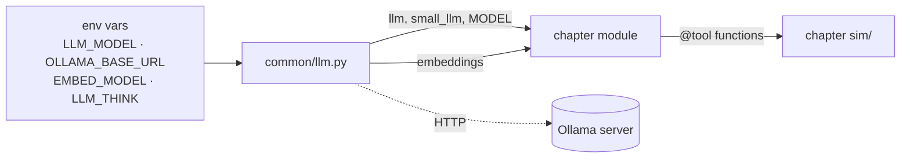
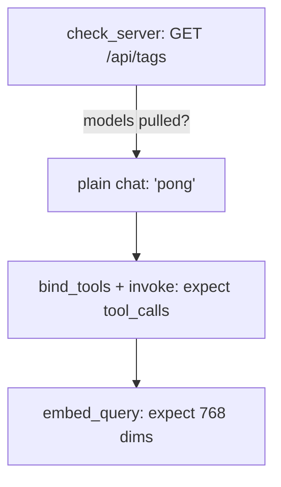
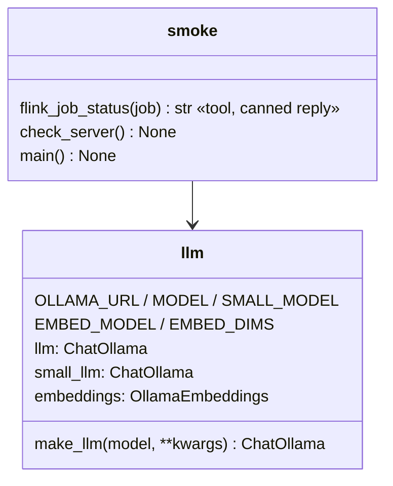

# Ch 0 — Setup & `common/`

`common/` holds only the **model config** and a **smoke check**. Nothing else is shared: each chapter brings its own simulated world in its `sim/` folder.

## Concept

- One place decides which model runs: `common/llm.py`. Chapters `from common.llm import llm, MODEL`. Swap models with env vars, not code.
- `init_chat_model("ollama:qwen3.5:4b")` returns a `ChatOllama`. LangChain/LangGraph only see the standard chat-model interface, so the same code works with any provider.
- Tools never call real Flink/Trino. Each chapter fakes what it needs in `chapters/chNN_<topic>/sim/`, following the incident story in [PLAN.md](../plan/PLAN.md#incident-story).
- `smoke.py` checks the Ollama machine is ready: models pulled, plain chat, tool calling, embeddings.

## Diagrams

**How a chapter reaches the model**



**Smoke check flow**



**Classes**



## Run it (on the Ollama machine)

```bash
ollama pull qwen3.5:4b && ollama pull nomic-embed-text
uv sync
export OLLAMA_BASE_URL=http://localhost:11434     # or the remote host
uv run python -m common.smoke                       # chat + tool call + embeddings
```

The smoke check passes when it prints `pong`, a non-empty `tool_calls` list and `dims: 768`.

## Env vars

| Var | Default | Notes |
| --- | --- | --- |
| `LLM_MODEL` | `ollama:qwen3.5:4b` | Must support tool calling (qwen3.5, llama3.1, mistral-nemo…) |
| `SMALL_LLM_MODEL` | same as `LLM_MODEL` | Used for summaries and cheap subagents |
| `OLLAMA_BASE_URL` | `http://localhost:11434` | |
| `EMBED_MODEL` / `EMBED_DIMS` | `ollama:nomic-embed-text` / `768` | Long-term memory search (Ch 6) |
| `LLM_THINK` | `false` | `true` / `false` / `default`. Thinking off is faster and cleaner for tool loops |

## Break it

- `LLM_MODEL=ollama:gemma2:2b` (no tool support) → step 2 of the smoke check fails. This is why the model choice matters for agents.
- `LLM_THINK=true` → slower; compare latency.
