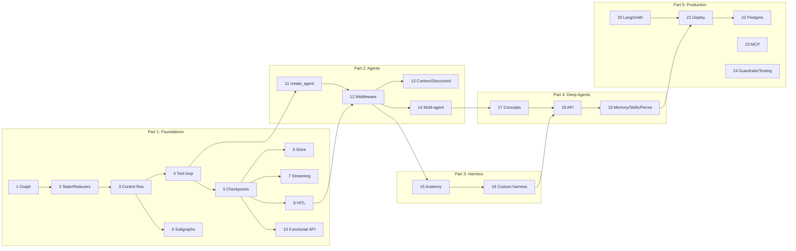

# LangGraph Learning Plan & Progress Tracker

Source curriculum: [LangGraph Curriculum](./LangGraph%20Curriculum%20From%20Graphs%20to%20Agents,%20Harnesses%20&%20Deep%20Agents.md)
Domain used everywhere: **on-call assistant for a data platform** (Iceberg, Flink, Trino, incidents).

---

## 📍 Where we are

| Field | Value |
| --- | --- |
| Current chapter | **Ch 0 — Setup** (code done; awaiting smoke run on the Ollama machine) |
| Last completed | — |
| Next up | Run `uv run python -m common.smoke` on the Ollama machine, then Ch 1 — Graph mental model |
| Last updated | 2026-11-06 |

### Progress

Status: ⬜ not started · 🟨 in progress · ✅ done (code runs on Ollama + README written)

| # | Chapter | Status | Notes |
| --- | --- | --- | --- |
| 0 | Setup & shared `common/` | 🟨 | Installed: langgraph 1.2.20, langchain 1.4.9, deepagents 0.7.34, langchain-ollama. `common/` = `llm.py` + `smoke.py` only. Smoke run pending on the Ollama machine |
| 1 | Graph mental model | ⬜ | |
| 2 | State, reducers, runtime context | ⬜ | |
| 3 | Control flow: conditional edges, `Command`, `Send` | ⬜ | |
| 4 | Tools & hand-built agent loop | ⬜ | |
| 5 | Persistence: checkpointers, threads, time travel | ⬜ | |
| 6 | Memory: short-term vs long-term `Store` | ⬜ | |
| 7 | Streaming | ⬜ | |
| 8 | Human-in-the-loop | ⬜ | |
| 9 | Subgraphs & composition | ⬜ | |
| 10 | Functional API & durable execution | ⬜ | |
| 11 | `create_agent` | ⬜ | |
| 12 | Middleware | ⬜ | |
| 13 | Context engineering & structured output | ⬜ | |
| 14 | Multi-agent patterns | ⬜ | |
| 15 | Harness anatomy | ⬜ | |
| 16 | Custom harness from scratch | ⬜ | |
| 17 | Deep Agents: concepts | ⬜ | |
| 18 | `deepagents` API | ⬜ | |
| 19 | Memory, skills, permissions | ⬜ | |
| 20 | LangSmith tracing & evals | ⬜ | |
| 21 | Deployment: Agent Server | ⬜ | |
| 22 | Postgres, durability, TTL | ⬜ | |
| 23 | MCP | ⬜ | |
| 24 | Guardrails & testing | ⬜ | |
| C1 | Capstone: Lakehouse Doctor | ⬜ | |
| C2 | Capstone: Mini Deep Agent | ⬜ | |
| C3 | Capstone: Incident Commander | ⬜ | |
| C4 | Capstone: Agent quality gate | ⬜ | |

---

## How each chapter is delivered

Each chapter is one folder (one module) with the same four parts:

```
chapters/chNN_<topic>/
├── README.md        # concept (5–8 bullets max) + mermaid diagrams (flow + class) + experiments
├── <module>.py      # concept code, runnable: `python -m chapters.chNN_<topic>.<module>`
├── sim/             # simulated world for this chapter: fake data + tool backends (optional)
├── test_<module>.py # 1–3 small tests for the deterministic parts only
└── __init__.py
```

- **Concept:** short bullets. Use a diagram wherever it explains better than prose.
- **Diagrams:** every README has a **flow diagram** (graph topology / sequence) and a **class diagram** (state schema, context, main classes). Mermaid, so it renders in the IDE and on GitHub. Update them whenever the code changes.
- **Code:** small, clearly named, commented only where the *why* is not obvious. Later chapters re-build what they need from earlier ones instead of importing across chapters, so each folder stands alone.
- **Run first:** every demo runs end to end against a local **Ollama** model. Running the code is the main way to learn.
- **Self-contained (hard rule):** each chapter runs on its own with `python -m …`. The only shared code is `common/llm.py` (model config); the only outside system is Ollama. Storage is in-memory/SQLite.
- **Simulation lives in `sim/`:** fake data, fake clients and tool backends go in the chapter's own `sim/` folder, so the main module shows only the concept. A chapter's `sim/` holds just what that demo needs, following the [incident story](#incident-story).
- **Docker only when a real system is the point** (e.g. Postgres in Ch 22, an MCP server in Ch 23): the chapter ships its own `docker-compose.yml` and README steps.
- **Tests (light):** learning code, not production. Only a few small tests per chapter, for deterministic logic (node functions, routing, reducers). No fake-LLM framework.
- **Experiments:** a "Break it" list at the end of each README (remove a reducer, drop the checkpointer, raise inside a tool…) to try out each concept by hand.

### Repo layout

```
langgraph-lab/
├── plan/PLAN.md                 # this file
├── common/
│   ├── llm.py                   # MODEL, llm, embeddings — all Ollama, overridable via env vars
│   └── smoke.py                 # Ch 0 check: chat + tool call + embeddings
├── chapters/ch01_graph_basics/ … chapters/ch24_guardrails_testing/   # each with its own sim/
├── capstones/c1_lakehouse_doctor/ …
└── pyproject.toml
```

### Concept map (how chapters build on each other)



---

## Incident story

Every chapter's `sim/` draws from the same story, so the examples feel connected even though no code is shared:

| Thing | State |
| --- | --- |
| Flink `orders-enricher` (team streaming) | lag 2.4M records · checkpoint FAILED (timeout after 10m) · backpressure HIGH on `enrich-join` · heap 92% · parallelism 4 |
| Flink `orders-sink` (streaming) / `feature-writer` (ml) | healthy |
| Iceberg `sales.orders` (analytics) | 1,240 snapshots · 412 GB · 38% small files · written by `orders-enricher` |
| Iceberg `sales.items` / `ops.events` | healthy |
| Effect | sales dashboards stale; Trino scans on `sales.orders` slow |

## Setup decisions (Ch 0)

| Issue | Decision |
| --- | --- |
| `pyproject.toml` project name is `langgraph`, so uv refuses to depend on the `langgraph` package | Rename the project to `langgraph-lab` |
| Python | Existing `.venv` (3.13.5); manage deps with `uv add` |
| Model | **Ollama** via `langchain-ollama`. `common/llm.py` reads `LLM_MODEL` (default `ollama:qwen3.5:4b`, which must support tool calling) and `OLLAMA_BASE_URL` (default `http://localhost:11434`). Where the curriculum uses a second, cheaper model, we use `SMALL_LLM_MODEL` (defaults to the same model) |
| Ch 6 uses OpenAI embeddings | Use Ollama `nomic-embed-text` (`EMBED_MODEL`) |
| Small local models are weaker at tool calling | Keep prompts and tool sets small; set `temperature=0`. If a run misbehaves, try a bigger model via `LLM_MODEL` |
| LangSmith (Ch 20/21) | Optional. Needs `LANGSMITH_API_KEY`; everything else runs fully local |
| Ch 22 needs Postgres | `docker run postgres` (pgvector image) only when we reach Ch 22 |
| API drift (deepagents planning opt-in, backend factory vs instance) | Check against the installed versions at the start of Ch 17–19; record what we find in the Notes column |

Packages: `langgraph langchain langchain-ollama deepagents langgraph-checkpoint-sqlite langgraph-checkpoint-postgres langchain-mcp-adapters langsmith "langgraph-cli[inmem]" pytest`

---

## Chapter plans

Each entry has: **Concept** (what you must leave knowing) · **Diagrams** · **Code** · **Mixes** (earlier concepts reused) · **Break it** (experiments).

### Ch 0 — Setup
- **Code:** rename project, install deps, `common/llm.py`, `common/smoke.py` (one LLM call + one tool call against Ollama).
- **Before you run:** `ollama pull qwen3.5:4b && ollama pull nomic-embed-text`.
- **Done when:** `python -m common.smoke` prints a model reply and a tool call.

### Part 1 — Foundations

#### Ch 1 — Graph mental model
- **Concept:** state machine = State + Nodes (`state → partial update`) + Edges; Pregel super-steps; `compile()`.
- **Diagrams:** triage graph topology; super-step timeline (step 1: classify → merge → step 2: assign).
- **Code:** `triage.py` — deterministic alert triage (classify → assign). Print the mermaid graph.
- **Break it:** mutate state in place; return a key not in the schema; forget an edge to `END`.

#### Ch 2 — State, reducers, runtime context
- **Concept:** overwrite vs reducer (`Annotated`); `InvalidUpdateError` on parallel writes; `add_messages`; State vs runtime `context_schema`.
- **Diagrams:** fan-out/fan-in with reducer merge; State vs Context class diagram (what gets checkpointed and what does not).
- **Code:** `table_audit.py` — parallel Iceberg checks merge `findings` (append) and `files_scanned` (sum); catalog passed as context.
- **Mixes:** Ch 1 graph building.
- **Break it:** remove `operator.add`; write a custom reducer (dedupe findings).

#### Ch 3 — Control flow
- **Concept:** conditional edge vs `Command(update, goto)` vs `Send` map-reduce; loops + `recursion_limit`.
- **Diagrams:** decision table "which one to use"; `Send` map-reduce diagram; loop with exit condition.
- **Code:** `incident_router.py` (Command), `fleet_audit.py` (Send over N tables → summarize), `retry_loop.py` (bounded loop).
- **Mixes:** Ch 2 reducers collect the `Send` results; Ch 1 triage feeds the router.
- **Break it:** set `recursion_limit=3`; drop `Literal` from the `Command` annotation and look at the drawn graph.

#### Ch 4 — Tools & the hand-built agent loop
- **Concept:** `@tool` (docstring = prompt), `bind_tools`, `ToolNode`, `tools_condition`; the model → tools → model loop.
- **Diagrams:** ReAct loop flow; sequence diagram of messages (Human → AI(tool_calls) → Tool → AI).
- **Code:** `flink_tools.py` (reused later), `agent_loop.py` — investigate a lagging Flink job.
- **Mixes:** `MessagesState` reducer (Ch 2), conditional edges and loop (Ch 3).
- **Break it:** bad docstring, tool raises an exception, `recursion_limit=4`.

#### Ch 5 — Persistence
- **Concept:** checkpoint per super-step; thread = history; `get_state`, `get_state_history`, `update_state` fork; `durability`.
- **Diagrams:** checkpoint timeline per thread; time-travel fork tree.
- **Code:** `incident_thread.py` — Ch 4 loop + `SqliteSaver`; multi-turn, then fork from an earlier checkpoint.
- **Mixes:** Ch 4 builder.
- **Break it:** drop the checkpointer and see memory disappear; reuse a `thread_id` across two incidents.

#### Ch 6 — Memory: short-term vs long-term
- **Concept:** thread memory vs cross-thread `Store`; namespaces; semantic search; semantic / episodic / procedural.
- **Diagrams:** Checkpointer (per thread) vs Store (shared) diagram; namespace tree.
- **Code:** `runbook_memory.py` — recall past incidents → learn the resolution; INC-2 finds INC-1's fix.
- **Mixes:** runtime context (Ch 2), checkpointer (Ch 5).
- **Break it:** different `team` namespace; remove the index and search again.

#### Ch 7 — Streaming
- **Concept:** `values` / `updates` / `messages` / `custom` / `debug`; multi-mode tuples; `get_stream_writer`; `version="v2"`.
- **Diagrams:** what each stream mode emits over one run (timeline).
- **Code:** `live_console.py` — stream the Ch 3 fleet audit with progress events plus Ch 4 agent tokens.
- **Mixes:** Ch 3 `Send`, Ch 4 loop.
- **Break it:** `subgraphs=True` vs not; emit custom events from inside a tool.

#### Ch 8 — Human-in-the-loop
- **Concept:** `interrupt(payload)` → `__interrupt__` → `Command(resume=)`; the node re-runs from its first line; approve / edit / reject.
- **Diagrams:** sequence diagram (graph ↔ checkpointer ↔ human); state diagram of approval.
- **Code:** `restart_approval.py` — propose restart → approval → execute.
- **Mixes:** `Command` routing (Ch 3), checkpointer (Ch 5).
- **Break it:** put the side effect *before* the `interrupt` and count how often it runs.

#### Ch 9 — Subgraphs
- **Concept:** compiled graph as a node; shared keys vs wrapper mapping; checkpointer and interrupt propagation.
- **Diagrams:** parent/child graph nesting; state mapping between schemas.
- **Code:** `maintenance_team.py` — Iceberg-maintenance subgraph inside the on-call graph, both styles, with an interrupt inside the child.
- **Mixes:** HITL (Ch 8), streaming `subgraphs=True` (Ch 7).
- **Break it:** mismatched schema keys.

#### Ch 10 — Functional API & durable execution
- **Concept:** `@entrypoint` / `@task`; task results checkpointed and replayed on resume; futures for parallelism.
- **Diagrams:** graph API vs functional API side by side; crash/resume replay sequence.
- **Code:** `postmortem.py` — parallel fetch tasks → draft → interrupt for review. Call counters printed on resume show the tasks did not re-run.
- **Mixes:** interrupt (Ch 8), checkpointer (Ch 5).
- **Break it:** move the side effect out of `@task` and watch it repeat.

### Part 2 — Agents

#### Ch 11 — `create_agent`
- **Concept:** the Ch 4 loop as a factory; it returns a compiled graph; `ToolRuntime`; tools returning `Command`.
- **Diagrams:** `create_agent` internals mapped back to the Ch 4 graph; ToolRuntime class diagram.
- **Code:** `flink_oncall_agent.py` — `my_jobs` uses context; a tool writes state via `Command`.
- **Mixes:** Ch 4 tools, Ch 5 checkpointer, Ch 2 context.

#### Ch 12 — Middleware
- **Concept:** six hooks, ordering (onion), node vs wrap style, built-ins.
- **Diagrams:** hook timeline around one loop iteration; onion nesting diagram.
- **Code:** `custom_middleware.py` (SQL policy + audit, a budget hook written by hand), `prod_agent.py` (built-ins stack + HITL).
- **Mixes:** HITL resume (Ch 8), Ch 11 agent.
- **Break it:** reorder middleware and observe the change.

#### Ch 13 — Context engineering & structured output
- **Concept:** `wrap_model_call` + `request.override`; `@dynamic_prompt`; `response_format` (Provider vs Tool strategy).
- **Diagrams:** what the model sees vs what is stored in state.
- **Code:** `triage_report.py` — per-team tool filtering, model escalation, `IncidentReport` output.
- **Mixes:** context (Ch 2/11), middleware (Ch 12).

#### Ch 14 — Multi-agent
- **Concept:** subagents-as-tools, handoffs, router, custom graph; context isolation.
- **Diagrams:** one diagram per pattern + decision table.
- **Code:** `supervisor.py` (Flink + Iceberg specialists), `handoff.py` (`Command.PARENT`).
- **Mixes:** `Send` router (Ch 3), subgraphs (Ch 9).

### Part 3 — Harness

#### Ch 15 — Harness anatomy
- **Concept:** model decides, harness does everything else; component → primitive map.
- **Diagrams:** harness anatomy diagram (loop at the centre, components around it).
- **Code:** `harness_map.py` — a small annotated agent that touches each component (budget hit, policy block, retry).

#### Ch 16 — Custom harness from scratch
- **Concept:** budgets in state, `RetryPolicy`, `handle_tool_errors`, `CachePolicy`, verifier loop, forced answer.
- **Diagrams:** act → tools → verify graph with budget exits; state class diagram.
- **Code:** `rca_harness.py` + the three exercises from the curriculum (flaky tool, cost budget, `create_agent` rebuild).
- **Mixes:** almost everything in Parts 1–2.

### Part 4 — Deep Agents

#### Ch 17 — Concepts
- **Concept:** why shallow loops fail; the pillars (planning, filesystem, subagents, prompt, memory/skills, steering).
- **Diagrams:** deep-agent middleware stack; context offload and isolation diagram.
- **Code:** `inspect_deep_agent.py` — build a minimal deep agent and print its tools, middleware and graph. Version check recorded here.

#### Ch 18 — `deepagents` API
- **Concept:** backends (State / Filesystem / Store / Composite), subagent specs, `CompiledSubAgent`, `interrupt_on`.
- **Diagrams:** CompositeBackend routing; parent → subagent → files flow.
- **Code:** `incident_commander.py` — two investigators + the Ch 16 harness as a subagent.

#### Ch 19 — Memory, skills, permissions
- **Concept:** `/memories/` in Store, `AGENTS.md`, skills (progressive disclosure), permission rules (first match wins), async subagents.
- **Diagrams:** permission rule evaluation flow; skill loading sequence.
- **Code:** `oncall_ws/` (AGENTS.md, skills/flink-backpressure/SKILL.md), `permissions.py` with a read-only auditor.

### Part 5 — Production

#### Ch 20 — LangSmith
- **Concept:** tracing, metadata and tags; offline evals (final, trajectory, single step); online evals.
- **Diagrams:** eval loop (dataset → target → evaluators → experiment → fix).
- **Code:** `evals.py` — evaluators run locally over a small dataset; uploading to LangSmith is optional (needs a key).

#### Ch 21 — Deployment
- **Concept:** Agent Server objects (Assistant, Thread, Run, Cron), `langgraph.json`, no checkpointer when deployed, double-texting, auth.
- **Diagrams:** client ↔ Agent Server ↔ Postgres/Redis architecture.
- **Code:** `langgraph.json`, `auth.py`, `client.py`; run `langgraph dev`.

#### Ch 22 — Postgres in production
- **Concept:** Postgres saver/store, durability trade-offs, encryption, TTL, idempotency via `tool_call_id`.
- **Diagrams:** durability modes timeline.
- **Code:** `pg_harness.py` against a dockerised Postgres.

#### Ch 23 — MCP
- **Concept:** consume MCP servers as tools; expose agents via `/mcp`; MCP tools are untrusted.
- **Diagrams:** agent ↔ MCP client ↔ servers.
- **Code:** a local stdio `trino_server.py` (fake data) + agent with policy middleware.

#### Ch 24 — Guardrails & testing
- **Concept:** guardrail layers (input / action / output / runtime); testing pyramid.
- **Diagrams:** layered guardrails; testing pyramid.
- **Code:** `guardrails.py` (prompt-injection check, output citation check) + one example of a scripted-fake-model graph test (the technique itself is part of this chapter).

### Capstones
- **C1 Lakehouse Doctor** (Ch 1–10, 16) · **C2 Mini Deep Agent** (Ch 11–12, 17) · **C3 Incident Commander** (Ch 18–23) · **C4 Agent quality gate** (Ch 20, 24). Scoped in detail when we get there.

---

## Session log

| Date | Chapter | What we did |
| --- | --- | --- |
| 2026-11-06 | — | Created this plan |
| 2026-11-06 | — | Switched to Ollama; tests kept light; focus on runnable code |
| 2026-11-06 | 0 | Project moved to `langgraph-lab`, renamed, deps installed; `common/llm.py`, `platform.py`, `smoke.py`, README; 2 tests pass (platform.py later removed) |
| 2026-11-06 | 0 | Default model set to `qwen3.5:4b` in all docs; self-contained chapters rule added |
| 2026-11-06 | 0 | Removed `common/platform.py`; simulations move into each chapter's `sim/`; incident story kept in this plan; Docker only where a real system is needed |
